# Aidean AI模型天梯图平台 - 数据库设计文档

> 版本：v2.1  
> 更新日期：2026-04-10  
> 总表数：62张（SQL）/ 65张（Prisma映射）  
> 数据库：PostgreSQL 16+

---

## 目录

1. [概述](#一概述)
2. [数据库设计规范](#二数据库设计规范)
3. [Schema架构](#三schema架构)
4. [核心表结构](#四核心表结构)
5. [模型天梯图域](#五模型天梯图域)
6. [资源管理域](#六资源管理域)
7. [审计与回滚域](#七审计与回滚域)
8. [IDE/CLI分身系统](#八idecli分身系统)
9. [表关系图](#九表关系图)
10. [使用场景](#十使用场景)
    - 管理员场景
    - 管理员场景 - 权限与组织
    - 用户场景
    - 用户场景 - 团队协作与配额
    - 数据分析场景
11. [附录](#十一附录)

---

## 一、概述

### 1.1 设计原则

- **标准化**：所有表遵循统一字段命名规范（蛇形命名）
- **可扩展**：预留JSONB扩展字段和动态属性字段
- **多租户**：内置tenant_id/org_id支持SaaS部署
- **软删除**：统一使用deleted_at实现软删除
- **审计追踪**：created_at/updated_at/created_by/updated_by全表覆盖
- **全文搜索**：关键表配备search_vector向量字段

### 1.2 通用字段规范

| 字段名 | 类型 | 必填 | 默认值 | 说明 |
|--------|------|------|--------|------|
| id | String/PK | 是 | cuid() | 主键，使用CUID |
| created_at | DateTime | 是 | now() | 创建时间 |
| updated_at | DateTime | 是 | 自动更新 | 更新时间 |
| deleted_at | DateTime? | 否 | null | 软删除标记 |
| is_active | Boolean | 是 | true | 激活状态 |
| tenant_id | String | 是 | "0" | 租户ID |

---

## 二、数据库设计规范

### 2.1 表命名规范

| 规范项 | 要求 | 示例 |
|--------|------|------|
| **大小写** | 全部小写 | `users`, `model_prices` |
| **分隔符** | 使用下划线 `_` | `ladder_rankings` |
| **单复数** | 使用复数形式（表是集合） | `models`, `scores` |
| **缩写** | 避免缩写，全称优先 | `api_stations` 而非 `api_stn` |
| **保留字** | 避免SQL保留字 | 不使用 `order`, `group` |
| **长度** | ≤ 63字符（PostgreSQL限制） | 所有表名符合 |
| **关联表** | 使用 `主表_从表` 或明确关系 | `evaluation_models`, `api_station_models` |

### 2.2 字段命名规范

| 规范项 | 要求 | 示例 |
|--------|------|------|
| **大小写** | 全部小写 | `created_at`, `model_id` |
| **分隔符** | 使用下划线 `_` | `benchmark_score` |
| **外键** | 使用 `表名_id` 格式 | `user_id`, `model_id` |
| **布尔值** | 使用 `is_` 或 `has_` 前缀 | `is_active`, `is_public` |
| **时间** | 使用 `_at` 后缀 | `created_at`, `published_at` |
| **状态** | 使用 `status` 或 `state` | `status` |
| **类型** | 使用 `_type` 后缀 | `collection_type`, `alert_type` |

### 2.3 主键设计规范

| 系统 | 主键类型 | 格式 | 说明 |
|------|----------|------|------|
| **核心系统** | BIGINT | 雪花算法 | 高性能，支持分片 |
| **Agent系统** | VARCHAR(26) | ULID | 分布式ID，支持离线生成 |
| **通用** | CUID | String(25) | Prisma默认，全局唯一 |

### 2.4 索引设计规范

| 索引类型 | 使用场景 | 命名规范 |
|----------|----------|----------|
| **主键索引** | 所有表 | 自动生成 |
| **唯一索引** | 业务唯一键 | `uk_表名_字段` |
| **普通索引** | 查询条件 | `idx_表名_字段` |
| **复合索引** | 多字段查询 | `idx_表名_字段1_字段2` |
| **部分索引** | 带WHERE条件 | `idx_表名_字段_条件` |
| **GIN索引** | JSONB/数组 | `idx_表名_字段_gin` |
| **GiST索引** | 全文搜索 | `idx_表名_字段_search` |

### 2.5 约束设计规范

| 约束类型 | 命名规范 | 示例 |
|----------|----------|------|
| **主键** | `表名_pkey` | `users_pkey` |
| **外键** | `fk_从表_主表` | `fk_evaluation_models_models` |
| **唯一** | `uk_表名_字段` | `uk_users_email` |
| **检查** | `chk_表名_字段_规则` | `chk_price_alerts_type` |

### 2.6 数据类型规范

| 数据类型 | 使用场景 | 说明 |
|----------|----------|------|
| **BIGINT** | 主键、ID、计数 | 8字节整数 |
| **VARCHAR(n)** | 字符串 | 变长，指定最大长度 |
| **TEXT** | 长文本 | 无长度限制 |
| **TIMESTAMPTZ** | 时间戳 | 带时区，推荐 |
| **TIMESTAMP** | 时间戳 | 不带时区 |
| **DATE** | 日期 | 仅日期部分 |
| **BOOLEAN** | 布尔值 | true/false |
| **JSONB** | JSON数据 | 二进制存储，支持索引 |
| **TEXT[]** | 字符串数组 | PostgreSQL数组类型 |
| **NUMERIC(p,s)** | 精确小数 | 金额、评分 |
| **FLOAT/REAL** | 浮点数 | 性能数据 |
| **TSVECTOR** | 全文搜索 | 搭配GIN索引 |
| **LTREE** | 树形结构 | 组织层级 |
| **UUID** | 全局唯一ID | 可选替代方案 |

### 2.7 软删除与审计规范

所有业务表必须包含以下字段：

| 字段名 | 类型 | 默认值 | 说明 |
|--------|------|--------|------|
| `id` | PK | - | 主键 |
| `created_at` | TIMESTAMPTZ | NOW() | 创建时间 |
| `updated_at` | TIMESTAMPTZ | NOW() | 更新时间 |
| `deleted_at` | TIMESTAMPTZ | NULL | 软删除标记 |
| `is_active` | BOOLEAN | TRUE | 激活状态 |
| `tenant_id` | BIGINT | 0 | 租户ID |
| `created_by` | BIGINT | NULL | 创建人 |
| `updated_by` | BIGINT | NULL | 更新人 |
| `version` | INT | 1 | 乐观锁版本 |

### 2.8 JSONB扩展字段规范

| 字段名 | 用途 | 示例内容 |
|--------|------|----------|
| `ext_json` | 通用扩展数据 | `{"custom_field": "value"}` |
| `ext_jsonb_index` | 需索引的JSON | `{"searchable": "data"}` |
| `metadata` | 业务元数据 | `{"source": "api", "ip": "1.1.1.1"}` |
| `config` | 配置数据 | `{"timeout": 30, "retry": 3}` |
| `raw_data` | 原始数据 | API响应原文 |

### 2.9 预留字段规范

| 字段名 | 类型 | 用途 |
|--------|------|------|
| `attr_01` - `attr_05` | VARCHAR(255) | 预留字符串 |
| `attr_int_01`, `attr_int_02` | INT | 预留整数 |
| `attr_num_01`, `attr_num_02` | NUMERIC(19,4) | 预留数值 |
| `attr_bool_01`, `attr_bool_02` | BOOLEAN | 预留布尔 |
| `attr_json_01`, `attr_json_02` | JSONB | 预留JSON |

### 2.10 注释规范

所有数据库对象必须添加中文注释：

```sql
-- 表注释
COMMENT ON TABLE users IS '用户表：系统用户信息';

-- 列注释
COMMENT ON COLUMN users.email IS '邮箱：唯一标识，用于登录';
COMMENT ON COLUMN users.status IS '状态：0-禁用 1-正常 2-待验证';
```

---

## 三、Schema架构

```
aidean_core          - 用户与认证
├── users            - 用户主表
├── user_profiles    - 用户资料
├── user_sessions    - 会话管理
├── api_keys         - API密钥
├── subscriptions    - 订阅管理

aidean_models        - 模型核心数据
├── vendors          - 厂商表
├── ai_models        - AI模型主表
├── model_prices     - 价格历史
├── model_scores     - 综合评分
├── model_benchmarks - 基准测试
├── ladder_charts    - 天梯图定义
├── ladder_rankings  - 排名数据
├── ranking_weights  - 评分权重
├── evaluations      - 评测任务
├── evaluation_models- 评测结果
├── sync_batches     - 同步批次
├── model_change_logs- 变更历史
├── custom_metrics   - 自定义指标
├── custom_metric_values - 指标值
├── vendor_relations - 厂商关系
├── model_versions   - 版本链

aidean_tools         - 工具生态
├── skills           - 技能市场
├── mcp_servers      - MCP服务器
├── agents           - 智能体
├── api_stations     - API站点

aidean_agent         - IDE/CLI分身系统
├── personas         - 用户分身
├── learning_sources - 学习源
├── conversations    - 对话记录
├── documents        - 文档管理
├── doc_templates    - 文档模板
├── user_templates   - 用户模板
├── tasks            - 任务执行
├── task_steps       - 任务步骤
├── task_artifacts   - 任务产出
├── task_notifications - 任务通知
├── task_rollbacks   - 任务回滚
├── tool_registries  - 工具注册
├── tool_executions  - 工具执行
├── remote_channels  - 远程通道
├── remote_commands  - 远程命令
├── agent_teams      - 智能体团队
├── model_providers  - 模型提供商

aidean_system        - 系统配置
├── feature_flags    - 功能开关
├── system_configs   - 系统配置
├── navigation_menus - 导航菜单
├── dict_types       - 字典类型
├── dict_items       - 字典项
├── scheduled_scripts - 定时脚本

aidean_analytics     - 分析统计
├── audit_logs       - 审计日志
├── user_notifications - 用户通知
├── notification_settings - 通知设置
├── inbox_notifications - 消息收件箱
├── system_metrics   - 系统指标
├── model_api_usage  - API使用统计
├── resource_access_logs - 访问日志

aidean_user          - 用户资源
├── favorites        - 收藏表
├── user_collections - 用户收藏
├── price_alerts     - 价格提醒
├── tags             - 标签管理
├── resource_tags    - 资源标签
├── feedback         - 用户反馈
├── feedback_comments - 反馈回复

aidean_finance       - 财务系统
├── transactions     - 交易记录
├── recharge_orders  - 充值订单

aidean_content       - 内容管理
├── newsync          - 资讯同步
```

---

## 四、核心表结构

### 4.1 用户系统 (Core Schema)

#### users - 用户主表

| 字段 | 类型 | 说明 |
|------|------|------|
| id | String PK | 主键 |
| email | String | 邮箱，唯一 |
| password | String | 加密密码 |
| nickname | String? | 昵称 |
| phone | String? | 手机号 |
| avatarUrl | String? | 头像 |
| role | Int | 角色：0-访客 1-用户 2-提供者 3-管理员 99-系统 |
| status | Int | 状态：0-禁用 1-正常 2-待验证 |
| balance | Decimal | 余额 |
| defaultPersonaId | String? | 默认分身ID |
| autoExecuteEnabled | Boolean | 自动执行开关 |
| learningEnabled | Boolean | 学习功能开关 |

#### user_profiles - 用户资料

| 字段 | 类型 | 说明 |
|------|------|------|
| userId | String FK | 用户ID |
| bio | String? | 简介 |
| location | String? | 位置 |
| company | String? | 公司 |
| website | String? | 网站 |
| github | String? | GitHub |
| socialLinks | Json? | 社交链接 |
| preferences | Json? | 偏好设置 |

---

## 五、模型天梯图域

### 5.1 厂商与模型

#### vendors - 厂商表

| 字段 | 类型 | 说明 |
|------|------|------|
| code | String Unique | 厂商代码：openai, anthropic, deepseek |
| name | String | 显示名称 |
| nameCn | String? | 中文名 |
| nameEn | String? | 英文名 |
| logoUrl | String? | Logo |
| brandColor | String? | 品牌色 |
| website | String? | 官网 |
| tierLevel | Int | 层级：1-5级 |
| isFeatured | Boolean | 是否精选 |
| companyName | String? | 公司全称 |
| country | String? | 国家 |
| foundedYear | Int? | 成立年份 |
| modelCount | Int | 模型数量（统计） |
| totalStars | Int | 总星数（统计） |

#### ai_models - AI模型主表

| 字段 | 类型 | 说明 |
|------|------|------|
| modelCode | String Unique | 模型代码：gpt-4o, claude-3-opus |
| nameDisplay | String | 显示名称 |
| slug | String Unique | URL友好名称 |
| vendorId | String FK | 厂商ID |
| modelType | Enum | 类型：CHAT/REASONING/MULTIMODAL/CODE |
| parameterCount | String? | 参数量：591B, 70B |
| contextLength | Int? | 上下文长度 |
| maxOutputTokens | Int? | 最大输出Token |
| isOpenSource | Boolean | 是否开源 |
| isMultiModal | Boolean | 是否多模态 |
| isReasoning | Boolean | 是否推理模型 |
| isCodingOptimized | Boolean | 是否代码优化 |
| protocol | Enum | 协议：OPENAI/ANTHROPIC/GOOGLE/CUSTOM |
| officialUrl | String? | 官网 |
| docsUrl | String? | 文档 |
| apiUrl | String? | API地址 |
| githubUrl | String? | GitHub |
| paperUrl | String? | 论文 |
| publishedAt | DateTime? | 发布时间 |
| deprecatedAt | DateTime? | 弃用时间 |
| status | Enum | 状态：ACTIVE/INACTIVE/DEPRECATED/BETA |
| visibility | Enum | 可见性：PUBLIC/LOGIN_ONLY/PAID_ONLY/HIDDEN |
| benchmarkScore | Float? | 基准测试分数（冗余） |
| popularityScore | Float? | 热度分数（冗余） |

### 4.2 评分与评测

#### model_scores - 模型综合评分

| 字段 | 类型 | 说明 |
|------|------|------|
| modelId | String FK | 模型ID |
| officialScore | Decimal? | 官方跑分 |
| actualScore | Decimal? | 实测分数 |
| reviewScore | Decimal? | 口碑分数 |
| selfTestScore | Decimal? | 自测分数 |
| reasoningScore | Decimal? | 推理能力 |
| codingScore | Decimal? | 代码能力 |
| mathScore | Decimal? | 数学能力 |
| multilingualScore | Decimal? | 多语言能力 |
| creativityScore | Decimal? | 创造力 |
| instructionScore | Decimal? | 指令遵循 |
| safetyScore | Decimal? | 安全性 |
| efficiencyScore | Decimal? | 效率 |
| valueScore | Decimal? | 性价比 |
| compositeScore | Decimal | 综合得分 |
| overallRank | Int? | 总排名 |
| categoryRank | Int? | 分类排名 |
| calcVersion | Int | 计算版本 |
| isCurrent | Boolean | 是否当前版本 |

#### evaluations - 评测任务表

| 字段 | 类型 | 说明 |
|------|------|------|
| userId | String FK | 用户ID |
| title | String? | 评测标题 |
| description | String? | 评测描述 |
| prompt | String Text | 评测提示词 |
| evalType | String | 类型：single/comparison/batch |
| comparisonMode | String? | 对比模式：parallel/sequential/ab_test |
| config | Json? | 评测参数配置 |
| criteria | Json? | 评分标准 |
| metadata | Json? | 环境元数据 |
| results | Json? | 结果汇总 |
| winnerModelId | String? | 胜出模型 |
| status | Enum | 状态：PENDING/RUNNING/COMPLETED/FAILED |
| progress | Int | 进度 0-100 |

#### evaluation_models - 评测模型关联表

| 字段 | 类型 | 说明 |
|------|------|------|
| evaluationId | String FK | 评测ID |
| modelId | String FK | 模型ID |
| response | String? Text | 最终输出 |
| thinking | String? Text | 思考过程 |
| reasoningContent | String? Text | 详细推理 |
| tokensInput | Int | 输入Token |
| tokensOutput | Int | 输出Token |
| tokensThinking | Int | 思考Token |
| tokensTotal | Int | 总计Token |
| latencyMs | Int? | 响应延迟(ms) |
| ttftMs | Int? | 首字延迟(ms) |
| score | Float? | 综合评分 |
| accuracyScore | Float? | 准确性 |
| relevanceScore | Float? | 相关性 |
| coherenceScore | Float? | 连贯性 |
| creativityScore | Float? | 创造力 |
| rawResponse | Json? | 原始API响应 |
| status | String | 状态：pending/running/completed/failed |
| errorMessage | String? | 错误信息 |

### 4.3 天梯图

#### ladder_charts - 天梯图定义

| 字段 | 类型 | 说明 |
|------|------|------|
| chartCode | String Unique | 图表唯一代码 |
| name | String | 名称 |
| nameCn | String? | 中文名 |
| nameEn | String? | 英文名 |
| description | String? | 描述 |
| chartType | Enum | 类型：PERFORMANCE/PRICE_VALUE/OPEN_SOURCE/MOBILE/CUSTOM |
| applicableTypes | ModelType[] | 适用模型类型 |
| defaultSortKey | String | 默认排序字段 |
| sortDirection | String | 排序方向：ASC/DESC |
| defaultFilters | Json? | 默认筛选条件 |
| displayColumns | Json? | 显示列配置 |
| scoreWeights | Json? | 评分权重配置 |
| isPublic | Boolean | 是否公开 |
| requiredRole | Int | 所需角色 |
| isFeatured | Boolean | 是否精选 |

#### ladder_rankings - 天梯排名

| 字段 | 类型 | 说明 |
|------|------|------|
| chartId | String FK | 天梯图ID |
| modelId | String FK | 模型ID |
| rankPosition | Int | 排名 |
| previousRank | Int? | 上次排名 |
| rankChange | Int? | 排名变化 |
| compositeScore | Decimal? | 综合得分 |
| benchmarkScore | Decimal? | 基准测试分 |
| contextLength | Int? | 上下文长度 |
| priceInput | Decimal? | 输入价格 |
| priceOutput | Decimal? | 输出价格 |
| isOpenSource | Boolean | 是否开源 |
| versionDate | DateTime | 版本日期 |
| versionSequence | Int | 版本序列 |
| status | String | 状态：active/hidden/deprecated |

---

## 六、资源管理域

### 6.1 厂商关系与版本

#### vendor_relations - 厂商关系表

| 字段 | 类型 | 说明 |
|------|------|------|
| parentVendorId | String FK | 父厂商ID |
| childVendorId | String FK | 子厂商ID |
| relationType | String | 关系类型：merge/acquire/partner/subsidiary |
| relationStart | DateTime? | 关系开始 |
| relationEnd | DateTime? | 关系结束 |
| isCurrent | Boolean | 是否当前有效 |
| description | String? | 描述 |

#### model_versions - 模型版本链

| 字段 | 类型 | 说明 |
|------|------|------|
| modelId | String FK | 模型ID |
| parentModelId | String? FK | 父版本模型ID |
| versionName | String? | 版本名称：v1, v2 |
| versionSequence | Int | 版本序号 |
| changeSummary | String? | 变更摘要 |
| inheritedFields | String[] | 继承字段 |
| breakingChanges | Boolean | 是否有破坏性变更 |

### 5.2 用户资源

#### user_collections - 用户收藏表

| 字段 | 类型 | 说明 |
|------|------|------|
| userId | String FK | 用户ID |
| collectionType | String | 收藏类型：model/skill/mcp/chart/document |
| resourceId | String | 资源ID |
| resourceType | String | 资源类型表名 |
| collectionName | String? | 收藏名称 |
| description | String? | 描述 |
| tags | String[] | 标签 |
| isPublic | Boolean | 是否公开 |
| sortOrder | Int | 排序 |

#### price_alerts - 价格提醒表

| 字段 | 类型 | 说明 |
|------|------|------|
| userId | String FK | 用户ID |
| modelId | String FK | 模型ID |
| alertType | String | 提醒类型：price_drop/price_increase/threshold |
| thresholdValue | Float? | 阈值 |
| isTriggered | Boolean | 是否已触发 |
| triggeredAt | DateTime? | 触发时间 |
| notificationSent | Boolean | 是否已发送通知 |
| isActive | Boolean | 是否激活 |

### 5.3 统计与分析

#### model_api_usage - API使用统计

| 字段 | 类型 | 说明 |
|------|------|------|
| modelId | String FK | 模型ID |
| userId | String? FK | 用户ID |
| apiEndpoint | String? | API端点 |
| requestCount | Int | 请求次数 |
| tokenInput | Int | 输入Token |
| tokenOutput | Int | 输出Token |
| latencyAvg | Float? | 平均延迟 |
| latencyP95 | Float? | P95延迟 |
| latencyP99 | Float? | P99延迟 |
| errorRate | Float? | 错误率 |
| usageDate | DateTime | 使用日期 |
| hourOfDay | Int | 小时(0-23) |

#### resource_access_logs - 资源访问日志

| 字段 | 类型 | 说明 |
|------|------|------|
| userId | String? FK | 用户ID |
| resourceType | String | 资源类型：model/skill/mcp/document/chart |
| resourceId | String | 资源ID |
| action | String | 行为：view/download/favorite/share/compare |
| ipAddress | String? | IP地址 |
| userAgent | String? | 用户代理 |
| referrer | String? | 来源 |
| sessionId | String? | 会话ID |
| metadata | Json? | 元数据 |

### 5.4 标签系统

#### tags - 标签表

| 字段 | 类型 | 说明 |
|------|------|------|
| name | String Unique | 标签名称 |
| nameCn | String? | 中文名 |
| description | String? | 描述 |
| category | String | 分类：capability/use_case/industry/feature/other |
| weight | Int | 权重 |
| usageCount | Int | 使用次数 |
| isActive | Boolean | 是否激活 |

#### resource_tags - 资源标签关联

| 字段 | 类型 | 说明 |
|------|------|------|
| tagId | String FK | 标签ID |
| resourceType | String | 资源类型：model/skill/mcp/vendor |
| resourceId | String | 资源ID |
| resourceWeight | Int | 资源特定权重 |

---

## 七、审计与回滚域

### 7.1 同步与变更追踪

#### sync_batches - 同步批次表

| 字段 | 类型 | 说明 |
|------|------|------|
| batchCode | String Unique | 批次编号 |
| source | String? | 来源：official_api/crawler/manual |
| sourceUrl | String? | 来源URL |
| totalRecords | Int | 总记录数 |
| successRecords | Int | 成功数 |
| failedRecords | Int | 失败数 |
| status | String | 状态：running/completed/failed/partial |
| validationSummary | Json? | 校验摘要 |
| errorSamples | Json? | 错误样例 |
| operatorId | String? FK | 操作人 |
| operatorNotes | String? | 操作备注 |

#### model_change_logs - 模型变更历史

| 字段 | 类型 | 说明 |
|------|------|------|
| modelId | String FK | 模型ID |
| syncBatchId | String? FK | 同步批次ID |
| changeType | String | 变更类型：CREATE/UPDATE/DELETE/SYNC |
| beforeData | Json? | 变更前数据 |
| afterData | Json? | 变更后数据 |
| changedFields | String[] | 变更字段列表 |
| source | String? | 来源 |
| sourceIp | String? | 来源IP |
| operatorId | String? FK | 操作人 |
| isReverted | Boolean | 是否已回滚 |
| revertedAt | DateTime? | 回滚时间 |
| revertReason | String? | 回滚原因 |
| validationStatus | String | 校验状态：pending/valid/invalid |
| checksum | String? | 校验和 |

### 6.2 自定义指标

#### custom_metrics - 自定义评分指标

| 字段 | 类型 | 说明 |
|------|------|------|
| metricCode | String Unique | 指标编码 |
| name | String | 名称 |
| description | String? | 描述 |
| formulaExpression | String? | 公式表达式 |
| formulaJson | Json? | 公式JSON结构 |
| sourceTables | String[] | 源表 |
| sourceFields | String[] | 源字段 |
| calcFrequency | String | 计算频率：on_demand/realtime/hourly/daily |
| lastCalculatedAt | DateTime? | 最后计算时间 |
| cacheDuration | Int | 缓存时长(秒) |
| isPublic | Boolean | 是否公开 |
| userId | String? FK | 创建用户 |

#### custom_metric_values - 自定义指标值

| 字段 | 类型 | 说明 |
|------|------|------|
| metricId | String FK | 指标ID |
| modelId | String FK | 模型ID |
| rawValue | Float? | 原始值 |
| normalizedValue | Float? | 归一化值(0-100) |
| rankPosition | Int? | 排名 |
| calcDetails | Json? | 计算详情 |
| calcVersion | Int | 计算版本 |
| expiresAt | DateTime? | 过期时间 |
| status | String | 状态：active/stale/error |

---

## 八、IDE/CLI分身系统

### 8.1 分身与学习

#### personas - 用户分身

| 字段 | 类型 | 说明 |
|------|------|------|
| userId | String FK | 用户ID |
| name | String | 分身名称 |
| description | String? | 描述 |
| avatar | String? | 头像 |
| config | Json | 分身配置 |
| preferences | Json | 学习偏好 |
| status | String | 状态：active/archived |

#### learning_sources - 学习数据源

| 字段 | 类型 | 说明 |
|------|------|------|
| personaId | String FK | 分身ID |
| sourceType | Enum | 类型：CONVERSATION/FILE_UPLOAD/CORRECTION |
| content | String Text | 内容 |
| metadata | Json? | 元数据 |
| isProcessed | Boolean | 是否已处理 |
| vectorId | String? | 向量ID |

### 7.2 任务执行

#### tasks - 任务主表

| 字段 | 类型 | 说明 |
|------|------|------|
| userId | String FK | 用户ID |
| personaId | String? FK | 分身ID |
| title | String | 标题 |
| description | String? Text | 描述 |
| plan | Json | 执行计划(DAG) |
| status | Enum | 状态 |
| autoExecute | Boolean | 自动执行 |
| confidence | Float | 置信度 |
| progress | Int | 进度 |
| currentStep | Int | 当前步骤 |
| source | Enum | 来源 |

#### task_steps - 任务步骤

| 字段 | 类型 | 说明 |
|------|------|------|
| taskId | String FK | 任务ID |
| stepOrder | Int | 步骤顺序 |
| type | Enum | 类型：SKILL/MCP/AGENT/CODE |
| name | String? | 名称 |
| description | String? Text | 描述 |
| input | Json? | 输入 |
| output | Json? | 输出 |
| log | Json? | 日志 |
| status | Enum | 状态 |
| retryCount | Int | 重试次数 |
| maxRetries | Int | 最大重试 |

---

## 九、表关系图

```mermaid
erDiagram
    %% 核心域
    users ||--o{ user_profiles : has
    users ||--o{ user_sessions : has
    users ||--o{ api_keys : owns
    users ||--o{ subscriptions : has
    
    %% 模型域
    vendors ||--o{ ai_models : produces
    ai_models ||--o{ model_prices : has
    ai_models ||--o{ model_scores : has
    ai_models ||--o{ model_benchmarks : tested
    ai_models ||--o{ evaluations : evaluated
    ai_models ||--o{ ladder_rankings : ranked
    
    %% 天梯图
    ladder_charts ||--o{ ladder_rankings : contains
    
    %% 评测
    evaluations ||--o{ evaluation_models : includes
    ai_models ||--o{ evaluation_models : participates
    
    %% 厂商关系
    vendors ||--o{ vendor_relations : parent
    vendors ||--o{ vendor_relations : child
    
    %% 模型版本
    ai_models ||--o{ model_versions : versions
    ai_models ||--o{ model_versions : parent
    
    %% 用户资源
    users ||--o{ user_collections : collects
    users ||--o{ price_alerts : subscribes
    users ||--o{ model_api_usage : uses
    
    %% 标签
    tags ||--o{ resource_tags : tagged
    
    %% 审计
    sync_batches ||--o{ model_change_logs : tracks
    ai_models ||--o{ model_change_logs : changes
    
    %% 自定义指标
    custom_metrics ||--o{ custom_metric_values : calculates
    ai_models ||--o{ custom_metric_values : scored
    
    %% IDE/CLI分身
    users ||--o{ personas : owns
    personas ||--o{ learning_sources : learns
    users ||--o{ tasks : creates
    tasks ||--o{ task_steps : contains
```



---

## 十、使用场景

### 10.1 管理员场景

| 场景 | 涉及表 | 功能 |
|------|--------|------|
| 厂商合并追踪 | vendor_relations, vendors | 记录厂商合并、收购关系 |
| 模型版本管理 | model_versions, ai_models | 追踪模型版本演进 |
| 数据同步监控 | sync_batches, model_change_logs | 监控同步批次，追踪变更 |
| 评分异常回滚 | model_change_logs, model_scores | 查看变更历史，回滚异常数据 |
| 自定义评分 | custom_metrics, custom_metric_values | 配置自定义公式，预计算指标 |

### 10.2 管理员场景 - 权限与组织

| 场景 | 涉及表 | 功能 |
|------|--------|------|
| 角色权限管理 | roles, permissions, user_roles, role_permissions | 配置RBAC权限体系，控制功能访问 |
| 组织架构管理 | departments, teams, team_members | 部门-团队-成员层级管理 |
| 套餐定价管理 | subscription_plans | 配置付费套餐和配额 |
| 用户配额监控 | user_quotas | 监控用户资源使用情况 |

### 10.3 用户场景

| 场景 | 涉及表 | 功能 |
|------|--------|------|
| 模型对比收藏 | user_collections, ai_models | 收藏模型，创建对比列表 |
| 价格变动提醒 | price_alerts, model_prices | 订阅价格提醒 |
| 评测模型 | evaluations, evaluation_models | 发起评测，对比多模型 |
| 查看天梯排名 | ladder_charts, ladder_rankings | 查看实时排名 |

### 10.4 用户场景 - 团队协作与配额

| 场景 | 涉及表 | 功能 |
|------|--------|------|
| 加入团队 | team_members, teams | 加入部门团队，协作共享 |
| 查看配额使用 | user_quotas | 查看API调用、存储等配额 |
| 升级套餐 | subscriptions, subscription_plans | 升级会员套餐获取更多配额 |

### 10.5 数据分析场景

| 场景 | 涉及表 | 功能 |
|------|--------|------|
| API使用统计 | model_api_usage | 统计模型调用量 |
| 用户行为分析 | resource_access_logs | 追踪资源访问行为 |
| 热门资源识别 | resource_access_logs, tags | 识别热门模型/技能 |

---

## 十一、附录

### A. 完整模型列表（62张）

#### Core (2张)
- users, subscriptions
> 注：user_profiles, user_sessions, api_keys 在Prisma中定义但未创建SQL表

#### Models (14张)
- providers(vendors), models(ai_models), model_prices, model_scores, benchmarks(model_benchmarks)
- ladder_rankings, ladder_configs
- evaluations, evaluation_results, evaluation_models
- sync_batches, model_change_logs, custom_metrics, custom_metric_values
- vendor_relations, model_versions
> 注：ladder_charts, ranking_weights 在Prisma中定义但未创建SQL表
> 命名差异：SQL providers -> Prisma vendors；SQL models -> Prisma ai_models；SQL benchmarks -> Prisma model_benchmarks

#### Tools (5张)
- skills, mcp_servers, agents, api_stations, api_station_models

#### Agent (13张)
- personas, learning_sources, conversations, documents
- doc_templates, user_templates
- tasks, task_steps, task_rollbacks
- tool_registries, tool_executions
- remote_channels, remote_commands
> 注：task_artifacts, task_notifications, agent_teams, model_providers 在Prisma中定义但未创建SQL表

#### System (4张)
- feature_flags, system_configs, dict_items, scheduled_scripts
> 注：navigation_menus, dict_types 在Prisma中定义但未创建SQL表

#### Analytics (3张)
- audit_logs, model_api_usage, resource_access_logs
> 注：user_notifications, notification_settings, inbox_notifications, system_metrics 在Prisma中定义但未创建SQL表

#### User Resources (5张)
- favorites, user_collections, price_alerts, tags, resource_tags
> 注：feedback, feedback_comments 在Prisma中定义但未创建SQL表

#### Finance (2张)
- transactions, recharge_orders

#### Content (1张)
- news
> 注：SQL表名为news，Prisma模型为Newsync映射到news

#### RBAC权限 (4张)
- roles, permissions, user_roles, role_permissions

#### 组织架构 (3张)
- departments, teams, team_members

#### 订阅套餐 (2张)
- subscription_plans, user_quotas

---

### B. 新增表结构详细说明

#### RBAC权限体系表

| 表名 | 说明 | 核心字段 |
|------|------|----------|
| `roles` | 角色定义表 | code, name, is_system, tenant_id |
| `permissions` | 权限定义表 | code, resource, action |
| `user_roles` | 用户角色关联 | user_id, role_id, expires_at |
| `role_permissions` | 角色权限关联 | role_id, permission_id, conditions |

#### 组织架构表

| 表名 | 说明 | 核心字段 |
|------|------|----------|
| `departments` | 部门表 | code, name, parent_id, org_path, manager_id |
| `teams` | 团队表 | name, department_id, leader_id, max_members |
| `team_members` | 团队成员 | team_id, user_id, role_in_team |

#### 订阅套餐表

| 表名 | 说明 | 核心字段 |
|------|------|----------|
| `subscription_plans` | 套餐定义 | code, price_monthly, quotas, features |
| `user_quotas` | 用户配额 | user_id, plan_id, api_calls_limit/used, storage_limit/used |

---

### C. 数据库一致性检查报告

#### 检查时间
2026-04-10

#### 检查结果摘要
| 维度 | 数量 | 状态 |
|------|------|------|
| SQL实际表数 | 62张 | ⚠️ |
| Prisma模型数 | 74个 | ⚠️ |
| Prisma实际映射表 | 65张 | ⚠️ |
| 文档声称表数（原98张） | 已修正为62张 | ✅ |

#### 命名不一致问题（需统一）

| SQL表名 | Prisma模型名 | 建议统一为 |
|---------|--------------|-----------|
| providers | vendors | vendors |
| models | ai_models | ai_models |
| benchmarks | model_benchmarks | model_benchmarks |
| news | Newsync | news |

#### SQL缺失的表（需补充DDL）

**Core域缺失（3张）：**
- `user_profiles` - 用户扩展资料
- `user_sessions` - 用户会话管理
- `api_keys` - API密钥管理

**Models域缺失（2张）：**
- `ladder_charts` - 天梯图定义
- `ranking_weights` - 排名权重配置

**Agent域缺失（4张）：**
- `task_artifacts` - 任务产物
- `task_notifications` - 任务通知
- `agent_teams` - Agent团队
- `model_providers` - 模型提供商

**System域缺失（2张）：**
- `navigation_menus` - 导航菜单
- `dict_types` - 字典类型

**Analytics域缺失（4张）：**
- `user_notifications` - 用户通知
- `notification_settings` - 通知设置
- `inbox_notifications` - 收件箱通知
- `system_metrics` - 系统指标

**User Resources域缺失（2张）：**
- `feedback` - 用户反馈
- `feedback_comments` - 反馈评论

#### 修复优先级

**P0（高优先级）：**
1. 统一命名差异（providers->vendors, models->ai_models, benchmarks->model_benchmarks）
2. 创建Core域缺失表（user_profiles, user_sessions, api_keys）

**P1（中优先级）：**
3. 创建Agent域缺失表（task_artifacts, task_notifications）
4. 创建Analytics域缺失表（user_notifications, system_metrics）

**P2（低优先级）：**
5. 其他缺失表按需创建

---

> 文档结束
