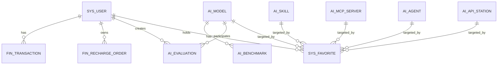
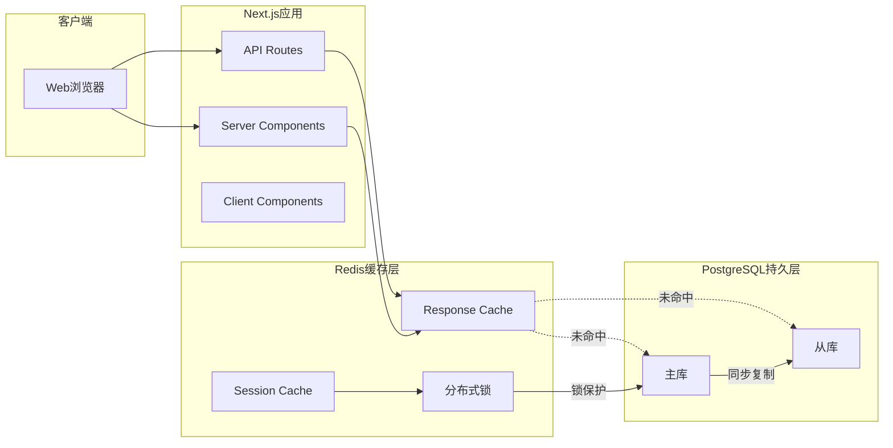

# AI模型天梯图平台 - 数据库架构设计方案

> 基于demo5需求和功能设计文档
> 版本：v1.0 | 设计日期：2026-04-07

---

## 一、核心实体提取（基于demo5）

从需求文档和功能设计文档提取的核心实体：

| 实体 | 说明 | 优先级 |
|------|------|--------|
| **User** | 用户系统（注册/登录/余额/订阅） | P0 |
| **Model** | AI大模型主表 | P0 |
| **Benchmark** | 基准测试记录 | P0 |
| **Evaluation** | 测评记录 | P1 |
| **Newsync** | AI快讯 | P1 |
| **ScheduledScript** | 定时脚本配置 | P1 |
| **Transaction** | 余额变动记录 | P0 |
| **RechargeOrder** | 充值订单 | P0 |
| **Skill** | Skills天梯图数据 | P2 |
| **MCPServer** | MCP天梯图数据 | P2 |
| **Agent** | Agent天梯图数据 | P2 |
| **APIStation** | API站天梯图数据 | P2 |
| **Favorite** | 收藏记录 | P1 |
| **FeatureFlag** | 功能开关 | P1 |

---

## 二、PostgreSQL设计

### 2.1 强制通用字段（所有表必须包含）

```sql
-- 核心审计字段
id              BIGINT PRIMARY KEY,  -- Snowflake分布式ID
created_at      TIMESTAMPTZ NOT NULL DEFAULT NOW(),
updated_at      TIMESTAMPTZ NOT NULL DEFAULT NOW(),
deleted_at      TIMESTAMPTZ,         -- 软删除时间
created_by      BIGINT,              -- 创建者ID
updated_by      BIGINT,              -- 更新者ID
is_active       BOOLEAN DEFAULT TRUE,
version         INTEGER DEFAULT 1,   -- 乐观锁

-- 多租户预留（即使单租户也必须预留）
tenant_id       BIGINT DEFAULT 1,
org_id          BIGINT DEFAULT 1,
org_path        LTREE,               -- 组织树路径

-- 扩展预留
ext_json        JSONB,               -- 扩展JSON
ext_jsonb_index JSONB,               -- GIN索引专用
tags            TEXT[],              -- 标签数组
attr_01         VARCHAR(255),        -- 预留字符串字段 x5
attr_02         VARCHAR(255),
attr_03         VARCHAR(255),
attr_04         VARCHAR(255),
attr_05         VARCHAR(255),
attr_int_01     INTEGER,             -- 预留整数字段 x2
attr_int_02     INTEGER,
attr_num_01     NUMERIC(18,4),       -- 预留数值字段 x2
attr_num_02     NUMERIC(18,4),
attr_bool_01    BOOLEAN,              -- 预留布尔字段 x2
attr_bool_02    BOOLEAN,
attr_json_01    JSONB,               -- 预留JSON字段 x2
attr_json_02    JSONB,

-- 地理预留（PostGIS）
geo_location    GEOGRAPHY(POINT),   -- 位置点
geo_boundary    GEOGRAPHY(POLYGON), -- 区域边界

-- 搜索预留（全文检索）
search_vector   TSVECTOR,           -- 中文全文搜索向量
search_text     TEXT,               -- 搜索文本

-- 安全预留
is_encrypted    BOOLEAN DEFAULT FALSE,
encryption_version INTEGER DEFAULT 1,
checksum        VARCHAR(64),        -- 数据校验和
data_classification SMALLINT,        -- 数据分级(1-4)

-- 生命周期
archive_status   VARCHAR(20),        -- 归档状态
archive_date     DATE,              -- 归档日期
retention_until  DATE,              -- 保留截止日期
access_count     INTEGER DEFAULT 0,  -- 访问次数
last_accessed_at TIMESTAMPTZ,       -- 最后访问时间
popularity_score NUMERIC(5,2) DEFAULT 0  -- 流行度分数
```

### 2.2 核心表结构设计

#### 2.2.1 用户表 (sys_user)

```sql
CREATE TABLE sys_user (
    -- 通用字段
    id              BIGINT PRIMARY KEY,
    created_at      TIMESTAMPTZ NOT NULL DEFAULT NOW(),
    updated_at      TIMESTAMPTZ NOT NULL DEFAULT NOW(),
    deleted_at      TIMESTAMPTZ,
    created_by      BIGINT,
    updated_by      BIGINT,
    is_active       BOOLEAN DEFAULT TRUE,
    version         INTEGER DEFAULT 1,
    tenant_id       BIGINT DEFAULT 1,
    org_id          BIGINT DEFAULT 1,
    org_path        LTREE,
    ext_json        JSONB,
    tags            TEXT[],
    
    -- 业务字段
    email           VARCHAR(255) NOT NULL UNIQUE,
    password        VARCHAR(255) NOT NULL,
    nickname        VARCHAR(100),
    avatar          VARCHAR(500),
    role            SMALLINT NOT NULL DEFAULT 1,
    balance         NUMERIC(12,2) DEFAULT 0,
    
    -- OAuth预留
    oauth_provider  VARCHAR(50),
    oauth_id        VARCHAR(255),
    
    -- 时区设置
    timezone        VARCHAR(50) DEFAULT 'Asia/Shanghai',
    locale          VARCHAR(10) DEFAULT 'zh-CN'
);

COMMENT ON TABLE sys_user IS '用户表 - 存储用户账户信息、余额和认证数据';
COMMENT ON COLUMN sys_user.email IS '用户邮箱（登录账号）';
COMMENT ON COLUMN sys_user.password IS 'bcrypt加密后的密码';
COMMENT ON COLUMN sys_user.role IS '角色: 1=普通用户 2=管理员';
COMMENT ON COLUMN sys_user.balance IS '用户余额（元）';
```

#### 2.2.2 AI模型表 (ai_model)

```sql
CREATE TABLE ai_model (
    -- 通用字段
    id              BIGINT PRIMARY KEY,
    created_at      TIMESTAMPTZ NOT NULL DEFAULT NOW(),
    updated_at      TIMESTAMPTZ NOT NULL DEFAULT NOW(),
    deleted_at      TIMESTAMPTZ,
    created_by      BIGINT,
    updated_by      BIGINT,
    is_active       BOOLEAN DEFAULT TRUE,
    version         INTEGER DEFAULT 1,
    tenant_id       BIGINT DEFAULT 1,
    org_id          BIGINT DEFAULT 1,
    org_path        LTREE,
    ext_json        JSONB,
    tags            TEXT[],
    popularity_score NUMERIC(5,2) DEFAULT 0,
    access_count    INTEGER DEFAULT 0,
    last_accessed_at TIMESTAMPTZ,
    search_vector   TSVECTOR,
    
    -- 业务字段
    name            VARCHAR(255) NOT NULL,
    name_en         VARCHAR(255),
    provider        VARCHAR(100) NOT NULL,
    provider_company VARCHAR(100),
    type            SMALLINT NOT NULL,
    category        SMALLINT NOT NULL DEFAULT 1,
    params          VARCHAR(50),
    context         INTEGER,
    is_open_source  BOOLEAN DEFAULT FALSE,
    
    -- 价格
    prices          JSONB,
    price_source    VARCHAR(50),
    
    -- 链接
    official_url    VARCHAR(500),
    api_url         VARCHAR(500),
    
    -- 基准分数（四维）
    scores          JSONB,
    
    -- 响应速度
    speed           NUMERIC(10,2),
    
    -- 发布时间
    published_at    DATE,
    
    -- 描述
    description     TEXT,
    description_en  TEXT,
    
    -- 评级
    rating          NUMERIC(3,2) DEFAULT 0,
    rating_count    INTEGER DEFAULT 0
);

COMMENT ON TABLE ai_model IS 'AI大模型表 - 存储所有AI模型的基础信息和评分';
COMMENT ON COLUMN ai_model.provider IS '模型系列/厂商（用于分组展示）';
COMMENT ON COLUMN ai_model.type IS '类型: 1=对话 2=多模态 3=嵌入 4=排序 5=ASR 6=TTS 7=生图 8=视频 9=系统';
COMMENT ON COLUMN ai_model.category IS '分类: 1=专业版 2=应用版';
COMMENT ON COLUMN ai_model.scores IS '四维评分: {official:官方, actual:实际, review:风评, self:自测}';
```

#### 2.2.3 基准测试记录表 (ai_benchmark)

```sql
CREATE TABLE ai_benchmark (
    -- 通用字段
    id              BIGINT PRIMARY KEY,
    created_at      TIMESTAMPTZ NOT NULL DEFAULT NOW(),
    updated_at      TIMESTAMPTZ NOT NULL DEFAULT NOW(),
    deleted_at      TIMESTAMPTZ,
    is_active       BOOLEAN DEFAULT TRUE,
    version         INTEGER DEFAULT 1,
    
    -- 业务字段
    model_id        BIGINT NOT NULL REFERENCES ai_model(id),
    source          SMALLINT NOT NULL,
    benchmark_name  VARCHAR(100) NOT NULL,
    scores          JSONB NOT NULL,
    total_score     NUMERIC(5,2) NOT NULL,
    recorded_at     TIMESTAMPTZ NOT NULL DEFAULT NOW(),
    source_url      VARCHAR(500),
    raw_data        JSONB
);

CREATE INDEX idx_benchmark_model ON ai_benchmark(model_id);
CREATE INDEX idx_benchmark_source ON ai_benchmark(source);
CREATE INDEX idx_benchmark_recorded ON ai_benchmark(recorded_at DESC);

COMMENT ON TABLE ai_benchmark IS '基准测试记录表 - 存储各模型的多维度评测数据';
```

#### 2.2.4 测评记录表 (ai_evaluation)

```sql
CREATE TABLE ai_evaluation (
    -- 通用字段
    id              BIGINT PRIMARY KEY,
    created_at      TIMESTAMPTZ NOT NULL DEFAULT NOW(),
    updated_at      TIMESTAMPTZ NOT NULL DEFAULT NOW(),
    deleted_at      TIMESTAMPTZ,
    is_active       BOOLEAN DEFAULT TRUE,
    version         INTEGER DEFAULT 1,
    
    -- 业务字段
    user_id         BIGINT NOT NULL REFERENCES sys_user(id),
    prompt          TEXT NOT NULL,
    model_ids       BIGINT[] NOT NULL,
    results         JSONB,
    status          SMALLINT DEFAULT 1,
    cost_amount     NUMERIC(10,2) DEFAULT 0,
    is_public       BOOLEAN DEFAULT FALSE,
    view_count      INTEGER DEFAULT 0
);

COMMENT ON TABLE ai_evaluation IS '测评记录表 - 用户自定义测评的执行记录';
```

#### 2.2.5 余额交易表 (fin_transaction)

```sql
CREATE TABLE fin_transaction (
    -- 通用字段
    id              BIGINT PRIMARY KEY,
    created_at      TIMESTAMPTZ NOT NULL DEFAULT NOW(),
    updated_at      TIMESTAMPTZ NOT NULL DEFAULT NOW(),
    is_active       BOOLEAN DEFAULT TRUE,
    
    -- 业务字段
    user_id         BIGINT NOT NULL REFERENCES sys_user(id),
    type            SMALLINT NOT NULL,
    amount          NUMERIC(12,4) NOT NULL,
    balance         NUMERIC(12,4) NOT NULL,
    description     VARCHAR(500),
    ref_type        VARCHAR(50),
    ref_id          BIGINT,
    payment_method  SMALLINT,
    trade_no        VARCHAR(100)
);

CREATE INDEX idx_transaction_user ON fin_transaction(user_id, created_at DESC);
CREATE INDEX idx_transaction_type ON fin_transaction(user_id, type);

COMMENT ON TABLE fin_transaction IS '余额交易表 - 记录用户所有余额变动';
```

#### 2.2.6 充值订单表 (fin_recharge_order)

```sql
CREATE TABLE fin_recharge_order (
    -- 通用字段
    id              BIGINT PRIMARY KEY,
    created_at      TIMESTAMPTZ NOT NULL DEFAULT NOW(),
    updated_at      TIMESTAMPTZ NOT NULL DEFAULT NOW(),
    deleted_at      TIMESTAMPTZ,
    is_active       BOOLEAN DEFAULT TRUE,
    
    -- 业务字段
    user_id         BIGINT NOT NULL REFERENCES sys_user(id),
    amount          NUMERIC(12,2) NOT NULL,
    bonus_amount    NUMERIC(12,2) DEFAULT 0,
    total_amount    NUMERIC(12,2) NOT NULL,
    pay_method      SMALLINT NOT NULL,
    status          SMALLINT DEFAULT 1,
    transaction_id  VARCHAR(100),
    paid_at         TIMESTAMPTZ,
    ext_json        JSONB
);

COMMENT ON TABLE fin_recharge_order IS '充值订单表 - 用户充值记录';
```

#### 2.2.7 资讯表 (content_newsync)

```sql
CREATE TABLE content_newsync (
    -- 通用字段
    id              BIGINT PRIMARY KEY,
    created_at      TIMESTAMPTZ NOT NULL DEFAULT NOW(),
    updated_at      TIMESTAMPTZ NOT NULL DEFAULT NOW(),
    deleted_at      TIMESTAMPTZ,
    is_active       BOOLEAN DEFAULT TRUE,
    search_vector   TSVECTOR,
    tags            TEXT[],
    
    -- 业务字段
    source          VARCHAR(100) NOT NULL,
    title           VARCHAR(500) NOT NULL,
    content         JSONB NOT NULL,
    published_at    TIMESTAMPTZ,
    author          VARCHAR(100),
    url             VARCHAR(500),
    image_url       VARCHAR(500)
);

CREATE INDEX idx_newsync_source ON content_newsync(source);
CREATE INDEX idx_newsync_published ON content_newsync(published_at DESC);

COMMENT ON TABLE content_newsync IS '资讯表 - AI快讯内容管理';
```

#### 2.2.8 定时脚本表 (sys_scheduled_script)

```sql
CREATE TABLE sys_scheduled_script (
    -- 通用字段
    id              BIGINT PRIMARY KEY,
    created_at      TIMESTAMPTZ NOT NULL DEFAULT NOW(),
    updated_at      TIMESTAMPTZ NOT NULL DEFAULT NOW(),
    deleted_at      TIMESTAMPTZ,
    is_active       BOOLEAN DEFAULT TRUE,
    
    -- 业务字段
    name            VARCHAR(100) NOT NULL,
    description     VARCHAR(500),
    script_path     VARCHAR(500) NOT NULL,
    params          JSONB,
    cron_expression VARCHAR(100),
    interval_days   INTEGER,
    interval_count  INTEGER,
    trigger_time    VARCHAR(10),
    last_run_at     TIMESTAMPTZ,
    next_run_at     TIMESTAMPTZ,
    run_status      SMALLINT DEFAULT 1,
    last_error      TEXT
);

COMMENT ON TABLE sys_scheduled_script IS '定时脚本表 - 数据采集任务配置';
```

#### 2.2.9 Skills表 (ai_skill)

```sql
CREATE TABLE ai_skill (
    -- 通用字段
    id              BIGINT PRIMARY KEY,
    created_at      TIMESTAMPTZ NOT NULL DEFAULT NOW(),
    updated_at      TIMESTAMPTZ NOT NULL DEFAULT NOW(),
    deleted_at      TIMESTAMPTZ,
    is_active       BOOLEAN DEFAULT TRUE,
    version         INTEGER DEFAULT 1,
    tenant_id       BIGINT DEFAULT 1,
    tags            TEXT[],
    popularity_score NUMERIC(5,2) DEFAULT 0,
    access_count    INTEGER DEFAULT 0,
    search_vector   TSVECTOR,
    
    -- 业务字段
    name            VARCHAR(255) NOT NULL,
    name_en         VARCHAR(255),
    icon            VARCHAR(500),
    description     TEXT,
    protocol        VARCHAR(50),
    supported_ides  TEXT[],
    category        VARCHAR(100),
    install_count   INTEGER DEFAULT 0,
    rating          NUMERIC(3,2) DEFAULT 0,
    rating_count    INTEGER DEFAULT 0,
    version_no      VARCHAR(50),
    source_url      VARCHAR(500),
    author          VARCHAR(100),
    is_official     BOOLEAN DEFAULT FALSE,
    is_verified     BOOLEAN DEFAULT FALSE,
    
    -- 天梯图评分维度
    quality_score      NUMERIC(5,2) DEFAULT 0,
    maintenance_score  NUMERIC(5,2) DEFAULT 0,
    compatibility_score NUMERIC(5,2) DEFAULT 0,
    
    -- 同步专用字段（v1.1新增）
    source              VARCHAR(50),           -- 来源平台：skillsmp/smithery/skills_sh
    source_id           VARCHAR(255),         -- 来源平台原始ID（如GitHub仓库名）
    source_url          VARCHAR(500),         -- 来源平台详情页URL
    stars               INTEGER DEFAULT 0,    -- GitHub stars数
    install_command     VARCHAR(500),         -- 安装命令
    last_synced_at      TIMESTAMPTZ            -- 最后同步时间
);

-- 唯一索引（来源+来源ID）
CREATE UNIQUE INDEX idx_skill_source_unique ON ai_skill(source, source_id) WHERE deleted_at IS NULL;

COMMENT ON TABLE ai_skill IS 'Skills表 - 技能市场数据（含多平台同步字段）';
COMMENT ON COLUMN ai_skill.source IS '来源平台：skillsmp/smithery/skills_sh';
COMMENT ON COLUMN ai_skill.source_id IS '来源平台原始ID，如GitHub仓库名';
COMMENT ON COLUMN ai_skill.stars IS 'GitHub stars数量';
COMMENT ON COLUMN ai_skill.install_command IS '安装命令，如npx skills add';
```

#### 2.2.10 MCP服务器表 (ai_mcp_server)

```sql
CREATE TABLE ai_mcp_server (
    -- 通用字段
    id              BIGINT PRIMARY KEY,
    created_at      TIMESTAMPTZ NOT NULL DEFAULT NOW(),
    updated_at      TIMESTAMPTZ NOT NULL DEFAULT NOW(),
    deleted_at      TIMESTAMPTZ,
    is_active       BOOLEAN DEFAULT TRUE,
    version         INTEGER DEFAULT 1,
    tenant_id       BIGINT DEFAULT 1,
    tags            TEXT[],
    popularity_score NUMERIC(5,2) DEFAULT 0,
    access_count    INTEGER DEFAULT 0,
    search_vector   TSVECTOR,
    
    -- 业务字段
    name            VARCHAR(255) NOT NULL,
    name_en         VARCHAR(255),
    icon            VARCHAR(500),
    description     TEXT,
    command         VARCHAR(500),
    args            JSONB,
    env             JSONB,
    tools           JSONB,
    tool_count      INTEGER DEFAULT 0,
    category        VARCHAR(100),
    
    -- 天梯图评分维度
    stability_score     NUMERIC(5,2) DEFAULT 0,
    functionality_score NUMERIC(5,2) DEFAULT 0,
    ease_of_use_score   NUMERIC(5,2) DEFAULT 0,
    
    install_count   INTEGER DEFAULT 0,
    usage_count     INTEGER DEFAULT 0,
    rating          NUMERIC(3,2) DEFAULT 0,
    is_official     BOOLEAN DEFAULT FALSE,
    is_verified     BOOLEAN DEFAULT FALSE,
    source          VARCHAR(100)
);

COMMENT ON TABLE ai_mcp_server IS 'MCP服务器表 - MCP工具市场数据';
```

#### 2.2.11 Agent表 (ai_agent)

```sql
CREATE TABLE ai_agent (
    -- 通用字段
    id              BIGINT PRIMARY KEY,
    created_at      TIMESTAMPTZ NOT NULL DEFAULT NOW(),
    updated_at      TIMESTAMPTZ NOT NULL DEFAULT NOW(),
    deleted_at      TIMESTAMPTZ,
    is_active       BOOLEAN DEFAULT TRUE,
    version         INTEGER DEFAULT 1,
    tenant_id       BIGINT DEFAULT 1,
    tags            TEXT[],
    popularity_score NUMERIC(5,2) DEFAULT 0,
    search_vector   TSVECTOR,
    
    -- 业务字段
    name            VARCHAR(255) NOT NULL,
    name_en         VARCHAR(255),
    icon            VARCHAR(500),
    description     TEXT,
    framework       VARCHAR(100),
    capabilities    TEXT[],
    task_types      TEXT[],
    
    -- 天梯图评分维度
    activity_score     NUMERIC(5,2) DEFAULT 0,
    completion_rate    NUMERIC(5,2) DEFAULT 0,
    efficiency_score   NUMERIC(5,2) DEFAULT 0,
    
    price           JSONB,
    usage_count     INTEGER DEFAULT 0,
    rating          NUMERIC(3,2) DEFAULT 0,
    is_official     BOOLEAN DEFAULT FALSE
);

COMMENT ON TABLE ai_agent IS 'Agent表 - 智能体市场数据';
```

#### 2.2.12 API中转站表 (ai_api_station)

```sql
CREATE TABLE ai_api_station (
    -- 通用字段
    id              BIGINT PRIMARY KEY,
    created_at      TIMESTAMPTZ NOT NULL DEFAULT NOW(),
    updated_at      TIMESTAMPTZ NOT NULL DEFAULT NOW(),
    deleted_at      TIMESTAMPTZ,
    is_active       BOOLEAN DEFAULT TRUE,
    version         INTEGER DEFAULT 1,
    tenant_id       BIGINT DEFAULT 1,
    tags            TEXT[],
    popularity_score NUMERIC(5,2) DEFAULT 0,
    search_vector   TSVECTOR,
    
    -- 业务字段
    name            VARCHAR(255) NOT NULL,
    name_cn         VARCHAR(255),
    name_en         VARCHAR(255),
    display_name    VARCHAR(255),
    icon            VARCHAR(500),
    description     TEXT,
    website         VARCHAR(500),
    api_endpoint    VARCHAR(500),
    
    -- 支持的模型
    supported_models TEXT[],
    model_count     INTEGER DEFAULT 0,
    
    -- 价格
    pricing         JSONB,
    
    -- 天梯图评分维度
    stability_score   NUMERIC(5,2) DEFAULT 0,
    speed_score       NUMERIC(5,2) DEFAULT 0,
    price_score       NUMERIC(5,2) DEFAULT 0,
    support_score     NUMERIC(5,2) DEFAULT 0,
    
    -- 地理位置
    regions         TEXT[],
    
    -- 速率限制
    rate_limit      JSONB,
    use_case        TEXT,
    
    -- 状态
    status          VARCHAR(20) DEFAULT 'active',
    last_checked_at TIMESTAMPTZ,
    
    rating          NUMERIC(3,2) DEFAULT 0,
    usage_count     INTEGER DEFAULT 0
);

COMMENT ON TABLE ai_api_station IS 'API中转站表 - API站天梯图数据';
```

#### 2.2.13 收藏表 (sys_favorite)

```sql
CREATE TABLE sys_favorite (
    -- 通用字段
    id              BIGINT PRIMARY KEY,
    created_at      TIMESTAMPTZ NOT NULL DEFAULT NOW(),
    updated_at      TIMESTAMPTZ NOT NULL DEFAULT NOW(),
    deleted_at      TIMESTAMPTZ,
    is_active       BOOLEAN DEFAULT TRUE,
    
    -- 业务字段
    user_id         BIGINT NOT NULL REFERENCES sys_user(id),
    target_type     SMALLINT NOT NULL,
    target_id       BIGINT NOT NULL,
    notes           VARCHAR(500),
    sort_order      INTEGER DEFAULT 0
);

CREATE UNIQUE INDEX idx_favorite_user_target ON sys_favorite(user_id, target_type, target_id) WHERE deleted_at IS NULL;

COMMENT ON TABLE sys_favorite IS '收藏表 - 用户收藏记录';
```

#### 2.2.14 功能开关表 (sys_feature_flag)

```sql
CREATE TABLE sys_feature_flag (
    -- 通用字段
    id              BIGINT PRIMARY KEY,
    created_at      TIMESTAMPTZ NOT NULL DEFAULT NOW(),
    updated_at      TIMESTAMPTZ NOT NULL DEFAULT NOW(),
    is_active       BOOLEAN DEFAULT TRUE,
    
    -- 业务字段
    flag_key        VARCHAR(100) NOT NULL UNIQUE,
    name            VARCHAR(100) NOT NULL,
    description     VARCHAR(500),
    is_enabled      BOOLEAN DEFAULT TRUE,
    enabled_roles   SMALLINT[],
    config          JSONB
);

INSERT INTO sys_feature_flag (flag_key, name, description, is_enabled) VALUES
('ladder.skill', 'Skills天梯图', '技能天梯图入口和功能', TRUE),
('ladder.mcp', 'MCP天梯图', 'MCP天梯图入口和功能', TRUE),
('ladder.agent', 'Agent天梯图', 'Agent天梯图入口和功能', TRUE),
('ladder.api', 'API站天梯图', 'API站天梯图入口和功能', TRUE),
('marketplace.skill', 'Skills市场', '技能市场入口和收藏', TRUE),
('marketplace.mcp', 'MCP市场', 'MCP市场入口和收藏', TRUE),
('favorites.enabled', '收藏夹系统', '收藏功能开关', TRUE),
('comparison.model', '模型对比', '模型对比功能', TRUE),
('chat.support', '客服聊天', '在线客服功能', TRUE);

COMMENT ON TABLE sys_feature_flag IS '功能开关表 - 功能模块启用/禁用控制';
```

### 2.3 索引策略

```sql
-- ai_model索引
CREATE INDEX idx_model_provider ON ai_model(provider);
CREATE INDEX idx_model_category ON ai_model(category);
CREATE INDEX idx_model_type ON ai_model(type);
CREATE INDEX idx_model_published ON ai_model(published_at DESC);
CREATE INDEX idx_model_is_open ON ai_model(is_open_source);
CREATE INDEX idx_model_scores ON ai_model USING GIN(ext_jsonb_index);

-- 全文搜索索引
CREATE INDEX idx_model_search ON ai_model USING GIN(search_vector);

-- 租户+时间复合索引
CREATE INDEX idx_model_tenant_time ON ai_model(tenant_id, created_at DESC);

-- 部分索引（仅活跃数据）
CREATE INDEX idx_model_active ON ai_model(created_at DESC) WHERE is_active = TRUE AND deleted_at IS NULL;
```

### 2.4 触发器设计

```sql
-- 自动更新updated_at触发器
CREATE OR REPLACE FUNCTION update_updated_at()
RETURNS TRIGGER AS $$
BEGIN
    NEW.updated_at = NOW();
    NEW.version = OLD.version + 1;
    RETURN NEW;
END;
$$ LANGUAGE plpgsql;

CREATE TRIGGER trigger_user_updated_at
    BEFORE UPDATE ON sys_user
    FOR EACH ROW EXECUTE FUNCTION update_updated_at();

CREATE TRIGGER trigger_model_updated_at
    BEFORE UPDATE ON ai_model
    FOR EACH ROW EXECUTE FUNCTION update_updated_at();

-- 中文全文搜索向量自动更新触发器
CREATE OR REPLACE FUNCTION update_search_vector()
RETURNS TRIGGER AS $$
BEGIN
    NEW.search_vector = to_tsvector('chinese', COALESCE(NEW.name, '') || ' ' || COALESCE(NEW.description, ''));
    RETURN NEW;
END;
$$ LANGUAGE plpgsql;

CREATE TRIGGER trigger_model_search_vector
    BEFORE INSERT OR UPDATE ON ai_model
    FOR EACH ROW EXECUTE FUNCTION update_search_vector();
```

---

## 三、Redis缓存设计

### 3.1 缓存映射表

| PG表 | Redis Key模式 | 数据类型 | TTL | 一致性策略 |
|------|---------------|----------|-----|------------|
| sys_user | `user:profile:{userId}` | Hash | 30分钟 | 写后删除 |
| ai_model | `model:detail:{modelId}` | Hash | 10分钟 | 写后删除 |
| ai_model列表 | `model:list:{hash}` | String(JSON) | 1小时 | 删缓存 |
| 排名数据 | `ranking:v1:{category}:{sort}` | String(JSON) | 1小时 | 定时刷新 |
| ai_benchmark | `benchmark:{modelId}` | Hash | 1小时 | 写后删除 |
| ai_skill | `skill:detail:{skillId}` | Hash | 1小时 | 写后删除 |
| ai_mcp_server | `mcp:detail:{mcpId}` | Hash | 1小时 | 写后删除 |
| 唯一索引缓存 | `idx:model:provider:{provider}` | Set | 永久 | 同步删除 |
| 收藏夹 | `favorite:user:{userId}:{type}` | Set | 30分钟 | 写后删除 |
| 计数器 | `counter:view:{type}:{id}` | String | 30天 | 日聚合 |

### 3.2 Redis Key命名规范

```
# 格式：{系统}:{模块}:{业务}:{标识}
user:profile:10001           # 用户信息Hash
model:detail:20231201001      # 模型详情Hash
model:list:prof:chat:openai   # 模型列表（带筛选hash）
ranking:v1:professional:benchmark_desc  # 排名数据
skill:list:category:dev       # Skill列表
mcp:list:source:smithery     # MCP列表

# 计数器
counter:view:model:10001     # 模型浏览次数
counter:download:skill:2001  # Skill下载次数

# 分布式锁
lock:eval:user:10001         # 测评锁（防止重复扣费）
lock:recharge:order:30001    # 充值锁
```

### 3.3 缓存策略表

| 数据类型 | 缓存策略 | 过期时间 | 一致性方案 |
|---------|---------|---------|-----------|
| 用户信息 | Cache-Aside | 30分钟 | 写后删除 |
| 商品详情 | Cache-Aside | 10分钟 | 写后删除 |
| 订单状态 | Write-Behind | 5分钟 | 延迟双删 |
| 会话Token | Write-Through | 2小时 | 强一致 |
| 热点数据 | LRU + TTL | 1小时 | 定期预热 |
| 分布式锁 | 无持久化 | 30秒 | 自动过期 |

### 3.4 Redis高可用配置

- [x] 主从复制（1主2从）
- [ ] 哨兵模式（3哨兵）或 Cluster模式（6节点）
- [x] 持久化：RDB+AOF混合
- [x] 内存淘汰策略：allkeys-lru
- [ ] 最大内存：根据服务器配置

---

## 四、Docker配置

### 4.1 开发环境 (docker-compose.dev.yml)

```yaml
version: '3.8'

services:
  postgres:
    image: postgres:16-alpine
    container_name: aidean_pg_dev
    environment:
      POSTGRES_USER: aidean
      POSTGRES_PASSWORD: aidean_dev_password
      POSTGRES_DB: aidean_db
      POSTGRES_INITDB_ARGS: --encoding=UTF8 --locale=zh_CN.UTF-8
      TZ: Asia/Shanghai
    ports:
      - "5432:5432"
    volumes:
      - pgdata_dev:/var/lib/postgresql/data
      - ./docker/postgres/init:/docker-entrypoint-initdb.d
    command:
      -c shared_buffers=256MB
      -c max_connections=200
      -c log_min_duration_statement=1000
      -c log_connections=on
    healthcheck:
      test: ["CMD-SHELL", "pg_isready -U aidean"]
      interval: 10s
      timeout: 5s

  redis:
    image: redis:7-alpine
    container_name: aidean_redis_dev
    ports:
      - "6379:6379"
    volumes:
      - redis_dev:/data
    command: redis-server --maxmemory 2gb --maxmemory-policy allkeys-lru --appendonly yes
    healthcheck:
      test: ["CMD", "redis-cli", "ping"]
      interval: 10s

volumes:
  pgdata_dev:
    driver: local
  redis_dev:
    driver: local
```

### 4.2 生产环境 (docker-compose.prod.yml)

```yaml
version: '3.8'

services:
  postgres_primary:
    image: postgres:16-alpine
    container_name: aidean_pg_primary
    environment:
      POSTGRES_USER: aidean
      POSTGRES_PASSWORD: ${PG_PASSWORD}
      POSTGRES_DB: aidean_db
      POSTGRES_INITDB_ARGS: --encoding=UTF8 --locale=zh_CN.UTF-8
      TZ: Asia/Shanghai
    ports:
      - "5432:5432"
    volumes:
      - pgdata_primary:/var/lib/postgresql/data
      - ./docker/postgres/init:/docker-entrypoint-initdb.d
      - ./docker/postgres/backup:/backup
    command:
      -c shared_buffers=1GB
      -c max_connections=300
      -c wal_level=replica
      -c max_wal_senders=3
      -c log_min_duration_statement=500
      -c synchronous_commit=on
    healthcheck:
      test: ["CMD-SHELL", "pg_isready -U aidean"]
    networks:
      - aidean_network

  postgres_replica:
    image: postgres:16-alpine
    container_name: aidean_pg_replica
    environment:
      POSTGRES_USER: aidean
      POSTGRES_PASSWORD: ${PG_PASSWORD}
      TZ: Asia/Shanghai
    command:
      -c shared_buffers=512MB
      -c hot_standby=on
    volumes:
      - pgdata_replica:/var/lib/postgresql/data
    depends_on:
      - postgres_primary
    networks:
      - aidean_network

  redis:
    image: redis:7-alpine
    container_name: aidean_redis
    ports:
      - "6379:6379"
    volumes:
      - redis_data:/data
    command: redis-server --maxmemory 4gb --maxmemory-policy volatile-lru --appendonly yes --requirepass ${REDIS_PASSWORD}
    healthcheck:
      test: ["CMD", "redis-cli", "-a", "${REDIS_PASSWORD}", "ping"]
    networks:
      - aidean_network

networks:
  aidean_network:
    driver: bridge

volumes:
  pgdata_primary:
  pgdata_replica:
  redis_data:
```

---

## 五、SQL脚本交付

### 5.1 01_init_extensions.sql

```sql
-- PostgreSQL扩展初始化（中文环境）
CREATE EXTENSION IF NOT EXISTS "uuid-ossp";
CREATE EXTENSION IF NOT EXISTS "pg_trgm";
CREATE EXTENSION IF NOT EXISTS "ltree";
CREATE EXTENSION IF NOT EXISTS "postgis";
CREATE EXTENSION IF NOT EXISTS "pgcrypto";

-- 中文分词全文搜索配置
CREATE TEXT SEARCH CONFIGURATION chinese (COPY = simple);

-- 设置时区
SET timezone = 'Asia/Shanghai';
```

### 5.2 02_create_schemas.sql

```sql
-- 创建业务Schema
CREATE SCHEMA IF NOT EXISTS sys;
CREATE SCHEMA IF NOT EXISTS ai;
CREATE SCHEMA IF NOT EXISTS fin;
CREATE SCHEMA IF NOT EXISTS content;
CREATE SCHEMA IF NOT EXISTS public;

COMMENT ON SCHEMA sys IS '系统表Schema';
COMMENT ON SCHEMA ai IS 'AI模型数据Schema';
COMMENT ON SCHEMA fin IS '财务数据Schema';
COMMENT ON SCHEMA content IS '内容数据Schema';
```

---

## 六、架构图

### 6.1 ER图



### 6.2 数据流图



---

## 七、核心配置参数

### 7.1 PostgreSQL关键参数

**开发环境**：
- shared_buffers: 256MB
- max_connections: 200
- log_min_duration_statement: 1000ms

**生产环境**：
- shared_buffers: 1GB
- max_connections: 300
- wal_level: replica
- synchronous_commit: on
- max_wal_senders: 3

### 7.2 Redis关键参数

**开发环境**：
- maxmemory: 2GB
- maxmemory-policy: allkeys-lru
- appendonly: yes

**生产环境**：
- maxmemory: 4GB
- maxmemory-policy: volatile-lru
- requirepass: ${REDIS_PASSWORD}

---

## 八、分阶段实施计划

### 阶段一：MVP（核心表）
- sys_user
- ai_model
- ai_benchmark
- fin_transaction
- fin_recharge_order

### 阶段二：优化（索引/分区）
- 添加全文搜索索引
- 时序数据分区
- Redis缓存集成

### 阶段三：扩展（分库分表）
- Skills/MCP/Agent/APIStation表
- 分片路由预留
- 高可用集群

---

## 九、总结

本方案基于demo5需求文档和功能设计文档，完成以下设计：

1. **14张核心表** 含强制通用字段（中文编码UTF-8，时区Asia/Shanghai）
2. **Redis缓存映射** 覆盖所有PG表
3. **Docker配置** 区分开发/生产环境
4. **完整索引策略** 支持高性能查询
5. **触发器** 自动更新审计字段和全文搜索向量
6. **ER图和数据流图** 使用Mermaid语法

---