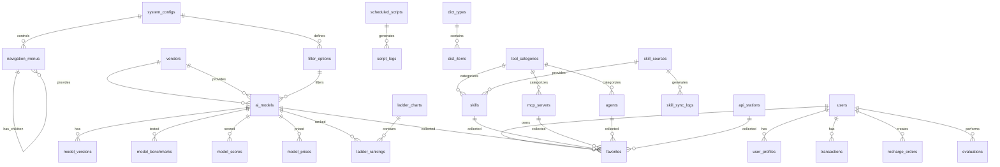
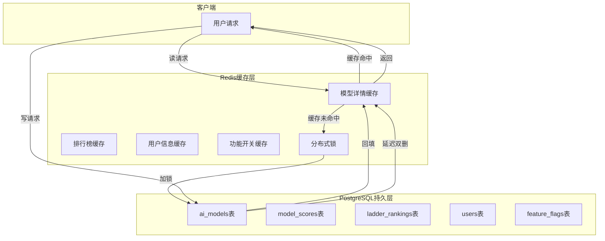

# Aidean 平台 PostgreSQL 数据库架构设计文档

> **版本**: v1.0  
> **创建日期**: 2026-04-07  
> **数据库版本**: PostgreSQL 16  
> **缓存版本**: Redis 7  
> **编码**: UTF-8  
> **时区**: Asia/Shanghai  

---

## 目录

- [一、需求分析与数据实体梳理](#一需求分析与数据实体梳理)
- [二、数据库架构总览](#二数据库架构总览)
- [三、核心表结构设计](#三核心表结构设计)
- [四、详细表结构定义](#四详细表结构定义)
- [五、索引策略设计](#五索引策略设计)
- [六、触发器与函数](#六触发器与函数)
- [七、Redis 缓存架构设计](#七redis-缓存架构设计)
- [八、Docker 配置](#八docker-配置)
- [九、运维文档概要](#九运维文档概要)
- [十、总结](#十总结)

---

## 一、需求分析与数据实体梳理

### 1.1 核心实体识别

根据文档和 demo5 分析，识别出以下核心数据实体：

| 实体类别 | 实体名称 | 说明 |
|---------|---------|------|
| **用户系统** | users | 用户基础信息、角色、余额 |
| **天梯图核心** | ai_models | AI大模型基础信息 |
| | model_vendors | 模型厂商/提供商 |
| | model_benchmarks | 模型基准测试数据 |
| | model_scores | 模型综合评分（四维） |
| | model_prices | 模型价格体系 |
| **扩展天梯图** | skills | Skills技能（多源同步） |
| | mcp_servers | MCP服务器 |
| | agents | Agent智能体 |
| | api_stations | API中转站 |
| **Skills同步** | skill_sync_logs | Skills同步日志 |
| | skill_sources | Skills数据源配置 |
| **天梯图榜单** | ladder_charts | 天梯图定义（性能/性价比/开源/手机端） |
| | ladder_rankings | 天梯图排名数据 |
| **收藏夹系统** | favorites | 用户收藏（Skills/MCP/Agent/API/模型） |
| **功能开关** | feature_flags | 功能开关配置 |
| **余额系统** | transactions | 余额交易记录 |
| | recharge_orders | 充值订单 |
| **定时任务** | scheduled_scripts | 数据采集脚本配置 |
| | script_logs | 脚本执行日志 |
| **系统配置** | system_configs | 系统配置项（网站名称、Logo、SEO等） |
| | navigation_menus | 导航菜单配置 |
| | filter_options | 筛选选项配置 |
| | audit_logs | 审计日志 |

### 1.2 Demo5 数据结构映射

```
DemoModel (前端) → ai_models (数据库)
├── id: string → id: BIGINT (Snowflake)
├── name: string → name: VARCHAR(255)
├── vendor: DemoVendor → vendor_id: BIGINT → model_vendors
├── type: DemoModelType → type: SMALLINT (枚举)
├── protocol: DemoProtocol → protocol: SMALLINT (枚举)
├── score: number → benchmark_score: NUMERIC(5,2)
├── contextK: number → context_length: INTEGER
├── speed: number → response_speed: NUMERIC(8,2)
├── price: number → price_input: NUMERIC(19,4)
├── openSource: boolean → is_open_source: BOOLEAN
├── tags: string[] → tags: TEXT[]
├── summary: string → summary: TEXT
└── highlights: string[] → highlights: TEXT[]
```

---

## 二、数据库架构总览

### 2.1 Schema 设计

```
aidean_platform/
├── public/                    # 默认Schema，系统扩展
├── aidean_core/               # 核心业务Schema
│   ├── users                  # 用户表
│   ├── user_profiles          # 用户扩展资料
│   └── user_sessions          # 会话管理
├── aidean_models/             # 模型与天梯图Schema
│   ├── vendors                # 厂商表
│   ├── ai_models              # AI模型主表
│   ├── model_versions         # 模型版本
│   ├── model_benchmarks       # 基准测试
│   ├── model_scores           # 综合评分
│   ├── model_prices           # 价格体系
│   ├── ladder_charts          # 天梯图定义
│   └── ladder_rankings        # 排名数据
├── aidean_tools/              # 工具生态Schema
│   ├── skills                 # Skills（多源同步）
│   ├── skill_sources          # Skills数据源配置
│   ├── skill_sync_logs        # Skills同步日志
│   ├── mcp_servers            # MCP服务器
│   ├── agents                 # Agents
│   ├── api_stations           # API中转站
│   └── tool_categories        # 工具分类
├── aidean_user/               # 用户行为Schema
│   ├── favorites              # 收藏夹
│   ├── transactions           # 余额交易
│   ├── recharge_orders        # 充值订单
│   └── evaluations            # 测评记录
├── aidean_system/             # 系统管理Schema
│   ├── feature_flags          # 功能开关
│   ├── scheduled_scripts      # 定时脚本
│   ├── script_logs            # 脚本日志
│   ├── system_configs         # 系统配置
│   ├── navigation_menus       # 导航菜单配置
│   ├── filter_options         # 筛选选项配置
│   └── audit_logs             # 审计日志
└── aidean_dict/               # 字典数据Schema
    ├── dict_types             # 字典类型
    └── dict_items             # 字典项
```

### 2.2 ER 关系图（Mermaid）



### 2.3 数据流图（PG↔Redis交互）



---

## 三、核心表结构设计

### 3.1 强制通用字段（所有表继承）

每个业务表必须包含以下字段：

```sql
-- 核心审计字段
id                  BIGINT PRIMARY KEY,           -- Snowflake ID
created_at          TIMESTAMPTZ NOT NULL DEFAULT NOW(),
updated_at          TIMESTAMPTZ NOT NULL DEFAULT NOW(),
deleted_at          TIMESTAMPTZ,                  -- 软删除
created_by          BIGINT,                       -- 创建者ID
updated_by          BIGINT,                       -- 更新者ID
is_active           BOOLEAN NOT NULL DEFAULT TRUE,
version             INTEGER NOT NULL DEFAULT 1,   -- 乐观锁

-- 多租户预留（即使单租户也必须预留）
tenant_id           BIGINT DEFAULT 0,
org_id              BIGINT DEFAULT 0,
org_path            LTREE DEFAULT '0'::LTREE,

-- 扩展预留
ext_json            JSONB DEFAULT '{}',
ext_jsonb_index     JSONB DEFAULT '{}',           -- 专用于GIN索引
tags                TEXT[] DEFAULT '{}',
attr_01~05          VARCHAR(255),
attr_int_01~02      BIGINT,
attr_num_01~02      NUMERIC(19,4),
attr_bool_01~02     BOOLEAN,
attr_json_01~02     JSONB,

-- 地理预留
geo_location        GEOGRAPHY(POINT,4326),
geo_boundary        GEOGRAPHY(POLYGON,4326),

-- 搜索预留
search_vector       TSVECTOR,
search_text         TEXT,

-- 安全预留
is_encrypted        BOOLEAN DEFAULT FALSE,
encryption_version  INTEGER DEFAULT 0,
checksum            VARCHAR(64),
data_classification SMALLINT DEFAULT 1,          -- 1-4级

-- 生命周期
archive_status      SMALLINT DEFAULT 0,          -- 0正常 1归档中 2已归档
archive_date        TIMESTAMPTZ,
retention_until     TIMESTAMPTZ,
access_count        BIGINT DEFAULT 0,
last_accessed_at    TIMESTAMPTZ,
popularity_score    NUMERIC(5,2) DEFAULT 0
```

### 3.2 字段类型规范

| 数据类型 | 推荐类型 | 说明 |
|---------|---------|------|
| 主键 | BIGINT | Snowflake/UUIDv7，禁止自增 |
| 金额 | NUMERIC(19,4) | 禁止FLOAT |
| 枚举 | SMALLINT | CHECK约束+字典表 |
| 时间 | TIMESTAMPTZ | UTC存储 |
| JSON | JSONB | 必用，配GIN索引 |
| 短文本 | VARCHAR(255) | - |
| 长文本 | TEXT | - |
| 树结构 | LTREE | 扩展 |
| 地理位置 | GEOGRAPHY | PostGIS扩展 |
| 全文搜索 | TSVECTOR | 中文分词 |

---

## 四、详细表结构定义

### 4.1 用户系统表

#### 4.1.1 users（用户主表）

```sql
CREATE TABLE aidean_core.users (
    -- 继承通用字段
    id                  BIGINT PRIMARY KEY,
    created_at          TIMESTAMPTZ NOT NULL DEFAULT NOW(),
    updated_at          TIMESTAMPTZ NOT NULL DEFAULT NOW(),
    deleted_at          TIMESTAMPTZ,
    created_by          BIGINT,
    updated_by          BIGINT,
    is_active           BOOLEAN NOT NULL DEFAULT TRUE,
    version             INTEGER NOT NULL DEFAULT 1,
    tenant_id           BIGINT DEFAULT 0,
    org_id              BIGINT DEFAULT 0,
    org_path            LTREE DEFAULT '0'::LTREE,
    ext_json            JSONB DEFAULT '{}',
    ext_jsonb_index     JSONB DEFAULT '{}',
    tags                TEXT[] DEFAULT '{}',
    attr_01             VARCHAR(255),
    attr_02             VARCHAR(255),
    attr_03             VARCHAR(255),
    attr_04             VARCHAR(255),
    attr_05             VARCHAR(255),
    attr_int_01         BIGINT,
    attr_int_02         BIGINT,
    attr_num_01         NUMERIC(19,4),
    attr_num_02         NUMERIC(19,4),
    attr_bool_01        BOOLEAN,
    attr_bool_02        BOOLEAN,
    attr_json_01        JSONB,
    attr_json_02        JSONB,
    geo_location        GEOGRAPHY(POINT,4326),
    geo_boundary        GEOGRAPHY(POLYGON,4326),
    search_vector       TSVECTOR,
    search_text         TEXT,
    is_encrypted        BOOLEAN DEFAULT FALSE,
    encryption_version  INTEGER DEFAULT 0,
    checksum            VARCHAR(64),
    data_classification SMALLINT DEFAULT 1,
    archive_status      SMALLINT DEFAULT 0,
    archive_date        TIMESTAMPTZ,
    retention_until     TIMESTAMPTZ,
    access_count        BIGINT DEFAULT 0,
    last_accessed_at    TIMESTAMPTZ,
    popularity_score    NUMERIC(5,2) DEFAULT 0,
    
    -- 业务字段
    email               VARCHAR(255) NOT NULL,
    email_verified      BOOLEAN DEFAULT FALSE,
    password_hash       VARCHAR(255) NOT NULL,
    nickname            VARCHAR(100),
    avatar_url          VARCHAR(500),
    phone               VARCHAR(50),
    phone_verified      BOOLEAN DEFAULT FALSE,
    role                SMALLINT NOT NULL DEFAULT 1,  -- 1用户 2付费 3管理员 4超级管理员
    status              SMALLINT NOT NULL DEFAULT 1,  -- 1正常 2禁用 3待验证
    
    -- 余额系统
    balance             NUMERIC(19,4) NOT NULL DEFAULT 0,
    total_recharged     NUMERIC(19,4) NOT NULL DEFAULT 0,
    total_consumed      NUMERIC(19,4) NOT NULL DEFAULT 0,
    
    -- 订阅系统
    subscription_type   SMALLINT DEFAULT 0,           -- 0无 1月付 2年付
    subscription_expires_at TIMESTAMPTZ,
    
    -- 安全字段
    last_login_at       TIMESTAMPTZ,
    last_login_ip       INET,
    login_fail_count    INTEGER DEFAULT 0,
    locked_until        TIMESTAMPTZ,
    mfa_enabled         BOOLEAN DEFAULT FALSE,
    mfa_secret          VARCHAR(255),
    
    -- 偏好设置
    language            VARCHAR(10) DEFAULT 'zh-CN',
    theme               VARCHAR(20) DEFAULT 'light',
    timezone            VARCHAR(50) DEFAULT 'Asia/Shanghai',
    
    -- 分片预留
    sharding_key        BIGINT GENERATED ALWAYS AS (id % 16) STORED,
    
    CONSTRAINT uk_users_email UNIQUE (email) WHERE deleted_at IS NULL,
    CONSTRAINT uk_users_phone UNIQUE (phone) WHERE deleted_at IS NULL AND phone IS NOT NULL
) PARTITION BY HASH (sharding_key);

-- 创建16个分区
CREATE TABLE aidean_core.users_p0 PARTITION OF aidean_core.users FOR VALUES WITH (MODULUS 16, REMAINDER 0);
CREATE TABLE aidean_core.users_p1 PARTITION OF aidean_core.users FOR VALUES WITH (MODULUS 16, REMAINDER 1);
CREATE TABLE aidean_core.users_p2 PARTITION OF aidean_core.users FOR VALUES WITH (MODULUS 16, REMAINDER 2);
CREATE TABLE aidean_core.users_p3 PARTITION OF aidean_core.users FOR VALUES WITH (MODULUS 16, REMAINDER 3);
CREATE TABLE aidean_core.users_p4 PARTITION OF aidean_core.users FOR VALUES WITH (MODULUS 16, REMAINDER 4);
CREATE TABLE aidean_core.users_p5 PARTITION OF aidean_core.users FOR VALUES WITH (MODULUS 16, REMAINDER 5);
CREATE TABLE aidean_core.users_p6 PARTITION OF aidean_core.users FOR VALUES WITH (MODULUS 16, REMAINDER 6);
CREATE TABLE aidean_core.users_p7 PARTITION OF aidean_core.users FOR VALUES WITH (MODULUS 16, REMAINDER 7);
CREATE TABLE aidean_core.users_p8 PARTITION OF aidean_core.users FOR VALUES WITH (MODULUS 16, REMAINDER 8);
CREATE TABLE aidean_core.users_p9 PARTITION OF aidean_core.users FOR VALUES WITH (MODULUS 16, REMAINDER 9);
CREATE TABLE aidean_core.users_p10 PARTITION OF aidean_core.users FOR VALUES WITH (MODULUS 16, REMAINDER 10);
CREATE TABLE aidean_core.users_p11 PARTITION OF aidean_core.users FOR VALUES WITH (MODULUS 16, REMAINDER 11);
CREATE TABLE aidean_core.users_p12 PARTITION OF aidean_core.users FOR VALUES WITH (MODULUS 16, REMAINDER 12);
CREATE TABLE aidean_core.users_p13 PARTITION OF aidean_core.users FOR VALUES WITH (MODULUS 16, REMAINDER 13);
CREATE TABLE aidean_core.users_p14 PARTITION OF aidean_core.users FOR VALUES WITH (MODULUS 16, REMAINDER 14);
CREATE TABLE aidean_core.users_p15 PARTITION OF aidean_core.users FOR VALUES WITH (MODULUS 16, REMAINDER 15);

COMMENT ON TABLE aidean_core.users IS '用户主表';
COMMENT ON COLUMN aidean_core.users.id IS 'Snowflake ID';
COMMENT ON COLUMN aidean_core.users.role IS '角色：1用户 2付费 3管理员 4超级管理员';
COMMENT ON COLUMN aidean_core.users.balance IS '用户余额（元）';
COMMENT ON COLUMN aidean_core.users.subscription_type IS '订阅类型：0无 1月付 2年付';
```

#### 4.1.2 transactions（余额交易记录）

```sql
CREATE TABLE aidean_user.transactions (
    id                  BIGINT PRIMARY KEY,
    created_at          TIMESTAMPTZ NOT NULL DEFAULT NOW(),
    updated_at          TIMESTAMPTZ NOT NULL DEFAULT NOW(),
    deleted_at          TIMESTAMPTZ,
    is_active           BOOLEAN NOT NULL DEFAULT TRUE,
    version             INTEGER NOT NULL DEFAULT 1,
    
    -- 业务字段
    user_id             BIGINT NOT NULL,
    transaction_type    SMALLINT NOT NULL,          -- 1充值 2消费 3退款 4赠送
    amount              NUMERIC(19,4) NOT NULL,     -- 正数收入，负数支出
    balance_after       NUMERIC(19,4) NOT NULL,     -- 操作后余额
    
    -- 关联信息
    ref_type            VARCHAR(50),                -- evaluation/mcp_trial/skill_trial/agent_trial/dev_env/purchase/recharge
    ref_id              BIGINT,
    description         TEXT,
    
    -- 支付信息（充值时）
    pay_method          SMALLINT,                   -- 1微信 2支付宝
    pay_transaction_id  VARCHAR(255),
    
    -- 元数据
    metadata            JSONB DEFAULT '{}',
    
    -- 分区键
    user_id_mod         SMALLINT GENERATED ALWAYS AS (user_id % 16) STORED
) PARTITION BY HASH (user_id_mod);

-- 创建16个分区
CREATE TABLE aidean_user.transactions_p0 PARTITION OF aidean_user.transactions FOR VALUES WITH (MODULUS 16, REMAINDER 0);
-- ... p1 到 p15

COMMENT ON TABLE aidean_user.transactions IS '余额交易记录表';
COMMENT ON COLUMN aidean_user.transactions.transaction_type IS '交易类型：1充值 2消费 3退款 4赠送';
COMMENT ON COLUMN aidean_user.transactions.ref_type IS '关联资源类型：evaluation/mcp_trial/skill_trial/agent_trial/dev_env/purchase/recharge';
```

### 4.2 模型与天梯图表

#### 4.2.1 vendors（厂商表）

```sql
CREATE TABLE aidean_models.vendors (
    id                  BIGINT PRIMARY KEY,
    created_at          TIMESTAMPTZ NOT NULL DEFAULT NOW(),
    updated_at          TIMESTAMPTZ NOT NULL DEFAULT NOW(),
    deleted_at          TIMESTAMPTZ,
    is_active           BOOLEAN NOT NULL DEFAULT TRUE,
    version             INTEGER NOT NULL DEFAULT 1,
    
    -- 基础信息
    name                VARCHAR(100) NOT NULL,      -- 厂商名称
    name_en             VARCHAR(100),               -- 英文名称
    display_name        VARCHAR(100) NOT NULL,      -- 显示名称
    series_name         VARCHAR(100),               -- 系列名称（如GPT、Claude）
    
    -- 品牌标识
    logo_url            VARCHAR(500),
    brand_color         VARCHAR(20),                -- 品牌色
    website_url         VARCHAR(500),
    
    -- 厂商信息
    company_name        VARCHAR(200),               -- 公司全称
    country             VARCHAR(50),
    description         TEXT,
    intro               TEXT,                       -- 简介（如demo5中的intro）
    
    -- 状态
    status              SMALLINT DEFAULT 1,         -- 1正常 2停用
    
    -- 层级控制
    tier_level          SMALLINT DEFAULT 1,         -- 厂商层级：1一线 2二线 3其他
    is_featured         BOOLEAN DEFAULT FALSE,      -- 是否推荐显示
    featured_weight     NUMERIC(5,2) DEFAULT 0,     -- 推荐权重（用于排序）
    sort_order          INTEGER DEFAULT 0,          -- 自定义排序
    
    -- 统计
    model_count         INTEGER DEFAULT 0,
    total_downloads     BIGINT DEFAULT 0,
    
    CONSTRAINT uk_vendors_name UNIQUE (name) WHERE deleted_at IS NULL
);

CREATE INDEX idx_vendors_tier ON aidean_models.vendors(tier_level) WHERE deleted_at IS NULL;
CREATE INDEX idx_vendors_featured ON aidean_models.vendors(is_featured, featured_weight DESC) WHERE deleted_at IS NULL;
CREATE INDEX idx_vendors_sort ON aidean_models.vendors(sort_order) WHERE deleted_at IS NULL;

COMMENT ON TABLE aidean_models.vendors IS '模型厂商表';
COMMENT ON COLUMN aidean_models.vendors.series_name IS '系列名称（如GPT、Claude、Gemini）';
COMMENT ON COLUMN aidean_models.vendors.brand_color IS '品牌色（用于UI展示）';
COMMENT ON COLUMN aidean_models.vendors.tier_level IS '厂商层级：1一线 2二线 3其他';
COMMENT ON COLUMN aidean_models.vendors.is_featured IS '是否推荐显示';
COMMENT ON COLUMN aidean_models.vendors.featured_weight IS '推荐权重（用于排序，值越大越靠前）';
```

#### 4.2.2 ai_models（AI模型主表）

```sql
CREATE TABLE aidean_models.ai_models (
    id                  BIGINT PRIMARY KEY,
    created_at          TIMESTAMPTZ NOT NULL DEFAULT NOW(),
    updated_at          TIMESTAMPTZ NOT NULL DEFAULT NOW(),
    deleted_at          TIMESTAMPTZ,
    created_by          BIGINT,
    updated_by          BIGINT,
    is_active           BOOLEAN NOT NULL DEFAULT TRUE,
    version             INTEGER NOT NULL DEFAULT 1,
    tenant_id           BIGINT DEFAULT 0,
    org_id              BIGINT DEFAULT 0,
    org_path            LTREE DEFAULT '0'::LTREE,
    ext_json            JSONB DEFAULT '{}',
    ext_jsonb_index     JSONB DEFAULT '{}',
    tags                TEXT[] DEFAULT '{}',
    attr_01             VARCHAR(255),
    attr_02             VARCHAR(255),
    attr_03             VARCHAR(255),
    attr_04             VARCHAR(255),
    attr_05             VARCHAR(255),
    attr_int_01         BIGINT,
    attr_int_02         BIGINT,
    attr_num_01         NUMERIC(19,4),
    attr_num_02         NUMERIC(19,4),
    attr_bool_01        BOOLEAN,
    attr_bool_02        BOOLEAN,
    attr_json_01        JSONB,
    attr_json_02        JSONB,
    geo_location        GEOGRAPHY(POINT,4326),
    geo_boundary        GEOGRAPHY(POLYGON,4326),
    search_vector       TSVECTOR,
    search_text         TEXT,
    is_encrypted        BOOLEAN DEFAULT FALSE,
    encryption_version  INTEGER DEFAULT 0,
    checksum            VARCHAR(64),
    data_classification SMALLINT DEFAULT 1,
    archive_status      SMALLINT DEFAULT 0,
    archive_date        TIMESTAMPTZ,
    retention_until     TIMESTAMPTZ,
    access_count        BIGINT DEFAULT 0,
    last_accessed_at    TIMESTAMPTZ,
    popularity_score    NUMERIC(5,2) DEFAULT 0,
    
    -- 核心字段
    model_id            VARCHAR(100) NOT NULL,      -- 模型唯一标识（如gpt-4o）
    name                VARCHAR(200) NOT NULL,      -- 模型名称
    name_zh             VARCHAR(200),               -- 中文名
    vendor_id           BIGINT NOT NULL,
    
    -- 分类
    category            SMALLINT NOT NULL DEFAULT 1, -- 1专业版 2应用版
    model_type          SMALLINT NOT NULL DEFAULT 1, -- 1对话 2推理 3多模态 4代码 5视觉 6语音 7嵌入 8排序 9ASR 10TTS 11生图 12视频 13系统
    
    -- 协议与开源
    protocol            SMALLINT NOT NULL DEFAULT 1, -- 1API 2开源 3闭源 4混合
    is_open_source      BOOLEAN DEFAULT FALSE,
    license_type        VARCHAR(100),
    
    -- 技术参数
    parameter_count     VARCHAR(50),                -- 参数量（如591B）
    context_length      INTEGER,                    -- 上下文长度（K tokens）
    max_tokens          INTEGER,                    -- 最大输出token
    
    -- 性能指标
    benchmark_score     NUMERIC(5,2),               -- 综合评分
    response_speed      NUMERIC(8,2),               -- 响应速度（tokens/秒）
    
    -- 描述信息
    summary             TEXT,                       -- 一句话简介
    description         TEXT,                       -- 详细描述
    highlights          TEXT[],                     -- 亮点数组
    
    -- 链接
    official_url        VARCHAR(500),               -- 官网
    documentation_url   VARCHAR(500),               -- 文档
    github_url          VARCHAR(500),               -- GitHub
    paper_url           VARCHAR(500),               -- 论文
    
    -- API推荐
    api_provider_id     BIGINT,                     -- 推荐API提供商
    api_provider_url    VARCHAR(500),
    api_discount_info   VARCHAR(200),               -- 折扣信息（如"1折起"）
    
    -- 发布时间
    published_at        TIMESTAMPTZ,
    
    -- 状态
    status              SMALLINT DEFAULT 1,         -- 1正常 2下架 3待审核
    
    -- 时序分区键
    created_month       INTEGER GENERATED ALWAYS AS (EXTRACT(YEAR FROM created_at) * 100 + EXTRACT(MONTH FROM created_at)) STORED,
    
    CONSTRAINT uk_ai_models_model_id UNIQUE (model_id) WHERE deleted_at IS NULL,
    CONSTRAINT fk_ai_models_vendor FOREIGN KEY (vendor_id) REFERENCES aidean_models.vendors(id)
) PARTITION BY RANGE (created_month);

-- 创建分区（按月）
CREATE TABLE aidean_models.ai_models_202601 PARTITION OF aidean_models.ai_models FOR VALUES FROM (202601) TO (202602);
CREATE TABLE aidean_models.ai_models_202602 PARTITION OF aidean_models.ai_models FOR VALUES FROM (202602) TO (202603);
-- ... 按需创建更多分区

COMMENT ON TABLE aidean_models.ai_models IS 'AI模型主表';
COMMENT ON COLUMN aidean_models.ai_models.model_id IS '模型唯一标识（如gpt-4o）';
COMMENT ON COLUMN aidean_models.ai_models.category IS '分类：1专业版 2应用版';
COMMENT ON COLUMN aidean_models.ai_models.model_type IS '模型类型：1对话 2推理 3多模态 4代码 5视觉 6语音 7嵌入 8排序 9ASR 10TTS 11生图 12视频 13系统';
COMMENT ON COLUMN aidean_models.ai_models.protocol IS '协议：1API 2开源 3闭源 4混合';
COMMENT ON COLUMN aidean_models.ai_models.context_length IS '上下文长度（K tokens）';
COMMENT ON COLUMN aidean_models.ai_models.response_speed IS '响应速度（tokens/秒）';
COMMENT ON COLUMN aidean_models.ai_models.highlights IS '亮点数组（JSON）';
```

#### 4.2.3 model_prices（模型价格表）

```sql
CREATE TABLE aidean_models.model_prices (
    id                  BIGINT PRIMARY KEY,
    created_at          TIMESTAMPTZ NOT NULL DEFAULT NOW(),
    updated_at          TIMESTAMPTZ NOT NULL DEFAULT NOW(),
    is_active           BOOLEAN NOT NULL DEFAULT TRUE,
    
    model_id            BIGINT NOT NULL,
    
    -- 价格（统一为 ￥/M Tokens）
    price_cache         NUMERIC(19,6),              -- 缓存价格
    price_input         NUMERIC(19,6) NOT NULL,     -- 输入价格
    price_output        NUMERIC(19,6) NOT NULL,     -- 输出价格
    
    -- 原始价格（用于记录来源）
    original_currency   VARCHAR(10),                -- 原始货币（USD/CNY/积分）
    original_price_input NUMERIC(19,6),
    original_price_output NUMERIC(19,6),
    exchange_rate       NUMERIC(10,6),              -- 汇率（¥5=$1）
    
    -- 生效时间
    effective_from      TIMESTAMPTZ NOT NULL DEFAULT NOW(),
    effective_until     TIMESTAMPTZ,
    
    -- 是否当前生效
    is_current          BOOLEAN DEFAULT TRUE,
    
    CONSTRAINT fk_model_prices_model FOREIGN KEY (model_id) REFERENCES aidean_models.ai_models(id)
);

COMMENT ON TABLE aidean_models.model_prices IS '模型价格表';
COMMENT ON COLUMN aidean_models.model_prices.price_input IS '输入价格（￥/M Tokens）';
COMMENT ON COLUMN aidean_models.model_prices.price_output IS '输出价格（￥/M Tokens）';
COMMENT ON COLUMN aidean_models.model_prices.exchange_rate IS '汇率（¥5=$1）';
```

#### 4.2.4 model_benchmarks（基准测试表）

```sql
CREATE TABLE aidean_models.model_benchmarks (
    id                  BIGINT PRIMARY KEY,
    created_at          TIMESTAMPTZ NOT NULL DEFAULT NOW(),
    updated_at          TIMESTAMPTZ NOT NULL DEFAULT NOW(),
    is_active           BOOLEAN NOT NULL DEFAULT TRUE,
    
    model_id            BIGINT NOT NULL,
    
    -- 测试来源
    source_type         SMALLINT NOT NULL,          -- 1官方 2实际 3风评 4自测
    source_name         VARCHAR(100),               -- 来源名称
    source_url          VARCHAR(500),
    
    -- 测试维度
    benchmark_type      VARCHAR(50),                -- 测试类型（推理/代码/数学等）
    
    -- 分数（JSONB存储多维度分数）
    scores              JSONB NOT NULL DEFAULT '{}',
    -- 示例：{"mmlu": 86.5, "hellaswag": 85.2, "human_eval": 78.9}
    
    total_score         NUMERIC(5,2),               -- 总分
    
    -- 测试详情
    test_date           DATE,
    test_params         JSONB DEFAULT '{}',         -- 测试参数
    raw_data            JSONB DEFAULT '{}',         -- 原始数据
    
    -- 权重（用于综合评分计算）
    weight              NUMERIC(4,3) DEFAULT 0.25,
    
    -- 时序分区键
    test_month          INTEGER GENERATED ALWAYS AS (EXTRACT(YEAR FROM created_at) * 100 + EXTRACT(MONTH FROM created_at)) STORED,
    
    CONSTRAINT fk_model_benchmarks_model FOREIGN KEY (model_id) REFERENCES aidean_models.ai_models(id)
) PARTITION BY RANGE (test_month);

COMMENT ON TABLE aidean_models.model_benchmarks IS '模型基准测试表';
COMMENT ON COLUMN aidean_models.model_benchmarks.source_type IS '来源类型：1官方 2实际 3风评 4自测';
COMMENT ON COLUMN aidean_models.model_benchmarks.scores IS '多维度分数（JSONB）';
COMMENT ON COLUMN aidean_models.model_benchmarks.weight IS '权重（用于综合评分计算）';
```

#### 4.2.5 model_scores（模型综合评分表）

```sql
CREATE TABLE aidean_models.model_scores (
    id                  BIGINT PRIMARY KEY,
    created_at          TIMESTAMPTZ NOT NULL DEFAULT NOW(),
    updated_at          TIMESTAMPTZ NOT NULL DEFAULT NOW(),
    
    model_id            BIGINT NOT NULL,
    
    -- 四维评分
    official_score      NUMERIC(5,2),               -- 官方评测基准
    actual_score        NUMERIC(5,2),               -- 实际评测基准
    review_score        NUMERIC(5,2),               -- 风评
    self_test_score     NUMERIC(5,2),               -- 自测
    
    -- 权重配置（记录计算时的权重）
    official_weight     NUMERIC(4,3) DEFAULT 0.25,
    actual_weight       NUMERIC(4,3) DEFAULT 0.25,
    review_weight       NUMERIC(4,3) DEFAULT 0.25,
    self_test_weight    NUMERIC(4,3) DEFAULT 0.25,
    
    -- 综合得分
    composite_score     NUMERIC(5,2) NOT NULL,      -- 加权综合得分
    
    -- 排名
    overall_rank        INTEGER,                    -- 总排名
    category_rank       INTEGER,                    -- 分类排名
    
    -- 计算版本
    calc_version        INTEGER DEFAULT 1,
    calc_at             TIMESTAMPTZ DEFAULT NOW(),
    
    CONSTRAINT fk_model_scores_model FOREIGN KEY (model_id) REFERENCES aidean_models.ai_models(id),
    CONSTRAINT uk_model_scores_model UNIQUE (model_id, calc_version)
);

COMMENT ON TABLE aidean_models.model_scores IS '模型综合评分表';
COMMENT ON COLUMN aidean_models.model_scores.official_score IS '官方评测基准分数';
COMMENT ON COLUMN aidean_models.model_scores.actual_score IS '实际评测基准分数';
COMMENT ON COLUMN aidean_models.model_scores.review_score IS '风评分数';
COMMENT ON COLUMN aidean_models.model_scores.self_test_score IS '自测分数';
COMMENT ON COLUMN aidean_models.model_scores.composite_score IS '加权综合得分';
```

#### 4.2.6 ladder_charts（天梯图定义表）

```sql
CREATE TABLE aidean_models.ladder_charts (
    id                  BIGINT PRIMARY KEY,
    created_at          TIMESTAMPTZ NOT NULL DEFAULT NOW(),
    updated_at          TIMESTAMPTZ NOT NULL DEFAULT NOW(),
    deleted_at          TIMESTAMPTZ,
    is_active           BOOLEAN NOT NULL DEFAULT TRUE,
    
    -- 基础信息
    chart_key           VARCHAR(50) NOT NULL,       -- 唯一标识（performance/price/open-source/mobile）
    name                VARCHAR(100) NOT NULL,      -- 名称
    name_en             VARCHAR(100),
    description         TEXT,
    
    -- 类型
    chart_type          SMALLINT NOT NULL,          -- 1性能 2性价比 3开源 4手机端
    
    -- 排序维度
    default_sort_key    VARCHAR(50) DEFAULT 'composite_score',
    sort_direction      VARCHAR(10) DEFAULT 'DESC',
    
    -- 筛选配置（JSON存储默认筛选条件）
    default_filters     JSONB DEFAULT '{}',
    
    -- 显示配置
    display_columns     JSONB DEFAULT '[]',         -- 显示列配置
    
    -- 状态
    is_public           BOOLEAN DEFAULT TRUE,
    sort_order          INTEGER DEFAULT 0,          -- 排序顺序
    
    -- 统计
    model_count         INTEGER DEFAULT 0,
    last_updated_at     TIMESTAMPTZ,
    
    CONSTRAINT uk_ladder_charts_key UNIQUE (chart_key) WHERE deleted_at IS NULL
);

COMMENT ON TABLE aidean_models.ladder_charts IS '天梯图定义表';
COMMENT ON COLUMN aidean_models.ladder_charts.chart_key IS '唯一标识（performance/price/open-source/mobile）';
COMMENT ON COLUMN aidean_models.ladder_charts.chart_type IS '类型：1性能 2性价比 3开源 4手机端';
COMMENT ON COLUMN aidean_models.ladder_charts.default_filters IS '默认筛选条件（JSON）';
COMMENT ON COLUMN aidean_models.ladder_charts.display_columns IS '显示列配置（JSON）';
```

#### 4.2.7 ladder_rankings（天梯图排名表）

```sql
CREATE TABLE aidean_models.ladder_rankings (
    id                  BIGINT PRIMARY KEY,
    created_at          TIMESTAMPTZ NOT NULL DEFAULT NOW(),
    updated_at          TIMESTAMPTZ NOT NULL DEFAULT NOW(),
    
    chart_id            BIGINT NOT NULL,
    model_id            BIGINT NOT NULL,
    
    -- 排名
    rank_position       INTEGER NOT NULL,           -- 排名位置
    
    -- 用于排名的数值
    sort_value          NUMERIC(19,4),              -- 排序值
    
    -- 显示数据（冗余存储，避免关联查询）
    model_name          VARCHAR(200),
    vendor_name         VARCHAR(100),
    vendor_color        VARCHAR(20),
    benchmark_score     NUMERIC(5,2),
    context_length      INTEGER,
    response_speed      NUMERIC(8,2),
    price_input         NUMERIC(19,6),
    is_open_source      BOOLEAN,
    model_tags          TEXT[],
    
    -- 版本控制
    version_date        DATE NOT NULL DEFAULT CURRENT_DATE,
    
    -- 分区键
    version_month       INTEGER GENERATED ALWAYS AS (EXTRACT(YEAR FROM created_at) * 100 + EXTRACT(MONTH FROM created_at)) STORED,
    
    CONSTRAINT fk_ladder_rankings_chart FOREIGN KEY (chart_id) REFERENCES aidean_models.ladder_charts(id),
    CONSTRAINT fk_ladder_rankings_model FOREIGN KEY (model_id) REFERENCES aidean_models.ai_models(id),
    CONSTRAINT uk_ladder_rankings UNIQUE (chart_id, model_id, version_date)
) PARTITION BY RANGE (version_month);

COMMENT ON TABLE aidean_models.ladder_rankings IS '天梯图排名表';
COMMENT ON COLUMN aidean_models.ladder_rankings.rank_position IS '排名位置';
COMMENT ON COLUMN aidean_models.ladder_rankings.sort_value IS '排序值';
COMMENT ON COLUMN aidean_models.ladder_rankings.version_date IS '版本日期（用于历史排名）';
```

### 4.3 工具生态表

#### 4.3.1 skills（Skills表 - 多源同步版）

```sql
CREATE TABLE aidean_tools.skills (
    id                  BIGINT PRIMARY KEY,
    created_at          TIMESTAMPTZ NOT NULL DEFAULT NOW(),
    updated_at          TIMESTAMPTZ NOT NULL DEFAULT NOW(),
    deleted_at          TIMESTAMPTZ,
    is_active           BOOLEAN NOT NULL DEFAULT TRUE,
    version             INTEGER NOT NULL DEFAULT 1,
    tenant_id           BIGINT DEFAULT 0,
    org_id              BIGINT DEFAULT 0,
    org_path            LTREE DEFAULT '0'::LTREE,
    ext_json            JSONB DEFAULT '{}',
    ext_jsonb_index     JSONB DEFAULT '{}',
    tags                TEXT[] DEFAULT '{}',
    attr_01             VARCHAR(255),
    attr_02             VARCHAR(255),
    attr_03             VARCHAR(255),
    attr_04             VARCHAR(255),
    attr_05             VARCHAR(255),
    attr_int_01         BIGINT,
    attr_int_02         BIGINT,
    attr_num_01         NUMERIC(19,4),
    attr_num_02         NUMERIC(19,4),
    attr_bool_01        BOOLEAN,
    attr_bool_02        BOOLEAN,
    attr_json_01        JSONB,
    attr_json_02        JSONB,
    search_vector       TSVECTOR,
    search_text         TEXT,
    
    -- 基础标识
    skill_key           VARCHAR(255) NOT NULL,      -- 唯一标识（owner/repo@skill）
    name                VARCHAR(255) NOT NULL,      -- 技能名称
    name_en             VARCHAR(255),               -- 英文名称
    
    -- 来源信息（多源同步）
    source_platform     VARCHAR(50) NOT NULL,       -- 来源平台：skills.sh/skillsmp/skillhub/smithery
    source_id           VARCHAR(255),               -- 来源平台ID
    source_url          VARCHAR(500),               -- 来源页面URL
    
    -- GitHub 信息
    github_owner        VARCHAR(100),               -- GitHub 仓库所有者
    github_repo         VARCHAR(200),               -- GitHub 仓库名
    github_url          VARCHAR(500),               -- GitHub 仓库URL
    github_stars        INTEGER DEFAULT 0,          -- GitHub Stars
    github_forks        INTEGER DEFAULT 0,          -- GitHub Forks
    github_updated_at   TIMESTAMPTZ,                -- GitHub 最后更新时间
    
    -- 描述信息
    summary             TEXT,                       -- 简短描述
    description         TEXT,                       -- 详细描述
    trigger_description TEXT,                       -- 触发描述（何时使用）
    
    -- 分类信息
    category            VARCHAR(100),               -- 主分类
    sub_category        VARCHAR(100),               -- 子分类
    occupation          VARCHAR(100),               -- 职业分类（SkillsMP）
    
    -- 统计数据（多源聚合）
    install_count       BIGINT DEFAULT 0,           -- 安装次数（取最大值）
    view_count          BIGINT DEFAULT 0,           -- 浏览次数
    like_count          INTEGER DEFAULT 0,          -- 点赞数
    download_count      BIGINT DEFAULT 0,           -- 下载量（SkillHub）
    
    -- 平台特有字段
    skillsmp_trending_rank INTEGER,                 -- SkillsMP 热榜排名
    skillsmp_occupation_code VARCHAR(50),           -- SkillsMP 职业代码（SOC）
    skillhub_china_optimized BOOLEAN DEFAULT FALSE, -- SkillHub 中国优化
    smithery_mcp_compatible BOOLEAN DEFAULT FALSE,  -- Smithery MCP兼容
    
    -- 质量指标
    quality_score       NUMERIC(5,2) DEFAULT 0,     -- 质量评分（综合计算）
    is_verified         BOOLEAN DEFAULT FALSE,      -- 是否官方认证
    is_featured         BOOLEAN DEFAULT FALSE,      -- 是否推荐
    
    -- 协议信息
    skills_protocol     VARCHAR(50),                -- 协议类型：anthropic/openai/universal
    has_scripts         BOOLEAN DEFAULT FALSE,      -- 是否包含脚本
    has_templates       BOOLEAN DEFAULT FALSE,      -- 是否包含模板
    
    -- 安装信息
    install_command     VARCHAR(500),               -- 安装命令
    skill_path          VARCHAR(500),               -- 技能路径
    
    -- 版本信息
    version_str         VARCHAR(50),                -- 版本号
    latest_version      VARCHAR(50),                -- 最新版本
    
    -- 同步信息
    sync_status         SMALLINT DEFAULT 1,         -- 1待同步 2同步中 3已同步 4失败
    sync_error          TEXT,                       -- 同步错误信息
    last_synced_at      TIMESTAMPTZ,                -- 最后同步时间
    
    -- 状态
    status              SMALLINT DEFAULT 1,         -- 1正常 2下架 3待审核
    
    -- 试用价格
    trial_price         NUMERIC(19,4) DEFAULT 0,    -- 试用价格（元/次）
    
    CONSTRAINT uk_skills_key UNIQUE (skill_key) WHERE deleted_at IS NULL,
    CONSTRAINT uk_skills_github UNIQUE (github_url) WHERE deleted_at IS NULL AND github_url IS NOT NULL
);

-- 索引
CREATE INDEX idx_skills_platform ON aidean_tools.skills(source_platform) WHERE deleted_at IS NULL;
CREATE INDEX idx_skills_category ON aidean_tools.skills(category) WHERE deleted_at IS NULL;
CREATE INDEX idx_skills_occupation ON aidean_tools.skills(occupation) WHERE deleted_at IS NULL;
CREATE INDEX idx_skills_quality ON aidean_tools.skills(quality_score DESC) WHERE deleted_at IS NULL;
CREATE INDEX idx_skills_install ON aidean_tools.skills(install_count DESC) WHERE deleted_at IS NULL;
CREATE INDEX idx_skills_sync_status ON aidean_tools.skills(sync_status) WHERE deleted_at IS NULL;
CREATE INDEX idx_skills_github_owner ON aidean_tools.skills(github_owner) WHERE deleted_at IS NULL;
CREATE INDEX idx_skills_search ON aidean_tools.skills USING GIN(search_vector);

COMMENT ON TABLE aidean_tools.skills IS 'Skills技能表（多源同步版）';
COMMENT ON COLUMN aidean_tools.skills.skill_key IS '唯一标识（格式：owner/repo@skill）';
COMMENT ON COLUMN aidean_tools.skills.source_platform IS '来源平台：skills.sh/skillsmp/skillhub/smithery';
COMMENT ON COLUMN aidean_tools.skills.quality_score IS '质量评分（0-100，综合安装量/Stars/认证状态）';
COMMENT ON COLUMN aidean_tools.skills.skills_protocol IS '协议类型：anthropic/openai/universal';
COMMENT ON COLUMN aidean_tools.skills.sync_status IS '同步状态：1待同步 2同步中 3已同步 4失败';
```

#### 4.3.2 skill_sources（Skills数据源配置表）

```sql
CREATE TABLE aidean_tools.skill_sources (
    id                  BIGINT PRIMARY KEY,
    created_at          TIMESTAMPTZ NOT NULL DEFAULT NOW(),
    updated_at          TIMESTAMPTZ NOT NULL DEFAULT NOW(),
    deleted_at          TIMESTAMPTZ,
    is_active           BOOLEAN NOT NULL DEFAULT TRUE,
    
    -- 数据源标识
    source_code         VARCHAR(50) NOT NULL,       -- 数据源代码：skills_sh/skillsmp/skillhub/smithery
    source_name         VARCHAR(100) NOT NULL,      -- 数据源名称
    source_url          VARCHAR(500),               -- 数据源官网URL
    
    -- 同步配置
    sync_enabled        BOOLEAN DEFAULT TRUE,       -- 是否启用同步
    sync_interval       INTEGER DEFAULT 86400,      -- 同步间隔（秒），默认24小时
    sync_cron           VARCHAR(100),               -- Cron表达式（可选）
    
    -- API配置
    api_url             VARCHAR(500),               -- API地址
    api_key_encrypted   TEXT,                       -- API密钥（加密存储）
    api_headers         JSONB DEFAULT '{}',         -- 请求头
    
    -- 爬虫配置
    crawler_enabled     BOOLEAN DEFAULT FALSE,      -- 是否启用爬虫
    crawler_type        VARCHAR(50),                -- 爬虫类型：puppeteer/playwright
    crawler_config      JSONB DEFAULT '{}',         -- 爬虫配置
    
    -- 限流配置
    rate_limit_rpm      INTEGER DEFAULT 60,         -- 每分钟请求数限制
    rate_limit_rpd      INTEGER DEFAULT 1000,       -- 每日请求数限制
    
    -- 同步状态
    last_sync_at        TIMESTAMPTZ,                -- 最后同步时间
    last_sync_status    SMALLINT,                   -- 1成功 2失败 3进行中
    last_sync_count     INTEGER DEFAULT 0,          -- 最后同步数量
    last_sync_error     TEXT,                       -- 最后同步错误
    
    -- 统计
    total_sync_count    BIGINT DEFAULT 0,           -- 累计同步次数
    total_records       BIGINT DEFAULT 0,           -- 累计记录数
    
    -- 优先级
    priority            SMALLINT DEFAULT 1,         -- 优先级：1最高 2高 3中 4低
    
    CONSTRAINT uk_skill_sources_code UNIQUE (source_code) WHERE deleted_at IS NULL
);

COMMENT ON TABLE aidean_tools.skill_sources IS 'Skills数据源配置表';
COMMENT ON COLUMN aidean_tools.skill_sources.source_code IS '数据源代码：skills_sh/skillsmp/skillhub/smithery';
COMMENT ON COLUMN aidean_tools.skill_sources.sync_interval IS '同步间隔（秒）';
COMMENT ON COLUMN aidean_tools.skill_sources.priority IS '优先级：1最高 2高 3中 4低';

-- 预置数据源配置
INSERT INTO aidean_tools.skill_sources (source_code, source_name, source_url, sync_enabled, priority, rate_limit_rpm) VALUES
('skills_sh', 'Skills.sh', 'https://skills.sh/', TRUE, 1, 100),
('skillsmp', 'SkillsMP', 'https://skillsmp.com/zh', TRUE, 2, 60),
('smithery', 'Smithery', 'https://smithery.ai/skills', TRUE, 3, 60),
('skillhub', 'SkillHub', 'https://skillhub.tencent.com/', TRUE, 4, 30);
```

#### 4.3.3 skill_sync_logs（Skills同步日志表）

```sql
CREATE TABLE aidean_tools.skill_sync_logs (
    id                  BIGINT PRIMARY KEY,
    created_at          TIMESTAMPTZ NOT NULL DEFAULT NOW(),
    
    -- 同步任务信息
    source_code         VARCHAR(50) NOT NULL,       -- 数据源代码
    sync_type           SMALLINT NOT NULL,          -- 1全量同步 2增量同步 3手动同步
    
    -- 执行信息
    started_at          TIMESTAMPTZ NOT NULL,       -- 开始时间
    finished_at         TIMESTAMPTZ,                -- 结束时间
    duration_ms         INTEGER,                    -- 执行时长（毫秒）
    
    -- 结果统计
    status              SMALLINT NOT NULL,          -- 1成功 2失败 3部分成功
    total_count         INTEGER DEFAULT 0,          -- 总记录数
    success_count       INTEGER DEFAULT 0,          -- 成功数
    failed_count        INTEGER DEFAULT 0,          -- 失败数
    new_count           INTEGER DEFAULT 0,          -- 新增数
    updated_count       INTEGER DEFAULT 0,          -- 更新数
    deleted_count       INTEGER DEFAULT 0,          -- 删除数
    
    -- 错误信息
    error_message       TEXT,                       -- 错误消息
    error_details       JSONB,                      -- 错误详情
    
    -- 元数据
    metadata            JSONB DEFAULT '{}',         -- 其他元数据
    
    -- 分区键（按月分区）
    sync_month          VARCHAR(7) GENERATED ALWAYS AS (TO_CHAR(created_at, 'YYYY-MM')) STORED
) PARTITION BY RANGE (sync_month);

-- 创建月度分区（示例）
CREATE TABLE aidean_tools.skill_sync_logs_202604 PARTITION OF aidean_tools.skill_sync_logs FOR VALUES FROM ('2026-04') TO ('2026-05');
CREATE TABLE aidean_tools.skill_sync_logs_202605 PARTITION OF aidean_tools.skill_sync_logs FOR VALUES FROM ('2026-05') TO ('2026-06');

-- 索引
CREATE INDEX idx_sync_logs_source ON aidean_tools.skill_sync_logs(source_code, created_at DESC);
CREATE INDEX idx_sync_logs_status ON aidean_tools.skill_sync_logs(status, created_at DESC);

COMMENT ON TABLE aidean_tools.skill_sync_logs IS 'Skills同步日志表';
COMMENT ON COLUMN aidean_tools.skill_sync_logs.source_code IS '数据源代码';
COMMENT ON COLUMN aidean_tools.skill_sync_logs.sync_type IS '同步类型：1全量同步 2增量同步 3手动同步';
COMMENT ON COLUMN aidean_tools.skill_sync_logs.status IS '状态：1成功 2失败 3部分成功';
```

#### 4.3.4 mcp_servers（MCP服务器表）

```sql
CREATE TABLE aidean_tools.mcp_servers (
    id                  BIGINT PRIMARY KEY,
    created_at          TIMESTAMPTZ NOT NULL DEFAULT NOW(),
    updated_at          TIMESTAMPTZ NOT NULL DEFAULT NOW(),
    deleted_at          TIMESTAMPTZ,
    is_active           BOOLEAN NOT NULL DEFAULT TRUE,
    version             INTEGER NOT NULL DEFAULT 1,
    tenant_id           BIGINT DEFAULT 0,
    org_id              BIGINT DEFAULT 0,
    org_path            LTREE DEFAULT '0'::LTREE,
    ext_json            JSONB DEFAULT '{}',
    ext_jsonb_index     JSONB DEFAULT '{}',
    tags                TEXT[] DEFAULT '{}',
    search_vector       TSVECTOR,
    search_text         TEXT,
    
    -- 业务字段
    server_key          VARCHAR(100) NOT NULL,      -- 唯一标识
    name                VARCHAR(200) NOT NULL,
    name_en             VARCHAR(200),
    description         TEXT,
    long_description    TEXT,
    
    -- 来源
    source_type         SMALLINT DEFAULT 1,         -- 1smithery 2glama 3npm 4用户提交
    source_id           VARCHAR(200),               -- 来源平台原始ID
    source_url          VARCHAR(500),
    
    -- 官方链接
    official_url        VARCHAR(500),
    documentation_url   VARCHAR(500),
    github_url          VARCHAR(500),
    
    -- MCP协议信息
    protocol_version    VARCHAR(20),                -- MCP协议版本
    transport_types     TEXT[],                     -- 传输方式（stdio/sse/http）
    capabilities        JSONB DEFAULT '{}',         -- 能力声明
    
    -- 分类
    category_id         BIGINT,
    tags_array          TEXT[],
    
    -- 统计
    download_count      BIGINT DEFAULT 0,
    star_count          INTEGER DEFAULT 0,
    rating              NUMERIC(3,2) DEFAULT 5.00,
    rating_count        INTEGER DEFAULT 0,
    
    -- 安全
    security_level      SMALLINT DEFAULT 1,         -- 1-5级
    
    -- 定价
    pricing_model       SMALLINT DEFAULT 1,         -- 1免费 2付费 3订阅
    trial_price         NUMERIC(19,4) DEFAULT 0,
    
    -- 安装配置
    install_command     TEXT,
    config_template     JSONB DEFAULT '{}',
    
    -- 版本
    version_str         VARCHAR(50),
    latest_version      VARCHAR(50),
    last_sync_at        TIMESTAMPTZ,
    
    -- 数据Hash（用于变更检测）
    raw_hash            VARCHAR(64),
    
    -- 状态
    status              SMALLINT DEFAULT 1,
    
    CONSTRAINT uk_mcp_servers_key UNIQUE (server_key) WHERE deleted_at IS NULL,
    CONSTRAINT uk_mcp_servers_source UNIQUE (source_type, source_id) WHERE deleted_at IS NULL
);

COMMENT ON TABLE aidean_tools.mcp_servers IS 'MCP服务器表';
COMMENT ON COLUMN aidean_tools.mcp_servers.source_type IS '来源类型：1smithery 2glama 3npm 4用户提交';
COMMENT ON COLUMN aidean_tools.mcp_servers.transport_types IS '传输方式（stdio/sse/http）';
COMMENT ON COLUMN aidean_tools.mcp_servers.capabilities IS '能力声明（JSONB）';
COMMENT ON COLUMN aidean_tools.mcp_servers.security_level IS '安全等级：1-5级';
COMMENT ON COLUMN aidean_tools.mcp_servers.pricing_model IS '定价模式：1免费 2付费 3订阅';
```

#### 4.3.3 api_stations（API中转站表）

```sql
CREATE TABLE aidean_tools.api_stations (
    id                  BIGINT PRIMARY KEY,
    created_at          TIMESTAMPTZ NOT NULL DEFAULT NOW(),
    updated_at          TIMESTAMPTZ NOT NULL DEFAULT NOW(),
    deleted_at          TIMESTAMPTZ,
    is_active           BOOLEAN NOT NULL DEFAULT TRUE,
    version             INTEGER NOT NULL DEFAULT 1,
    search_vector       TSVECTOR,
    search_text         TEXT,
    
    -- 基础信息
    station_key         VARCHAR(100) NOT NULL,
    name                VARCHAR(200) NOT NULL,
    name_en             VARCHAR(200),
    description         TEXT,
    
    -- 品牌
    logo_url            VARCHAR(500),
    brand_color         VARCHAR(20),
    
    -- 网址
    website_url         VARCHAR(500),
    base_url            VARCHAR(500) NOT NULL,      -- API Base URL
    
    -- 支持的模型（JSON数组）
    supported_models    JSONB DEFAULT '[]',
    -- 示例：[{"model_id": "gpt-4o", "station_model_id": "gpt-4o", "price_input": 0.002, "price_output": 0.008, "response_speed": 78}]
    
    -- 价格体系
    pricing_type        SMALLINT DEFAULT 1,         -- 1统一价格 2按模型定价
    
    -- 限制
    rate_limit          JSONB DEFAULT '{}',         -- 速率限制
    -- 示例：{"requests_per_minute": 60, "tokens_per_day": 100000}
    
    -- 使用案例
    use_cases           TEXT[],
    example_code        TEXT,
    
    -- 统计
    stability_score     NUMERIC(5,2),               -- 稳定性评分
    speed_score         NUMERIC(5,2),               -- 速度评分
    rating              NUMERIC(3,2) DEFAULT 5.00,
    
    -- 状态
    status              SMALLINT DEFAULT 1,
    
    CONSTRAINT uk_api_stations_key UNIQUE (station_key) WHERE deleted_at IS NULL
);

COMMENT ON TABLE aidean_tools.api_stations IS 'API中转站表';
COMMENT ON COLUMN aidean_tools.api_stations.supported_models IS '支持的模型列表（JSON数组）';
COMMENT ON COLUMN aidean_tools.api_stations.rate_limit IS '速率限制（JSON）';
```

### 4.4 收藏夹系统表

#### 4.4.1 favorites（收藏夹表）

```sql
CREATE TABLE aidean_user.favorites (
    id                  BIGINT PRIMARY KEY,
    created_at          TIMESTAMPTZ NOT NULL DEFAULT NOW(),
    updated_at          TIMESTAMPTZ NOT NULL DEFAULT NOW(),
    deleted_at          TIMESTAMPTZ,
    is_active           BOOLEAN NOT NULL DEFAULT TRUE,
    
    user_id             BIGINT NOT NULL,
    
    -- 收藏类型
    favorite_type       SMALLINT NOT NULL,          -- 1Skill 2MCP 3Agent 4API站 5模型
    
    -- 关联ID（根据类型对应不同表）
    skill_id            BIGINT,
    mcp_server_id       BIGINT,
    agent_id            BIGINT,
    api_station_id      BIGINT,
    model_id            BIGINT,
    
    -- 收藏夹分组
    folder_name         VARCHAR(100) DEFAULT '默认收藏',
    
    -- 用户备注
    user_note           TEXT,
    user_tags           TEXT[],
    
    -- 排序
    sort_order          INTEGER DEFAULT 0,
    
    -- 分区键
    user_id_mod         SMALLINT GENERATED ALWAYS AS (user_id % 16) STORED,
    
    CONSTRAINT fk_favorites_user FOREIGN KEY (user_id) REFERENCES aidean_core.users(id),
    CONSTRAINT fk_favorites_skill FOREIGN KEY (skill_id) REFERENCES aidean_tools.skills(id),
    CONSTRAINT fk_favorites_mcp FOREIGN KEY (mcp_server_id) REFERENCES aidean_tools.mcp_servers(id),
    CONSTRAINT fk_favorites_model FOREIGN KEY (model_id) REFERENCES aidean_models.ai_models(id),
    CONSTRAINT uk_favorites UNIQUE (user_id, favorite_type, skill_id, mcp_server_id, agent_id, api_station_id, model_id) WHERE deleted_at IS NULL
) PARTITION BY HASH (user_id_mod);

-- 创建16个分区
CREATE TABLE aidean_user.favorites_p0 PARTITION OF aidean_user.favorites FOR VALUES WITH (MODULUS 16, REMAINDER 0);
-- ... p1 到 p15

COMMENT ON TABLE aidean_user.favorites IS '用户收藏夹表';
COMMENT ON COLUMN aidean_user.favorites.favorite_type IS '收藏类型：1Skill 2MCP 3Agent 4API站 5模型';
COMMENT ON COLUMN aidean_user.favorites.folder_name IS '收藏夹分组名称';
```

### 4.5 功能开关系统表

#### 4.5.1 feature_flags（功能开关表）

```sql
CREATE TABLE aidean_system.feature_flags (
    id                  BIGINT PRIMARY KEY,
    created_at          TIMESTAMPTZ NOT NULL DEFAULT NOW(),
    updated_at          TIMESTAMPTZ NOT NULL DEFAULT NOW(),
    deleted_at          TIMESTAMPTZ,
    is_active           BOOLEAN NOT NULL DEFAULT TRUE,
    
    -- 开关标识
    flag_key            VARCHAR(100) NOT NULL,      -- 唯一标识（如ladder.skill）
    name                VARCHAR(200) NOT NULL,      -- 显示名称
    description         TEXT,
    
    -- 开关类型
    flag_type           SMALLINT DEFAULT 1,         -- 1布尔 2百分比 3用户列表
    
    -- 默认值
    default_value       BOOLEAN DEFAULT TRUE,
    default_percentage  INTEGER DEFAULT 100,        -- 百分比 rollout
    
    -- 作用范围
    scope               SMALLINT DEFAULT 1,         -- 1全局 2用户角色 3订阅级别
    
    -- 约束条件（JSON）
    constraints         JSONB DEFAULT '{}',
    -- 示例：{"roles": ["ADMIN", "PAID"], "subscription_types": [1, 2]}
    
    -- 依赖
    depends_on          VARCHAR(100)[],             -- 依赖的其他开关
    
    -- 元数据
    category            VARCHAR(50),                -- 分类
    sort_order          INTEGER DEFAULT 0,
    
    CONSTRAINT uk_feature_flags_key UNIQUE (flag_key) WHERE deleted_at IS NULL
);

COMMENT ON TABLE aidean_system.feature_flags IS '功能开关表';
COMMENT ON COLUMN aidean_system.feature_flags.flag_key IS '开关唯一标识（如ladder.skill）';
COMMENT ON COLUMN aidean_system.feature_flags.flag_type IS '开关类型：1布尔 2百分比 3用户列表';
COMMENT ON COLUMN aidean_system.feature_flags.scope IS '作用范围：1全局 2用户角色 3订阅级别';
COMMENT ON COLUMN aidean_system.feature_flags.constraints IS '约束条件（JSON）';
```

#### 4.5.2 system_configs（系统配置表）

```sql
CREATE TABLE aidean_system.system_configs (
    id                  BIGINT PRIMARY KEY,
    created_at          TIMESTAMPTZ NOT NULL DEFAULT NOW(),
    updated_at          TIMESTAMPTZ NOT NULL DEFAULT NOW(),
    deleted_at          TIMESTAMPTZ,
    is_active           BOOLEAN NOT NULL DEFAULT TRUE,
    
    -- 配置标识
    config_key          VARCHAR(100) NOT NULL,      -- 配置Key（如site.name）
    config_group        VARCHAR(50),                -- 配置分组：site/seo/email/payment等
    
    -- 配置值
    config_type         SMALLINT DEFAULT 1,         -- 1字符串 2数字 3布尔 4JSON 5富文本
    config_value        TEXT,                       -- 配置值
    config_value_en     TEXT,                       -- 英文值
    
    -- 元数据
    description         TEXT,                       -- 配置说明
    validation_rule     VARCHAR(500),               -- 验证规则（正则）
    default_value       TEXT,                       -- 默认值
    
    -- 显示控制
    is_public           BOOLEAN DEFAULT FALSE,      -- 是否公开（前端可访问）
    is_editable         BOOLEAN DEFAULT TRUE,       -- 是否可编辑
    is_required         BOOLEAN DEFAULT FALSE,      -- 是否必填
    
    -- UI配置
    input_type          VARCHAR(50),                -- input/textarea/rich-text/switch/select
    input_options       JSONB,                      -- 输入选项（如select的options）
    sort_order          INTEGER DEFAULT 0,
    
    CONSTRAINT uk_system_configs_key UNIQUE (config_key) WHERE deleted_at IS NULL
);

COMMENT ON TABLE aidean_system.system_configs IS '系统配置表';
COMMENT ON COLUMN aidean_system.system_configs.config_key IS '配置Key（如site.name、site.logo_url）';
COMMENT ON COLUMN aidean_system.system_configs.config_group IS '配置分组：site/seo/email/payment等';
COMMENT ON COLUMN aidean_system.system_configs.config_type IS '配置类型：1字符串 2数字 3布尔 4JSON 5富文本';
COMMENT ON COLUMN aidean_system.system_configs.is_public IS '是否公开（前端可访问）';

-- 预置配置数据
INSERT INTO aidean_system.system_configs (config_key, config_group, config_value, config_value_en, is_public, description) VALUES
-- 网站基础配置
('site.name', 'site', 'Aidean', 'Aidean', TRUE, '网站名称'),
('site.slogan', 'site', '大模型性能天梯图', 'AI Model Performance Ladder', TRUE, '网站副标题'),
('site.description', 'site', '专业的AI大模型性能评测与对比平台', 'Professional AI Model Performance Evaluation Platform', TRUE, '网站描述'),
('site.logo_url', 'site', '/images/logo.svg', '/images/logo.svg', TRUE, 'Logo图片URL'),
('site.logo_dark_url', 'site', '/images/logo-dark.svg', '/images/logo-dark.svg', TRUE, '深色Logo URL'),
('site.favicon_url', 'site', '/favicon.ico', '/favicon.ico', TRUE, 'Favicon URL'),
('site.footer_email', 'site', '164093410@qq.com', '164093410@qq.com', TRUE, '底部联系邮箱'),
('site.copyright', 'site', '© 2026 Aidean. All rights reserved.', '© 2026 Aidean. All rights reserved.', TRUE, '版权信息'),
('site.icp', 'site', '', '', TRUE, 'ICP备案号'),
('site.police_icp', 'site', '', '', TRUE, '公安备案号'),

-- SEO配置
('seo.title', 'seo', 'Aidean - 大模型性能天梯图', 'Aidean - AI Model Performance Ladder', TRUE, 'SEO标题'),
('seo.keywords', 'seo', 'AI模型,大模型,天梯图,性能评测,GPT,Claude', 'AI Model,LLM,Ladder,Performance,GPT,Claude', TRUE, 'SEO关键词'),
('seo.description', 'seo', '专业的AI大模型性能评测与对比平台', 'Professional AI Model Performance Evaluation Platform', TRUE, 'SEO描述'),
('seo.og_image', 'seo', '/images/og-image.png', '/images/og-image.png', TRUE, 'OG图片URL'),

-- 联系方式
('contact.wechat', 'contact', '', '', FALSE, '微信公众号'),
('contact.wechat_qrcode', 'contact', '', '', FALSE, '微信二维码URL'),
('contact.qq_group', 'contact', '', '', FALSE, 'QQ群号'),
('contact.github', 'contact', '', '', TRUE, 'GitHub地址');
```

#### 4.5.3 navigation_menus（导航菜单配置表）

```sql
CREATE TABLE aidean_system.navigation_menus (
    id                  BIGINT PRIMARY KEY,
    created_at          TIMESTAMPTZ NOT NULL DEFAULT NOW(),
    updated_at          TIMESTAMPTZ NOT NULL DEFAULT NOW(),
    deleted_at          TIMESTAMPTZ,
    is_active           BOOLEAN NOT NULL DEFAULT TRUE,
    
    -- 基础信息
    menu_key            VARCHAR(50) NOT NULL,       -- 唯一标识（如products、resources）
    name                VARCHAR(100) NOT NULL,      -- 显示名称
    name_en             VARCHAR(100),               -- 英文名称
    icon                VARCHAR(100),               -- 图标（Lucide图标名）
    icon_url            VARCHAR(500),               -- 自定义图标URL
    
    -- 层级与排序
    parent_id           BIGINT,                     -- 父菜单ID（用于多级菜单）
    level               SMALLINT DEFAULT 1,         -- 层级：1一级 2二级 3三级
    sort_order          INTEGER DEFAULT 0,          -- 排序（同级内）
    
    -- 链接配置
    link_type           SMALLINT DEFAULT 1,         -- 1内部链接 2外部链接 3下拉菜单
    link_url            VARCHAR(500),               -- 链接地址
    link_target         VARCHAR(20) DEFAULT '_self', -- _self / _blank
    
    -- 显示控制
    is_dropdown         BOOLEAN DEFAULT FALSE,      -- 是否下拉菜单
    is_visible          BOOLEAN DEFAULT TRUE,       -- 是否显示
    show_in_header      BOOLEAN DEFAULT TRUE,       -- 显示在顶部导航
    show_in_footer      BOOLEAN DEFAULT FALSE,      -- 显示在底部
    
    -- 权限控制
    require_login       BOOLEAN DEFAULT FALSE,      -- 是否需要登录
    required_role       SMALLINT[],                 -- 需要的角色列表
    required_subscription SMALLINT[],               -- 需要的订阅级别
    
    -- 多语言
    i18n_key            VARCHAR(100),               -- 国际化Key
    
    -- 样式配置
    badge_text          VARCHAR(50),                -- 徽章文本（如"新"、"热"）
    badge_color         VARCHAR(20),                -- 徽章颜色
    highlight           BOOLEAN DEFAULT FALSE,      -- 是否高亮显示
    
    -- 扩展
    metadata            JSONB DEFAULT '{}',         -- 扩展元数据
    
    CONSTRAINT uk_navigation_menus_key UNIQUE (menu_key) WHERE deleted_at IS NULL,
    CONSTRAINT fk_navigation_menus_parent FOREIGN KEY (parent_id) REFERENCES aidean_system.navigation_menus(id)
);

CREATE INDEX idx_navigation_menus_parent ON aidean_system.navigation_menus(parent_id) WHERE deleted_at IS NULL;
CREATE INDEX idx_navigation_menus_sort ON aidean_system.navigation_menus(level, sort_order) WHERE deleted_at IS NULL;
CREATE INDEX idx_navigation_menus_visible ON aidean_system.navigation_menus(is_visible, show_in_header) WHERE deleted_at IS NULL;

COMMENT ON TABLE aidean_system.navigation_menus IS '导航菜单配置表';
COMMENT ON COLUMN aidean_system.navigation_menus.menu_key IS '菜单唯一标识（如products、resources）';
COMMENT ON COLUMN aidean_system.navigation_menus.link_type IS '链接类型：1内部链接 2外部链接 3下拉菜单';
COMMENT ON COLUMN aidean_system.navigation_menus.level IS '层级：1一级 2二级 3三级';
COMMENT ON COLUMN aidean_system.navigation_menus.show_in_header IS '显示在顶部导航';

-- 预置导航菜单数据
INSERT INTO aidean_system.navigation_menus (id, menu_key, name, name_en, level, sort_order, is_dropdown, show_in_header) VALUES
-- 一级菜单
(1, 'home', '首页', 'Home', 1, 1, FALSE, TRUE),
(2, 'ladder', '天梯图', 'Ladder', 1, 2, FALSE, TRUE),
(3, 'products', '产品', 'Products', 1, 3, TRUE, TRUE),
(4, 'resources', '资源', 'Resources', 1, 4, TRUE, TRUE),
(5, 'about', '关于', 'About', 1, 5, FALSE, TRUE);

-- 产品子菜单
INSERT INTO aidean_system.navigation_menus (id, menu_key, name, name_en, parent_id, level, sort_order, link_url, show_in_header) VALUES
(31, 'ai_employee', 'AI员工', 'AI Employee', 3, 2, 1, '/products/ai-employee', TRUE),
(32, 'ladder_detail', '天梯图', 'Ladder', 3, 2, 2, '/ladder', TRUE),
(33, 'benchmark', '测评', 'Benchmark', 3, 2, 3, '/benchmark', TRUE);

-- 资源子菜单
INSERT INTO aidean_system.navigation_menus (id, menu_key, name, name_en, parent_id, level, sort_order, link_url, show_in_header) VALUES
(41, 'docs', '文档', 'Docs', 4, 2, 1, '/docs', TRUE),
(42, 'help', '帮助', 'Help', 4, 2, 2, '/help', TRUE),
(43, 'pricing', '价格', 'Pricing', 4, 2, 3, '/pricing', TRUE),
(44, 'api', 'API', 'API', 4, 2, 4, '/api', TRUE);
```

#### 4.5.4 filter_options（筛选选项配置表）

```sql
CREATE TABLE aidean_system.filter_options (
    id                  BIGINT PRIMARY KEY,
    created_at          TIMESTAMPTZ NOT NULL DEFAULT NOW(),
    updated_at          TIMESTAMPTZ NOT NULL DEFAULT NOW(),
    deleted_at          TIMESTAMPTZ,
    is_active           BOOLEAN NOT NULL DEFAULT TRUE,
    
    -- 筛选标识
    filter_key          VARCHAR(50) NOT NULL,       -- 筛选Key（如model_type、protocol）
    filter_group        VARCHAR(50),                -- 筛选分组：model/skill/mcp/agent
    
    -- 选项值
    option_value        VARCHAR(100) NOT NULL,      -- 选项值（存储值）
    option_label        VARCHAR(100) NOT NULL,      -- 显示标签
    option_label_en     VARCHAR(100),               -- 英文标签
    
    -- 排序与控制
    sort_order          INTEGER DEFAULT 0,          -- 排序
    is_default          BOOLEAN DEFAULT FALSE,      -- 是否默认选中
    is_visible          BOOLEAN DEFAULT TRUE,       -- 是否显示
    is_exclusive        BOOLEAN DEFAULT FALSE,      -- 是否互斥（单选）
    
    -- 图标与颜色
    icon                VARCHAR(100),               -- 图标（Lucide图标名）
    icon_url            VARCHAR(500),               -- 自定义图标URL
    color               VARCHAR(20),                -- 颜色（Tailwind类名或HEX）
    badge_text          VARCHAR(50),                -- 徽章文本
    
    -- 描述
    description         TEXT,                       -- 选项描述
    description_en      TEXT,                       -- 英文描述
    
    -- 扩展
    metadata            JSONB DEFAULT '{}',         -- 扩展元数据
    
    CONSTRAINT uk_filter_options UNIQUE (filter_key, option_value) WHERE deleted_at IS NULL
);

CREATE INDEX idx_filter_options_key ON aidean_system.filter_options(filter_key) WHERE deleted_at IS NULL;
CREATE INDEX idx_filter_options_group ON aidean_system.filter_options(filter_group) WHERE deleted_at IS NULL;
CREATE INDEX idx_filter_options_sort ON aidean_system.filter_options(filter_key, sort_order) WHERE deleted_at IS NULL;

COMMENT ON TABLE aidean_system.filter_options IS '筛选选项配置表';
COMMENT ON COLUMN aidean_system.filter_options.filter_key IS '筛选Key（如model_type、protocol、open_source）';
COMMENT ON COLUMN aidean_system.filter_options.filter_group IS '筛选分组：model/skill/mcp/agent';
COMMENT ON COLUMN aidean_system.filter_options.option_value IS '选项值（存储值）';
COMMENT ON COLUMN aidean_system.filter_options.is_exclusive IS '是否互斥（单选）';

-- 预置筛选选项数据
INSERT INTO aidean_system.filter_options (filter_key, filter_group, option_value, option_label, option_label_en, sort_order, icon, color) VALUES
-- 模型类型筛选
('model_type', 'model', '1', '对话', 'Chat', 1, 'MessageSquare', 'blue'),
('model_type', 'model', '2', '推理', 'Reasoning', 2, 'Brain', 'purple'),
('model_type', 'model', '3', '多模态', 'Multimodal', 3, 'Layers', 'green'),
('model_type', 'model', '4', '代码', 'Code', 4, 'Code', 'orange'),
('model_type', 'model', '5', '视觉', 'Vision', 5, 'Eye', 'cyan'),
('model_type', 'model', '6', '语音', 'Audio', 6, 'Mic', 'pink'),
('model_type', 'model', '11', '生图', 'Image Gen', 7, 'Image', 'rose'),
('model_type', 'model', '12', '视频', 'Video', 8, 'Video', 'amber');

-- 协议筛选
INSERT INTO aidean_system.filter_options (filter_key, filter_group, option_value, option_label, option_label_en, sort_order, icon) VALUES
('protocol', 'model', '1', 'API', 'API', 1, 'Cloud'),
('protocol', 'model', '2', '开源', 'Open Source', 2, 'Github'),
('protocol', 'model', '3', '闭源', 'Closed Source', 3, 'Lock'),
('protocol', 'model', '4', '混合', 'Hybrid', 4, 'GitBranch');

-- 开源状态筛选
INSERT INTO aidean_system.filter_options (filter_key, filter_group, option_value, option_label, option_label_en, sort_order, is_exclusive) VALUES
('open_source', 'model', 'true', '开源', 'Open Source', 1, TRUE),
('open_source', 'model', 'false', '闭源', 'Closed Source', 2, TRUE);

-- 厂商层级筛选
INSERT INTO aidean_system.filter_options (filter_key, filter_group, option_value, option_label, option_label_en, sort_order) VALUES
('vendor_tier', 'model', '1', '一线厂商', 'Tier 1', 1),
('vendor_tier', 'model', '2', '二线厂商', 'Tier 2', 2),
('vendor_tier', 'model', '3', '其他', 'Others', 3);
```

### 4.6 定时任务系统表

#### 4.6.1 scheduled_scripts（定时脚本配置表）

```sql
CREATE TABLE aidean_system.scheduled_scripts (
    id                  BIGINT PRIMARY KEY,
    created_at          TIMESTAMPTZ NOT NULL DEFAULT NOW(),
    updated_at          TIMESTAMPTZ NOT NULL DEFAULT NOW(),
    deleted_at          TIMESTAMPTZ,
    is_active           BOOLEAN NOT NULL DEFAULT TRUE,
    
    -- 基础信息
    name                VARCHAR(200) NOT NULL,
    description         TEXT,
    
    -- 脚本信息
    script_type         SMALLINT NOT NULL,          -- 1MCP采集 2排名更新 3资讯同步 4缓存清理 5Skills同步
    script_path         VARCHAR(500) NOT NULL,
    
    -- 执行参数
    params              JSONB DEFAULT '{}',
    
    -- 调度配置
    cron_expression     VARCHAR(100),               -- Cron表达式
    interval_days       INTEGER,                    -- 间隔天数
    interval_count      INTEGER,                    -- 间隔次数
    trigger_time        TIME,                       -- 指定触发时间
    
    -- 状态
    is_enabled          BOOLEAN DEFAULT TRUE,
    
    -- 执行统计
    last_run_at         TIMESTAMPTZ,
    last_run_status     SMALLINT,                   -- 1成功 2失败 3运行中
    last_run_result     TEXT,
    last_run_duration   INTEGER,                    -- 执行时长（秒）
    
    next_run_at         TIMESTAMPTZ,
    run_count           INTEGER DEFAULT 0,
    fail_count          INTEGER DEFAULT 0,
    
    -- 失败处理
    max_retries         INTEGER DEFAULT 3,
    retry_interval      INTEGER DEFAULT 300,        -- 重试间隔（秒）
    
    -- 通知配置
    notify_on_failure   BOOLEAN DEFAULT TRUE,
    notify_emails       TEXT[]
);

COMMENT ON TABLE aidean_system.scheduled_scripts IS '定时脚本配置表';
COMMENT ON COLUMN aidean_system.scheduled_scripts.script_type IS '脚本类型：1MCP采集 2排名更新 3资讯同步 4缓存清理 5Skills同步';
COMMENT ON COLUMN aidean_system.scheduled_scripts.last_run_status IS '上次执行状态：1成功 2失败 3运行中';

-- 预置Skills同步任务
INSERT INTO aidean_system.scheduled_scripts (name, description, script_type, script_path, cron_expression, params, is_enabled) VALUES
('Skills官方目录同步', '从skills.sh同步官方Skills目录', 5, '/scripts/sync/skills_sh.ts', '0 2 * * *', '{"source": "skills_sh", "limit": 1000, "sync_type": "incremental"}', TRUE),
('SkillsMP市场同步', '从SkillsMP同步中文Skills市场数据', 5, '/scripts/sync/skillsmp.ts', '0 3 * * *', '{"source": "skillsmp", "limit": 5000, "sync_type": "incremental"}', TRUE),
('Smithery同步', '从Smithery同步Skills和MCP数据', 5, '/scripts/sync/smithery.ts', '0 4 * * *', '{"source": "smithery", "limit": 500, "sync_type": "incremental"}', TRUE),
('SkillHub同步', '从SkillHub同步腾讯Skills数据', 5, '/scripts/sync/skillhub.ts', '0 5 * * 0', '{"source": "skillhub", "limit": 1000, "sync_type": "incremental"}', TRUE),
('Skills质量评分更新', '更新所有Skills的质量评分', 5, '/scripts/sync/skills_quality.ts', '0 6 * * *', '{"recalculate_all": false}', TRUE);
```

---

## 五、索引策略设计

### 5.1 核心表索引

```sql
-- ============================================
-- users 表索引
-- ============================================
CREATE INDEX idx_users_email ON aidean_core.users(email) WHERE deleted_at IS NULL;
CREATE INDEX idx_users_role ON aidean_core.users(role) WHERE deleted_at IS NULL;
CREATE INDEX idx_users_status ON aidean_core.users(status) WHERE deleted_at IS NULL;
CREATE INDEX idx_users_created_at ON aidean_core.users(created_at);
CREATE INDEX idx_users_subscription ON aidean_core.users(subscription_type, subscription_expires_at);
CREATE INDEX idx_users_search ON aidean_core.users USING GIN(search_vector);
CREATE INDEX idx_users_tags ON aidean_core.users USING GIN(tags);

-- ============================================
-- ai_models 表索引
-- ============================================
CREATE INDEX idx_models_vendor ON aidean_models.ai_models(vendor_id) WHERE deleted_at IS NULL;
CREATE INDEX idx_models_category ON aidean_models.ai_models(category) WHERE deleted_at IS NULL;
CREATE INDEX idx_models_type ON aidean_models.ai_models(model_type) WHERE deleted_at IS NULL;
CREATE INDEX idx_models_protocol ON aidean_models.ai_models(protocol) WHERE deleted_at IS NULL;
CREATE INDEX idx_models_open_source ON aidean_models.ai_models(is_open_source) WHERE deleted_at IS NULL;
CREATE INDEX idx_models_score ON aidean_models.ai_models(benchmark_score DESC) WHERE deleted_at IS NULL;
CREATE INDEX idx_models_status ON aidean_models.ai_models(status) WHERE deleted_at IS NULL;
CREATE INDEX idx_models_published ON aidean_models.ai_models(published_at DESC) WHERE deleted_at IS NULL;
CREATE INDEX idx_models_search ON aidean_models.ai_models USING GIN(search_vector);
CREATE INDEX idx_models_tags ON aidean_models.ai_models USING GIN(tags);
CREATE INDEX idx_models_ext ON aidean_models.ai_models USING GIN(ext_jsonb_index);
CREATE INDEX idx_models_vendor_category ON aidean_models.ai_models(vendor_id, category) WHERE deleted_at IS NULL;

-- ============================================
-- model_prices 表索引
-- ============================================
CREATE INDEX idx_prices_model ON aidean_models.model_prices(model_id);
CREATE INDEX idx_prices_current ON aidean_models.model_prices(model_id, is_current) WHERE is_current = TRUE;
CREATE INDEX idx_prices_effective ON aidean_models.model_prices(effective_from, effective_until);

-- ============================================
-- model_benchmarks 表索引
-- ============================================
CREATE INDEX idx_benchmarks_model ON aidean_models.model_benchmarks(model_id);
CREATE INDEX idx_benchmarks_source ON aidean_models.model_benchmarks(source_type);
CREATE INDEX idx_benchmarks_type ON aidean_models.model_benchmarks(benchmark_type);
CREATE INDEX idx_benchmarks_date ON aidean_models.model_benchmarks(test_date);

-- ============================================
-- model_scores 表索引
-- ============================================
CREATE INDEX idx_scores_model ON aidean_models.model_scores(model_id);
CREATE INDEX idx_scores_composite ON aidean_models.model_scores(composite_score DESC);
CREATE INDEX idx_scores_version ON aidean_models.model_scores(calc_version);
CREATE INDEX idx_scores_rank ON aidean_models.model_scores(overall_rank);

-- ============================================
-- ladder_rankings 表索引
-- ============================================
CREATE INDEX idx_rankings_chart ON aidean_models.ladder_rankings(chart_id);
CREATE INDEX idx_rankings_model ON aidean_models.ladder_rankings(model_id);
CREATE INDEX idx_rankings_position ON aidean_models.ladder_rankings(chart_id, rank_position);
CREATE INDEX idx_rankings_version ON aidean_models.ladder_rankings(version_date);
CREATE INDEX idx_rankings_chart_version ON aidean_models.ladder_rankings(chart_id, version_date);

-- ============================================
-- favorites 表索引
-- ============================================
CREATE INDEX idx_favorites_user ON aidean_user.favorites(user_id);
CREATE INDEX idx_favorites_type ON aidean_user.favorites(user_id, favorite_type);
CREATE INDEX idx_favorites_created ON aidean_user.favorites(user_id, created_at DESC);

-- ============================================
-- transactions 表索引
-- ============================================
CREATE INDEX idx_transactions_user ON aidean_user.transactions(user_id, created_at DESC);
CREATE INDEX idx_transactions_type ON aidean_user.transactions(user_id, transaction_type);
CREATE INDEX idx_transactions_ref ON aidean_user.transactions(ref_type, ref_id);

-- ============================================
-- mcp_servers 表索引
-- ============================================
CREATE INDEX idx_mcp_source ON aidean_tools.mcp_servers(source_type, source_id);
CREATE INDEX idx_mcp_status ON aidean_tools.mcp_servers(status) WHERE deleted_at IS NULL;
CREATE INDEX idx_mcp_search ON aidean_tools.mcp_servers USING GIN(search_vector);
CREATE INDEX idx_mcp_tags ON aidean_tools.mcp_servers USING GIN(tags);
CREATE INDEX idx_mcp_download ON aidean_tools.mcp_servers(download_count DESC);

-- ============================================
-- skills 表索引
-- ============================================
CREATE INDEX idx_skills_protocol ON aidean_tools.skills(protocol_type) WHERE deleted_at IS NULL;
CREATE INDEX idx_skills_status ON aidean_tools.skills(status) WHERE deleted_at IS NULL;
CREATE INDEX idx_skills_search ON aidean_tools.skills USING GIN(search_vector);
CREATE INDEX idx_skills_tags ON aidean_tools.skills USING GIN(tags);

-- ============================================
-- feature_flags 表索引
-- ============================================
CREATE INDEX idx_flags_key ON aidean_system.feature_flags(flag_key) WHERE deleted_at IS NULL;
CREATE INDEX idx_flags_category ON aidean_system.feature_flags(category);
CREATE INDEX idx_flags_enabled ON aidean_system.feature_flags(is_active, default_value);

-- ============================================
-- scheduled_scripts 表索引
-- ============================================
CREATE INDEX idx_scripts_type ON aidean_system.scheduled_scripts(script_type);
CREATE INDEX idx_scripts_enabled ON aidean_system.scheduled_scripts(is_enabled);
CREATE INDEX idx_scripts_next_run ON aidean_system.scheduled_scripts(next_run_at);
```

### 5.2 BRIN 索引（大表时序数据）

```sql
-- 为时序分区表创建BRIN索引（高效的范围查询）
CREATE INDEX idx_models_created_brin ON aidean_models.ai_models USING BRIN(created_at);
CREATE INDEX idx_benchmarks_created_brin ON aidean_models.model_benchmarks USING BRIN(created_at);
CREATE INDEX idx_rankings_created_brin ON aidean_models.ladder_rankings USING BRIN(created_at);
CREATE INDEX idx_transactions_created_brin ON aidean_user.transactions USING BRIN(created_at);
```

### 5.3 覆盖索引（优化查询性能）

```sql
-- 覆盖索引示例（包含常用查询字段）
CREATE INDEX idx_models_list_cover ON aidean_models.ai_models(vendor_id, category, benchmark_score DESC)
    INCLUDE (name, model_id, context_length, is_open_source)
    WHERE deleted_at IS NULL AND status = 1;

CREATE INDEX idx_rankings_list_cover ON aidean_models.ladder_rankings(chart_id, rank_position)
    INCLUDE (model_name, vendor_name, benchmark_score, context_length, response_speed, price_input, is_open_source);
```

---

## 六、触发器与函数

### 6.1 自动更新触发器

```sql
-- ============================================
-- 自动更新 updated_at 和 version
-- ============================================
CREATE OR REPLACE FUNCTION aidean_core.update_timestamp_and_version()
RETURNS TRIGGER AS $$
BEGIN
    NEW.updated_at = NOW();
    NEW.version = OLD.version + 1;
    RETURN NEW;
END;
$$ LANGUAGE plpgsql;

-- 为所有业务表应用
CREATE TRIGGER trg_users_update
    BEFORE UPDATE ON aidean_core.users
    FOR EACH ROW EXECUTE FUNCTION aidean_core.update_timestamp_and_version();

CREATE TRIGGER trg_ai_models_update
    BEFORE UPDATE ON aidean_models.ai_models
    FOR EACH ROW EXECUTE FUNCTION aidean_core.update_timestamp_and_version();

CREATE TRIGGER trg_vendors_update
    BEFORE UPDATE ON aidean_models.vendors
    FOR EACH ROW EXECUTE FUNCTION aidean_core.update_timestamp_and_version();

CREATE TRIGGER trg_mcp_servers_update
    BEFORE UPDATE ON aidean_tools.mcp_servers
    FOR EACH ROW EXECUTE FUNCTION aidean_core.update_timestamp_and_version();

CREATE TRIGGER trg_skills_update
    BEFORE UPDATE ON aidean_tools.skills
    FOR EACH ROW EXECUTE FUNCTION aidean_core.update_timestamp_and_version();

CREATE TRIGGER trg_favorites_update
    BEFORE UPDATE ON aidean_user.favorites
    FOR EACH ROW EXECUTE FUNCTION aidean_core.update_timestamp_and_version();

CREATE TRIGGER trg_transactions_update
    BEFORE UPDATE ON aidean_user.transactions
    FOR EACH ROW EXECUTE FUNCTION aidean_core.update_timestamp_and_version();

CREATE TRIGGER trg_feature_flags_update
    BEFORE UPDATE ON aidean_system.feature_flags
    FOR EACH ROW EXECUTE FUNCTION aidean_core.update_timestamp_and_version();

CREATE TRIGGER trg_scheduled_scripts_update
    BEFORE UPDATE ON aidean_system.scheduled_scripts
    FOR EACH ROW EXECUTE FUNCTION aidean_core.update_timestamp_and_version();
```

### 6.2 全文搜索更新触发器

```sql
-- ============================================
-- 自动更新 search_vector（中文分词）
-- ============================================
CREATE OR REPLACE FUNCTION aidean_core.update_search_vector()
RETURNS TRIGGER AS $$
BEGIN
    NEW.search_vector := 
        setweight(to_tsvector('chinese', COALESCE(NEW.name, '')), 'A') ||
        setweight(to_tsvector('chinese', COALESCE(NEW.search_text, '')), 'B') ||
        setweight(to_tsvector('chinese', COALESCE(array_to_string(NEW.tags, ' '), '')), 'C');
    RETURN NEW;
END;
$$ LANGUAGE plpgsql;

CREATE TRIGGER trg_ai_models_search
    BEFORE INSERT OR UPDATE ON aidean_models.ai_models
    FOR EACH ROW EXECUTE FUNCTION aidean_core.update_search_vector();

CREATE TRIGGER trg_mcp_servers_search
    BEFORE INSERT OR UPDATE ON aidean_tools.mcp_servers
    FOR EACH ROW EXECUTE FUNCTION aidean_core.update_search_vector();

CREATE TRIGGER trg_skills_search
    BEFORE INSERT OR UPDATE ON aidean_tools.skills
    FOR EACH ROW EXECUTE FUNCTION aidean_core.update_search_vector();

CREATE TRIGGER trg_users_search
    BEFORE INSERT OR UPDATE ON aidean_core.users
    FOR EACH ROW EXECUTE FUNCTION aidean_core.update_search_vector();
```

### 6.3 审计日志触发器

```sql
-- ============================================
-- 审计日志记录
-- ============================================
CREATE TABLE aidean_system.audit_logs (
    id              BIGINT PRIMARY KEY,
    created_at      TIMESTAMPTZ NOT NULL DEFAULT NOW(),
    
    table_name      VARCHAR(100) NOT NULL,
    record_id       BIGINT NOT NULL,
    operation       VARCHAR(10) NOT NULL,          -- INSERT/UPDATE/DELETE
    
    old_data        JSONB,
    new_data        JSONB,
    changed_fields  JSONB,
    
    created_by      BIGINT,
    ip_address      INET,
    user_agent      TEXT
);

CREATE INDEX idx_audit_table ON aidean_system.audit_logs(table_name, record_id);
CREATE INDEX idx_audit_created ON aidean_system.audit_logs(created_at);
CREATE INDEX idx_audit_user ON aidean_system.audit_logs(created_by);

CREATE OR REPLACE FUNCTION aidean_core.audit_trigger()
RETURNS TRIGGER AS $$
DECLARE
    old_data JSONB;
    new_data JSONB;
    changed_fields JSONB;
BEGIN
    IF TG_OP = 'DELETE' THEN
        old_data := to_jsonb(OLD);
        changed_fields := old_data;
    ELSIF TG_OP = 'INSERT' THEN
        new_data := to_jsonb(NEW);
        changed_fields := new_data;
    ELSE
        old_data := to_jsonb(OLD);
        new_data := to_jsonb(NEW);
        changed_fields := jsonb_object_agg(key, value)
            FROM jsonb_each(new_data)
            WHERE new_data->key IS DISTINCT FROM old_data->key;
    END IF;
    
    INSERT INTO aidean_system.audit_logs (
        table_name,
        record_id,
        operation,
        old_data,
        new_data,
        changed_fields,
        created_by
    ) VALUES (
        TG_TABLE_NAME,
        COALESCE(NEW.id, OLD.id),
        TG_OP,
        old_data,
        new_data,
        changed_fields,
        COALESCE(NEW.updated_by, OLD.updated_by)
    );
    
    RETURN COALESCE(NEW, OLD);
END;
$$ LANGUAGE plpgsql;

-- 为关键表应用审计触发器
CREATE TRIGGER trg_users_audit
    AFTER INSERT OR UPDATE OR DELETE ON aidean_core.users
    FOR EACH ROW EXECUTE FUNCTION aidean_core.audit_trigger();

CREATE TRIGGER trg_ai_models_audit
    AFTER INSERT OR UPDATE OR DELETE ON aidean_models.ai_models
    FOR EACH ROW EXECUTE FUNCTION aidean_core.audit_trigger();

CREATE TRIGGER trg_transactions_audit
    AFTER INSERT OR UPDATE OR DELETE ON aidean_user.transactions
    FOR EACH ROW EXECUTE FUNCTION aidean_core.audit_trigger();
```

---

## 七、Redis 缓存架构设计

### 7.1 Key 命名规范

```
格式：{系统}:{模块}:{业务}:{标识}:{子标识}

示例：
app:model:detail:{model_id}           # 模型详情缓存
app:model:list:{hash}                 # 模型列表缓存
app:ranking:{chart}:{filters_hash}    # 排名数据缓存
app:user:favorites:{user_id}          # 用户收藏夹
app:user:balance:{user_id}            # 用户余额
app:user:profile:{user_id}            # 用户信息
app:feature:flags                     # 功能开关配置
app:mcp:detail:{mcp_id}               # MCP详情缓存
app:skill:detail:{skill_id}           # Skill详情缓存
app:skill:list:{source}:{hash}        # Skills列表缓存（按来源）
app:skill:trending:{period}           # 热门Skills排行（day/week/month）
app:skill:search:{query_hash}         # Skills搜索结果
app:skill:sources                     # 数据源配置
app:skill:sync:status:{source}        # 同步状态
app:cache:lock:{key}                  # 分布式锁
app:counter:daily:{type}:{date}       # 日计数器
```

### 7.2 缓存映射策略

| PG表 | Redis Key | 数据类型 | TTL | 说明 |
|------|-----------|---------|-----|------|
| ai_models | app:model:detail:{id} | Hash | 1小时 | 字段级缓存 |
| ai_models | app:model:list:{hash} | String(JSON) | 1小时 | 列表缓存 |
| model_scores | app:ranking:{chart} | ZSet | 1小时 | 排行榜 |
| favorites | app:user:favorites:{user_id} | Hash | 30分钟 | 用户收藏 |
| users | app:user:profile:{user_id} | Hash | 30分钟 | 用户信息 |
| users | app:user:balance:{user_id} | String | 实时 | 用户余额 |
| feature_flags | app:feature:flags | String(JSON) | 5分钟 | 功能开关 |
| mcp_servers | app:mcp:detail:{id} | Hash | 1小时 | MCP详情 |
| skills | app:skill:detail:{id} | Hash | 1小时 | Skill详情 |
| skills | app:skill:list:{source}:{hash} | String(JSON) | 1小时 | Skills列表（按来源） |
| skills | app:skill:trending:{period} | ZSet | 1小时 | 热门Skills排行 |
| skills | app:skill:search:{query_hash} | String(JSON) | 30分钟 | Skills搜索结果 |
| skill_sources | app:skill:sources | String(JSON) | 1小时 | 数据源配置 |
| skill_sync_logs | app:skill:sync:status:{source} | Hash | 10分钟 | 同步状态 |
| system_configs | app:config:{group} | String(JSON) | 5分钟 | 系统配置 |
| navigation_menus | app:navigation:header | String(JSON) | 10分钟 | 顶部导航 |
| navigation_menus | app:navigation:footer | String(JSON) | 10分钟 | 底部导航 |
| filter_options | app:filter:{filter_key} | String(JSON) | 30分钟 | 筛选选项 |
| vendors | app:vendor:list | String(JSON) | 1小时 | 厂商列表 |

### 7.3 缓存一致性策略

#### 读流程（Cache-Aside）

```
1. 先查Redis
2. 命中 → 返回
3. 未命中 → 加分布式锁 → 查PG → 回填Redis → 释放锁 → 返回
```

#### 写流程（延迟双删）

```
1. 先删Redis
2. 写PG
3. 延迟500ms再删Redis（异步）
```

#### 强一致场景

```
1. 先写Redis(5分钟临时)
2. 写PG
3. 确认后延长TTL
```

---

## 八、Docker 配置

### 8.1 docker-compose.dev.yml（开发环境）

```yaml
version: '3.8'

services:
  postgres:
    image: postgres:16-alpine
    container_name: aidean-postgres-dev
    environment:
      POSTGRES_USER: root
      POSTGRES_PASSWORD: NewPassword123!
      POSTGRES_DB: aidean_platform
      POSTGRES_INITDB_ARGS: "--encoding=UTF8 --locale=zh_CN.UTF-8"
      TZ: Asia/Shanghai
      PGTZ: Asia/Shanghai
    ports:
      - "5432:5432"
    volumes:
      - /var/lib/postgresql/data:/var/lib/postgresql/data
      - ./docker/postgres/init:/docker-entrypoint-initdb.d
    command: >
      postgres
      -c shared_buffers=256MB
      -c max_connections=200
      -c log_min_duration_statement=1000
      -c timezone=Asia/Shanghai
      -c default_text_search_config=pg_catalog.chinese
    networks:
      - aidean-network
    healthcheck:
      test: ["CMD-SHELL", "pg_isready -U root -d aidean_platform"]
      interval: 10s
      timeout: 5s
      retries: 5

  redis:
    image: redis:7-alpine
    container_name: aidean-redis-dev
    ports:
      - "6379:6379"
    volumes:
      - /var/lib/redis/data:/data
      - ./docker/redis/redis.dev.conf:/usr/local/etc/redis/redis.conf
    command: redis-server /usr/local/etc/redis/redis.conf
    networks:
      - aidean-network
    healthcheck:
      test: ["CMD", "redis-cli", "ping"]
      interval: 10s
      timeout: 5s
      retries: 5

networks:
  aidean-network:
    driver: bridge
```

### 8.2 docker-compose.prod.yml（生产环境）

```yaml
version: '3.8'

services:
  postgres-primary:
    image: postgres:16-alpine
    container_name: aidean-postgres-primary
    environment:
      POSTGRES_USER: ${DB_USER}
      POSTGRES_PASSWORD: ${DB_PASSWORD}
      POSTGRES_DB: aidean_platform
      TZ: Asia/Shanghai
      PGTZ: Asia/Shanghai
    volumes:
      - postgres_primary_data:/var/lib/postgresql/data
      - ./docker/postgres/init:/docker-entrypoint-initdb.d
    command: >
      postgres
      -c shared_buffers=4GB
      -c max_connections=500
      -c wal_level=replica
      -c max_wal_senders=10
      -c max_replication_slots=10
      -c hot_standby=on
      -c archive_mode=on
      -c archive_command='cp %p /var/lib/postgresql/archive/%f'
      -c timezone=Asia/Shanghai
    networks:
      - aidean-network

  postgres-replica:
    image: postgres:16-alpine
    container_name: aidean-postgres-replica
    environment:
      TZ: Asia/Shanghai
      PGTZ: Asia/Shanghai
    volumes:
      - postgres_replica_data:/var/lib/postgresql/data
    command: >
      postgres
      -c primary_conninfo='host=postgres-primary port=5432 user=replicator'
      -c hot_standby=on
    depends_on:
      - postgres-primary
    networks:
      - aidean-network

  redis-master:
    image: redis:7-alpine
    container_name: aidean-redis-master
    volumes:
      - redis_master_data:/data
      - ./docker/redis/redis.prod.conf:/usr/local/etc/redis/redis.conf
    command: redis-server /usr/local/etc/redis/redis.conf
    networks:
      - aidean-network

  redis-slave-1:
    image: redis:7-alpine
    container_name: aidean-redis-slave-1
    command: redis-server --slaveof redis-master 6379
    depends_on:
      - redis-master
    networks:
      - aidean-network

volumes:
  postgres_primary_data:
  postgres_replica_data:
  redis_master_data:

networks:
  aidean-network:
    driver: bridge
```

---

## 九、运维文档概要

### 9.1 备份策略

```bash
# 每日全量备份
pg_dump -h localhost -U root -d aidean_platform -F c -f /backup/aidean_$(date +%Y%m%d).dump

# WAL归档备份
# 配置archive_mode和archive_command

# Redis RDB备份
redis-cli BGSAVE
```

### 9.2 监控指标

| 指标 | 告警阈值 | 说明 |
|------|---------|------|
| PG连接数 | >400 | 连接池告警 |
| PG慢查询 | >1秒 | 慢查询告警 |
| Redis内存 | >80% | 内存告警 |
| Redis命中率 | <95% | 缓存命中率告警 |
| 磁盘空间 | >85% | 磁盘告警 |

### 9.3 性能优化建议

1. **数据库层面**
   - 定期执行 VACUUM ANALYZE
   - 监控表膨胀率
   - 优化慢查询
   - 合理设置连接池

2. **缓存层面**
   - 监控缓存命中率
   - 合理设置TTL
   - 防止缓存穿透/击穿/雪崩
   - 使用布隆过滤器

3. **应用层面**
   - 使用连接池
   - 批量操作优化
   - 异步处理非关键路径
   - 合理使用事务

---

## 十、总结

本数据库架构设计遵循以下核心原则：

1. **高扩展性**：预留分库分表字段（sharding_key）、分区表设计、JSONB扩展字段
2. **高性能**：合理的索引策略（B-tree/GIN/BRIN）、Redis缓存架构、读写分离预留
3. **双环境适配**：Windows WSL2开发 + Ubuntu Docker生产
4. **宁多勿少**：每个表预留20+扩展字段，支持未来3-5年业务增长
5. **数据一致性**：延迟双删策略、分布式锁、审计日志
6. **中文支持**：UTF8编码、中文分词、Asia/Shanghai时区

### 核心表清单

- **用户系统**：users, transactions, recharge_orders
- **天梯图**：vendors, ai_models, model_prices, model_benchmarks, model_scores, ladder_charts, ladder_rankings
- **工具生态**：skills, mcp_servers, agents, api_stations
- **收藏夹**：favorites
- **功能开关**：feature_flags
- **系统配置**：system_configs, navigation_menus, filter_options
- **定时任务**：scheduled_scripts, script_logs

### 下一步工作

1. 创建完整的 SQL DDL 脚本文件
2. 编写数据迁移脚本
3. 配置监控告警系统
4. 性能测试与优化

---

**文档版本**: v1.1  
**最后更新**: 2026-04-07  
**维护者**: Trae AI Assistant
app:mcp:detail:{mcp_id}               # MCP详情缓存
app:skill:detail:{skill_id}           # Skill详情缓存
app:cache:lock:{key}                  # 分布式锁
app:counter:daily:{type}:{date}       # 日计数器
```

### 7.2 缓存映射策略

| PG表 | Redis Key | 数据类型 | TTL | 说明 |
|------|-----------|---------|-----|------|
| ai_models | app:model:detail:{id} | Hash | 1小时 | 字段级缓存 |
| ai_models | app:model:list:{hash} | String(JSON) | 1小时 | 列表缓存 |
| model_scores | app:ranking:{chart} | ZSet | 1小时 | 排行榜 |
| favorites | app:user:favorites:{user_id} | Hash | 30分钟 | 用户收藏 |
| users | app:user:profile:{user_id} | Hash | 30分钟 | 用户信息 |
| users | app:user:balance:{user_id} | String | 实时 | 用户余额 |
| feature_flags | app:feature:flags | String(JSON) | 5分钟 | 功能开关 |
| mcp_servers | app:mcp:detail:{id} | Hash | 1小时 | MCP详情 |
| skills | app:skill:detail:{id} | Hash | 1小时 | Skill详情 |

### 7.3 缓存一致性策略

#### 读流程（Cache-Aside）

```
1. 先查Redis
2. 命中 → 返回
3. 未命中 → 加分布式锁 → 查PG → 回填Redis → 释放锁 → 返回
```

#### 写流程（延迟双删）

```
1. 先删Redis
2. 写PG
3. 延迟500ms再删Redis（异步）
```

#### 强一致场景

```
1. 先写Redis(5分钟临时)
2. 写PG
3. 确认后延长TTL
```

### 7.4 Redis 配置文件

#### redis.dev.conf（开发环境）

```conf
# 基础配置
bind 0.0.0.0
port 6379
daemonize no
pidfile /var/run/redis/redis-server.pid
logfile /var/log/redis/redis.log

# 内存配置
maxmemory 2gb
maxmemory-policy allkeys-lru

# 持久化配置
save 900 1
save 300 10
save 60 10000
appendonly yes
appendfsync everysec
appendfilename "appendonly.aof"

# 慢查询日志
slowlog-log-slower-than 10000
slowlog-max-len 128

# 客户端配置
maxclients 10000
timeout 300

# 编码
charset UTF-8
```

#### redis.prod.conf（生产环境）

```conf
# 基础配置
bind 0.0.0.0
port 6379
daemonize yes
pidfile /var/run/redis/redis-server.pid
logfile /var/log/redis/redis.log

# 内存配置
maxmemory 8gb
maxmemory-policy volatile-lru

# 持久化配置
save 900 1
save 300 10
save 60 10000
appendonly yes
appendfsync everysec
appendfilename "appendonly.aof"

# 主从复制
replicaof <master-ip> <master-port>
replica-read-only yes
repl-diskless-sync yes

# 慢查询日志
slowlog-log-slower-than 10000
slowlog-max-len 256

# 客户端配置
maxclients 20000
timeout 300

# 安全配置
requirepass ${REDIS_PASSWORD}
rename-command FLUSHALL ""
rename-command FLUSHDB ""
rename-command CONFIG ""

# 编码
charset UTF-8
```

---

## 八、Docker 配置

### 8.1 docker-compose.dev.yml（开发环境）

```yaml
version: '3.8'

services:
  postgres:
    image: postgres:16-alpine
    container_name: aidean-postgres-dev
    environment:
      POSTGRES_USER: root
      POSTGRES_PASSWORD: NewPassword123!
      POSTGRES_DB: aidean_platform
      POSTGRES_INITDB_ARGS: "--encoding=UTF8 --locale=zh_CN.UTF-8"
      TZ: Asia/Shanghai
      PGTZ: Asia/Shanghai
    ports:
      - "5432:5432"
    volumes:
      # WSL2路径（避免Windows NTFS）
      - /var/lib/postgresql/data:/var/lib/postgresql/data
      - ./docker/postgres/init:/docker-entrypoint-initdb.d
    command: >
      postgres
      -c shared_buffers=256MB
      -c max_connections=200
      -c log_min_duration_statement=1000
      -c log_statement=slow
      -c timezone=Asia/Shanghai
      -c default_text_search_config=pg_catalog.chinese
    networks:
      - aidean-network
    healthcheck:
      test: ["CMD-SHELL", "pg_isready -U root -d aidean_platform"]
      interval: 10s
      timeout: 5s
      retries: 5

  redis:
    image: redis:7-alpine
    container_name: aidean-redis-dev
    ports:
      - "6379:6379"
    volumes:
      - /var/lib/redis/data:/data
      - ./docker/redis/redis.dev.conf:/usr/local/etc/redis/redis.conf
    command: redis-server /usr/local/etc/redis/redis.conf
    networks:
      - aidean-network
    healthcheck:
      test: ["CMD", "redis-cli", "ping"]
      interval: 10s
      timeout: 5s
      retries: 5

networks:
  aidean-network:
    driver: bridge
```

### 8.2 docker-compose.prod.yml（生产环境）

```yaml
version: '3.8'

services:
  postgres-primary:
    image: postgres:16-alpine
    container_name: aidean-postgres-primary
    environment:
      POSTGRES_USER: ${DB_USER}
      POSTGRES_PASSWORD: ${DB_PASSWORD}
      POSTGRES_DB: aidean_platform
      TZ: Asia/Shanghai
      PGTZ: Asia/Shanghai
    volumes:
      - postgres_primary_data:/var/lib/postgresql/data
      - ./docker/postgres/init:/docker-entrypoint-initdb.d
    command: >
      postgres
      -c shared_buffers=4GB
      -c max_connections=500
      -c wal_level=replica
      -c max_wal_senders=10
      -c max_replication_slots=10
      -c hot_standby=on
      -c archive_mode=on
      -c archive_command='cp %p /var/lib/postgresql/archive/%f'
      -c timezone=Asia/Shanghai
      -c default_text_search_config=pg_catalog.chinese
    networks:
      - aidean-network
    healthcheck:
      test: ["CMD-SHELL", "pg_isready -U ${DB_USER} -d aidean_platform"]
      interval: 10s
      timeout: 5s
      retries: 5

  postgres-replica:
    image: postgres:16-alpine
    container_name: aidean-postgres-replica
    environment:
      TZ: Asia/Shanghai
      PGTZ: Asia/Shanghai
    volumes:
      - postgres_replica_data:/var/lib/postgresql/data
    command: >
      postgres
      -c primary_conninfo