# AI模型天梯图平台 - 完整数据库设计文档

> 版本：v2.0 | 整合版
> 整合来源：数据库设计文档_opencode.md + 数据库设计文档_trae.md
> 生成日期：2026-04-09

---

## 一、数据库架构总览

### 1.1 Schema设计

```
aidean_platform/
├── aidean_core/               # 核心业务Schema
│   ├── users                  # 用户主表
│   ├── user_profiles          # 用户扩展资料
│   ├── user_sessions          # 会话管理
│   ├── user_oauths            # OAuth绑定
│   └── user_mfa               # MFA认证
├── aidean_models/             # 模型与天梯图Schema
│   ├── vendors                # 厂商表
│   ├── ai_models              # AI模型主表
│   ├── model_versions         # 模型版本
│   ├── model_prices           # 价格体系（历史）
│   ├── model_benchmarks       # 基准测试
│   ├── model_scores           # 综合评分
│   ├── ladder_charts          # 天梯图定义
│   └── ladder_rankings        # 排名数据
├── aidean_tools/              # 工具生态Schema
│   ├── tool_categories        # 工具分类（多级）
│   ├── skills                 # Skills（多源同步）
│   ├── skill_sources          # Skills数据源配置
│   ├── skill_sync_logs        # Skills同步日志
│   ├── mcp_servers            # MCP服务器
│   ├── mcp_tools              # MCP工具详情
│   ├── agents                 # Agents
│   ├── agent_capabilities     # Agent能力
│   ├── api_stations           # API中转站
│   └── api_station_models     # API站支持模型
├── aidean_resources/          # 资源内容Schema
│   ├── news                   # AI快讯
│   ├── news_categories        # 资讯分类
│   ├── scenarios              # 场景方案
│   ├── scenario_steps         # 方案步骤
│   └── scenario_categories    # 方案分类
├── aidean_user/               # 用户行为Schema
│   ├── favorites              # 收藏夹
│   ├── favorite_folders       # 收藏文件夹
│   ├── transactions           # 余额交易
│   ├── recharge_orders        # 充值订单
│   ├── billing_rules          # 计费规则
│   ├── evaluations            # 测评记录
│   ├── evaluation_details     # 测评详情
│   └── evaluation_results     # 测评结果
├── aidean_system/             # 系统管理Schema
│   ├── feature_flags          # 功能开关
│   ├── scheduled_scripts      # 定时脚本
│   ├── script_logs            # 脚本日志
│   ├── system_configs         # 系统配置
│   ├── navigation_menus       # 导航菜单（多级）
│   ├── filter_options         # 筛选选项
│   ├── dict_types             # 字典类型
│   ├── dict_items             # 字典项
│   ├── categories             # 通用分类（多级）
│   ├── regions                # 地区（多级）
│   ├── audit_logs             # 审计日志
│   ├── operation_logs         # 操作日志
│   ├── notifications          # 消息通知
│   └── user_notifications     # 用户消息
└── aidean_analytics/          # 统计分析Schema
    ├── user_behaviors         # 用户行为
    ├── model_access_logs      # 模型访问日志
    ├── tool_usage_logs        # 工具使用日志
    ├── daily_statistics       # 每日统计
    └── realtime_metrics       # 实时指标
```

### 1.2 ER关系图

```mermaid
erDiagram
    users ||--o{ user_profiles : has
    users ||--o{ favorites : owns
    users ||--o{ transactions : has
    users ||--o{ recharge_orders : creates
    users ||--o{ evaluations : performs
    users ||--o{ user_notifications : receives
    
    vendors ||--o{ ai_models : provides
    ai_models ||--o{ model_versions : has
    ai_models ||--o{ model_benchmarks : tested
    ai_models ||--o{ model_scores : scored
    ai_models ||--o{ model_prices : priced
    ai_models ||--o{ ladder_rankings : ranked
    ai_models ||--o{ favorites : collected
    ai_models ||--o{ model_access_logs : accessed
    
    ladder_charts ||--o{ ladder_rankings : contains
    
    tool_categories ||--o{ skills : categorizes
    tool_categories ||--o{ mcp_servers : categorizes
    tool_categories ||--o{ agents : categorizes
    tool_categories ||--o{ api_stations : categorizes
    tool_categories ||--o{ tool_categories : parent
    
    skills ||--o{ favorites : collected
    mcp_servers ||--o{ favorites : collected
    agents ||--o{ favorites : collected
    api_stations ||--o{ favorites : collected
    
    skill_sources ||--o{ skills : provides
    skill_sources ||--o{ skill_sync_logs : generates
    
    scheduled_scripts ||--o{ script_logs : generates
    
    dict_types ||--o{ dict_items : contains
    
    categories ||--o{ categories : parent
    categories ||--o{ news : categorizes
    categories ||--o{ scenarios : categorizes
    
    regions ||--o{ regions : parent
    
    navigation_menus ||--o{ navigation_menus : parent
    
    favorites ||--o{ favorite_folders : organized
```



---

## 二、强制通用字段（所有表继承）

```sql
-- =============================================
-- 强制通用字段模板（所有业务表必须包含）
-- =============================================

-- 核心审计字段
id                  BIGINT PRIMARY KEY,           -- Snowflake ID
created_at          TIMESTAMPTZ NOT NULL DEFAULT NOW(),
updated_at          TIMESTAMPTZ NOT NULL DEFAULT NOW(),
deleted_at          TIMESTAMPTZ,                  -- 软删除
created_by          BIGINT,                       -- 创建者ID
updated_by          BIGINT,                       -- 更新者ID
is_active           BOOLEAN NOT NULL DEFAULT TRUE,
version             INTEGER NOT NULL DEFAULT 1,   -- 乐观锁

-- 多租户预留（即使单租户也必须预留）
tenant_id           BIGINT DEFAULT 0,
org_id              BIGINT DEFAULT 0,
org_path            LTREE DEFAULT '0'::LTREE,

-- 扩展预留字段（宁多不少策略）
ext_json            JSONB DEFAULT '{}',
ext_jsonb_index     JSONB DEFAULT '{}',           -- 专用于GIN索引
tags                TEXT[] DEFAULT '{}',
attr_01             VARCHAR(255),                 -- 预留字符串字段 x10
attr_02             VARCHAR(255),
attr_03             VARCHAR(255),
attr_04             VARCHAR(255),
attr_05             VARCHAR(255),
attr_06             VARCHAR(255),
attr_07             VARCHAR(255),
attr_08             VARCHAR(255),
attr_09             VARCHAR(255),
attr_10             VARCHAR(255),
attr_int_01         BIGINT,                       -- 预留整数字段 x5
attr_int_02         BIGINT,
attr_int_03         BIGINT,
attr_int_04         BIGINT,
attr_int_05         BIGINT,
attr_num_01         NUMERIC(19,4),                -- 预留数值字段 x5
attr_num_02         NUMERIC(19,4),
attr_num_03         NUMERIC(19,4),
attr_num_04         NUMERIC(19,4),
attr_num_05         NUMERIC(19,4),
attr_bool_01        BOOLEAN,                      -- 预留布尔字段 x5
attr_bool_02        BOOLEAN,
attr_bool_03        BOOLEAN,
attr_bool_04        BOOLEAN,
attr_bool_05        BOOLEAN,
attr_json_01        JSONB,                        -- 预留JSON字段 x5
attr_json_02        JSONB,
attr_json_03        JSONB,
attr_json_04        JSONB,
attr_json_05        JSONB,
attr_text_01        TEXT,                         -- 预留长文本字段 x3
attr_text_02        TEXT,
attr_text_03        TEXT,

-- 地理预留（PostGIS）
geo_location        GEOGRAPHY(POINT,4326),
geo_boundary        GEOGRAPHY(POLYGON,4326),

-- 搜索预留（全文检索）
search_vector       TSVECTOR,
search_text         TEXT,

-- 安全预留
is_encrypted        BOOLEAN DEFAULT FALSE,
encryption_version  INTEGER DEFAULT 0,
checksum            VARCHAR(64),                  -- 数据校验和
data_classification SMALLINT DEFAULT 1,          -- 数据分级(1-4)

-- 生命周期管理
archive_status      SMALLINT DEFAULT 0,          -- 0正常 1归档中 2已归档
archive_date        TIMESTAMPTZ,
retention_until     TIMESTAMPTZ,
access_count        BIGINT DEFAULT 0,
last_accessed_at    TIMESTAMPTZ,
popularity_score    NUMERIC(5,2) DEFAULT 0,

-- 排序权重
sort_order          INTEGER DEFAULT 0,
is_featured         BOOLEAN DEFAULT FALSE,
featured_weight     NUMERIC(5,2) DEFAULT 0
```

---

## 三、核心表结构定义

### 3.1 用户系统表

#### 3.1.1 users（用户主表）

```sql
CREATE TABLE aidean_core.users (
    -- 继承通用字段
    id                  BIGINT PRIMARY KEY,
    created_at          TIMESTAMPTZ NOT NULL DEFAULT NOW(),
    updated_at          TIMESTAMPTZ NOT NULL DEFAULT NOW(),
    deleted_at          TIMESTAMPTZ,
    created_by          BIGINT,
    updated_by          BIGINT,
    is_active           BOOLEAN NOT NULL DEFAULT TRUE,
    version             INTEGER NOT NULL DEFAULT 1,
    tenant_id           BIGINT DEFAULT 0,
    org_id              BIGINT DEFAULT 0,
    org_path            LTREE DEFAULT '0'::LTREE,
    ext_json            JSONB DEFAULT '{}',
    ext_jsonb_index     JSONB DEFAULT '{}',
    tags                TEXT[] DEFAULT '{}',
    attr_01             VARCHAR(255),
    attr_02             VARCHAR(255),
    attr_03             VARCHAR(255),
    attr_04             VARCHAR(255),
    attr_05             VARCHAR(255),
    
    -- 基础信息
    email               VARCHAR(255) NOT NULL,
    email_verified      BOOLEAN DEFAULT FALSE,
    password_hash       VARCHAR(255) NOT NULL,
    nickname            VARCHAR(100),
    avatar_url          VARCHAR(500),
    phone               VARCHAR(50),
    phone_verified      BOOLEAN DEFAULT FALSE,
    
    -- 角色与状态
    role                SMALLINT NOT NULL DEFAULT 1,  -- 1用户 2付费 3管理员 4超级管理员
    status              SMALLINT NOT NULL DEFAULT 1,  -- 1正常 2禁用 3待验证
    
    -- 余额系统
    balance             NUMERIC(19,4) NOT NULL DEFAULT 0,
    total_recharged     NUMERIC(19,4) NOT NULL DEFAULT 0,
    total_consumed      NUMERIC(19,4) NOT NULL DEFAULT 0,
    frozen_amount       NUMERIC(19,4) DEFAULT 0,      -- 冻结金额
    
    -- 订阅系统
    subscription_type   SMALLINT DEFAULT 0,           -- 0无 1月付 2年付 3终身
    subscription_expires_at TIMESTAMPTZ,
    subscription_level  SMALLINT DEFAULT 0,           -- 订阅等级
    
    -- 安全字段
    last_login_at       TIMESTAMPTZ,
    last_login_ip       INET,
    login_fail_count    INTEGER DEFAULT 0,
    locked_until        TIMESTAMPTZ,
    mfa_enabled         BOOLEAN DEFAULT FALSE,
    mfa_secret          VARCHAR(255),
    mfa_backup_codes    TEXT[],                       -- 备用验证码
    
    -- 偏好设置
    language            VARCHAR(10) DEFAULT 'zh-CN',
    theme               VARCHAR(20) DEFAULT 'light',
    timezone            VARCHAR(50) DEFAULT 'Asia/Shanghai',
    notification_prefs  JSONB DEFAULT '{}',            -- 通知偏好
    privacy_settings    JSONB DEFAULT '{}',          -- 隐私设置
    
    -- 统计字段
    login_count         INTEGER DEFAULT 0,
    evaluation_count    INTEGER DEFAULT 0,
    favorite_count      INTEGER DEFAULT 0,
    
    -- 分片预留
    sharding_key        BIGINT GENERATED ALWAYS AS (id % 16) STORED,
    
    CONSTRAINT uk_users_email UNIQUE (email) WHERE deleted_at IS NULL,
    CONSTRAINT uk_users_phone UNIQUE (phone) WHERE deleted_at IS NULL AND phone IS NOT NULL
) PARTITION BY HASH (sharding_key);

-- 创建16个分区
CREATE TABLE aidean_core.users_p0 PARTITION OF aidean_core.users FOR VALUES WITH (MODULUS 16, REMAINDER 0);
CREATE TABLE aidean_core.users_p1 PARTITION OF aidean_core.users FOR VALUES WITH (MODULUS 16, REMAINDER 1);
-- ... p2 到 p15

-- 索引
CREATE INDEX idx_users_role ON aidean_core.users(role) WHERE deleted_at IS NULL;
CREATE INDEX idx_users_status ON aidean_core.users(status) WHERE deleted_at IS NULL;
CREATE INDEX idx_users_subscription ON aidean_core.users(subscription_type) WHERE deleted_at IS NULL;
CREATE INDEX idx_users_created ON aidean_core.users(created_at DESC) WHERE deleted_at IS NULL;
CREATE INDEX idx_users_last_login ON aidean_core.users(last_login_at DESC) WHERE deleted_at IS NULL;

COMMENT ON TABLE aidean_core.users IS '用户主表';
COMMENT ON COLUMN aidean_core.users.role IS '角色：1用户 2付费 3管理员 4超级管理员';
COMMENT ON COLUMN aidean_core.users.subscription_type IS '订阅类型：0无 1月付 2年付 3终身';
COMMENT ON COLUMN aidean_core.users.frozen_amount IS '冻结金额（提现/退款中）';
```

#### 3.1.2 user_profiles（用户扩展资料表）

```sql
CREATE TABLE aidean_core.user_profiles (
    id                  BIGINT PRIMARY KEY,
    created_at          TIMESTAMPTZ NOT NULL DEFAULT NOW(),
    updated_at          TIMESTAMPTZ NOT NULL DEFAULT NOW(),
    deleted_at          TIMESTAMPTZ,
    is_active           BOOLEAN NOT NULL DEFAULT TRUE,
    
    user_id             BIGINT NOT NULL UNIQUE,
    
    -- 个人资料
    real_name           VARCHAR(100),
    gender              SMALLINT,                     -- 0保密 1男 2女
    birthday            DATE,
    company             VARCHAR(200),
    position            VARCHAR(100),
    industry            VARCHAR(100),
    
    -- 联系信息
    website             VARCHAR(500),
    github_url          VARCHAR(500),
    twitter_url         VARCHAR(500),
    wechat_id           VARCHAR(100),
    
    -- 工作信息
    occupation          VARCHAR(100),
    experience_years    INTEGER,
    ai_usage_purpose    VARCHAR(200),                 -- AI使用目的
    
    -- 扩展信息
    bio                 TEXT,
    skills              TEXT[],                       -- 技能标签
    interests           TEXT[],                       -- 兴趣标签
    
    -- 统计
    profile_completed   SMALLINT DEFAULT 0,           -- 资料完成度(%)
    
    CONSTRAINT fk_profiles_user FOREIGN KEY (user_id) REFERENCES aidean_core.users(id)
);

COMMENT ON TABLE aidean_core.user_profiles IS '用户扩展资料表';
```

#### 3.1.3 user_sessions（用户会话表）

```sql
CREATE TABLE aidean_core.user_sessions (
    id                  BIGINT PRIMARY KEY,
    created_at          TIMESTAMPTZ NOT NULL DEFAULT NOW(),
    updated_at          TIMESTAMPTZ NOT NULL DEFAULT NOW(),
    
    user_id             BIGINT NOT NULL,
    
    -- 会话信息
    session_token       VARCHAR(255) NOT NULL,
    refresh_token       VARCHAR(255),
    device_type         SMALLINT DEFAULT 1,           -- 1PC 2Mobile 3Tablet
    device_info         VARCHAR(255),
    browser_info        VARCHAR(255),
    os_info             VARCHAR(100),
    ip_address          INET,
    
    -- 位置信息
    country             VARCHAR(100),
    region              VARCHAR(100),
    city                VARCHAR(100),
    
    -- 状态
    is_valid            BOOLEAN DEFAULT TRUE,
    expires_at          TIMESTAMPTZ NOT NULL,
    last_active_at      TIMESTAMPTZ,
    
    -- 注销信息
    revoked_at          TIMESTAMPTZ,
    revoke_reason       VARCHAR(100),
    
    CONSTRAINT uk_sessions_token UNIQUE (session_token),
    CONSTRAINT fk_sessions_user FOREIGN KEY (user_id) REFERENCES aidean_core.users(id)
);

CREATE INDEX idx_sessions_user ON aidean_core.user_sessions(user_id, created_at DESC);
CREATE INDEX idx_sessions_token ON aidean_core.user_sessions(session_token) WHERE is_valid = TRUE;
CREATE INDEX idx_sessions_expires ON aidean_core.user_sessions(expires_at) WHERE is_valid = TRUE;

COMMENT ON TABLE aidean_core.user_sessions IS '用户会话表';
```

---

### 3.2 模型与天梯图表

#### 3.2.1 vendors（厂商表）

```sql
CREATE TABLE aidean_models.vendors (
    id                  BIGINT PRIMARY KEY,
    created_at          TIMESTAMPTZ NOT NULL DEFAULT NOW(),
    updated_at          TIMESTAMPTZ NOT NULL DEFAULT NOW(),
    deleted_at          TIMESTAMPTZ,
    is_active           BOOLEAN NOT NULL DEFAULT TRUE,
    version             INTEGER NOT NULL DEFAULT 1,
    tenant_id           BIGINT DEFAULT 0,
    org_id              BIGINT DEFAULT 0,
    org_path            LTREE DEFAULT '0'::LTREE,
    ext_json            JSONB DEFAULT '{}',
    tags                TEXT[] DEFAULT '{}',
    
    -- 基础信息
    vendor_code         VARCHAR(100) NOT NULL,      -- 厂商代码（如openai）
    name                VARCHAR(100) NOT NULL,        -- 厂商名称
    name_en             VARCHAR(100),               -- 英文名称
    display_name        VARCHAR(100) NOT NULL,      -- 显示名称
    series_name         VARCHAR(100),               -- 系列名称（如GPT、Claude）
    
    -- 品牌标识
    logo_url            VARCHAR(500),
    brand_color         VARCHAR(20),                -- 品牌色（#RRGGBB）
    website_url         VARCHAR(500),
    
    -- 厂商信息
    company_name        VARCHAR(200),               -- 公司全称
    country             VARCHAR(50),
    country_code        VARCHAR(10),                -- ISO国家代码
    founded_year        INTEGER,
    employee_count      VARCHAR(50),                -- 员工规模
    
    -- 描述信息
    description         TEXT,
    intro               TEXT,                       -- 简介（用于展示）
    highlights          TEXT[],                     -- 亮点数组
    
    -- 层级控制
    tier_level          SMALLINT DEFAULT 1,         -- 厂商层级：1一线 2二线 3其他
    is_featured         BOOLEAN DEFAULT FALSE,      -- 是否推荐显示
    featured_weight     NUMERIC(5,2) DEFAULT 0,     -- 推荐权重
    sort_order          INTEGER DEFAULT 0,          -- 自定义排序
    
    -- 状态
    status              SMALLINT DEFAULT 1,         -- 1正常 2停用
    
    -- 统计
    model_count         INTEGER DEFAULT 0,
    total_downloads     BIGINT DEFAULT 0,
    total_stars         BIGINT DEFAULT 0,
    
    -- 联系信息
    contact_email       VARCHAR(255),
    contact_phone       VARCHAR(50),
    support_url         VARCHAR(500),
    
    CONSTRAINT uk_vendors_code UNIQUE (vendor_code) WHERE deleted_at IS NULL,
    CONSTRAINT uk_vendors_name UNIQUE (name) WHERE deleted_at IS NULL
);

CREATE INDEX idx_vendors_tier ON aidean_models.vendors(tier_level) WHERE deleted_at IS NULL;
CREATE INDEX idx_vendors_featured ON aidean_models.vendors(is_featured, featured_weight DESC) WHERE deleted_at IS NULL;
CREATE INDEX idx_vendors_sort ON aidean_models.vendors(sort_order) WHERE deleted_at IS NULL;
CREATE INDEX idx_vendors_country ON aidean_models.vendors(country_code) WHERE deleted_at IS NULL;

COMMENT ON TABLE aidean_models.vendors IS '模型厂商表';
COMMENT ON COLUMN aidean_models.vendors.vendor_code IS '厂商唯一代码（如openai、anthropic）';
COMMENT ON COLUMN aidean_models.vendors.series_name IS '系列名称（如GPT、Claude、Gemini）';
COMMENT ON COLUMN aidean_models.vendors.brand_color IS '品牌色（用于UI展示）';
COMMENT ON COLUMN aidean_models.vendors.tier_level IS '厂商层级：1一线 2二线 3其他';
```

#### 3.2.2 ai_models（AI模型主表）

```sql
CREATE TABLE aidean_models.ai_models (
    id                  BIGINT PRIMARY KEY,
    created_at          TIMESTAMPTZ NOT NULL DEFAULT NOW(),
    updated_at          TIMESTAMPTZ NOT NULL DEFAULT NOW(),
    deleted_at          TIMESTAMPTZ,
    created_by          BIGINT,
    updated_by          BIGINT,
    is_active           BOOLEAN NOT NULL DEFAULT TRUE,
    version             INTEGER NOT NULL DEFAULT 1,
    tenant_id           BIGINT DEFAULT 0,
    org_id              BIGINT DEFAULT 0,
    org_path            LTREE DEFAULT '0'::LTREE,
    ext_json            JSONB DEFAULT '{}',
    ext_jsonb_index     JSONB DEFAULT '{}',
    tags                TEXT[] DEFAULT '{}',
    attr_01             VARCHAR(255),
    attr_02             VARCHAR(255),
    attr_03             VARCHAR(255),
    attr_04             VARCHAR(255),
    attr_05             VARCHAR(255),
    search_vector       TSVECTOR,
    search_text         TEXT,
    access_count        BIGINT DEFAULT 0,
    last_accessed_at    TIMESTAMPTZ,
    popularity_score    NUMERIC(5,2) DEFAULT 0,
    sort_order          INTEGER DEFAULT 0,
    is_featured         BOOLEAN DEFAULT FALSE,
    featured_weight     NUMERIC(5,2) DEFAULT 0,
    
    -- 核心标识
    model_code          VARCHAR(100) NOT NULL,      -- 模型唯一代码（如gpt-4o）
    name                VARCHAR(200) NOT NULL,        -- 模型名称
    name_zh             VARCHAR(200),                 -- 中文名
    name_display        VARCHAR(200),                 -- 显示名称
    
    -- 关联关系
    vendor_id           BIGINT NOT NULL,
    
    -- 分类（支持多级）
    category_id         BIGINT,                       -- 主分类ID
    category_ids        BIGINT[],                     -- 所有分类ID（含父级）
    model_type          SMALLINT NOT NULL DEFAULT 1,  -- 1对话 2推理 3多模态 4代码 5视觉 6语音 7嵌入 8排序 9ASR 10TTS 11生图 12视频 13系统
    
    -- 版本与应用类型
    model_version       VARCHAR(50),                  -- 版本号
    app_category        SMALLINT DEFAULT 1,          -- 1专业版 2应用版
    
    -- 协议与开源
    protocol            SMALLINT NOT NULL DEFAULT 1,  -- 1API 2开源 3闭源 4混合
    is_open_source      BOOLEAN DEFAULT FALSE,
    license_type        VARCHAR(100),                 -- 开源协议类型
    github_url          VARCHAR(500),                 -- GitHub地址
    
    -- 技术参数
    parameter_count     VARCHAR(50),                  -- 参数量（如591B、70B）
    parameter_count_num BIGINT,                       -- 参数量数值（用于排序）
    context_length      INTEGER,                      -- 上下文长度（K tokens）
    context_length_orig VARCHAR(50),                  -- 原始上下文长度描述
    max_tokens          INTEGER,                      -- 最大输出token
    max_tokens_orig     VARCHAR(50),                  -- 原始最大输出描述
    input_modes         TEXT[],                       -- 支持输入模态
    output_modes        TEXT[],                       -- 支持输出模态
    supported_languages TEXT[],                       -- 支持语言
    
    -- 性能指标
    benchmark_score     NUMERIC(5,2),                 -- 综合评分（0-100）
    response_speed      NUMERIC(8,2),                 -- 响应速度（tokens/秒）
    latency_avg         NUMERIC(8,2),                 -- 平均延迟（毫秒）
    availability        NUMERIC(5,2),                 -- 可用性百分比
    
    -- 多维评分（JSON存储）
    dimension_scores    JSONB DEFAULT '{}',
    -- 示例：{"reasoning": 85.5, "coding": 92.0, "math": 88.5, "multilingual": 90.0}
    
    -- 描述信息
    summary             TEXT,                         -- 一句话简介
    description         TEXT,                         -- 详细描述
    description_en      TEXT,                         -- 英文描述
    highlights          TEXT[],                       -- 亮点数组
    use_cases           TEXT[],                       -- 适用场景
    limitations         TEXT[],                       -- 局限性
    
    -- 链接信息
    official_url        VARCHAR(500),                 -- 官网
    documentation_url   VARCHAR(500),                 -- 文档
    api_docs_url        VARCHAR(500),                 -- API文档
    paper_url           VARCHAR(500),                 -- 论文
    demo_url            VARCHAR(500),                 -- 演示地址
    
    -- API推荐
    api_provider_id     BIGINT,                       -- 推荐API提供商
    api_provider_url    VARCHAR(500),
    api_discount_info   VARCHAR(200),                 -- 折扣信息（如"1折起"）
    api_pricing_url     VARCHAR(500),                 -- API定价页面
    
    -- 发布信息
    published_at        TIMESTAMPTZ,                  -- 发布时间
    announced_at        TIMESTAMPTZ,                  -- 官宣时间
    is_new              BOOLEAN DEFAULT FALSE,        -- 是否新品
    is_beta             BOOLEAN DEFAULT FALSE,        -- 是否Beta版
    is_deprecated       BOOLEAN DEFAULT FALSE,        -- 是否已弃用
    deprecated_at       TIMESTAMPTZ,                  -- 弃用时间
    replacement_id      BIGINT,                       -- 替代模型ID
    
    -- 状态
    status              SMALLINT DEFAULT 1,          -- 1正常 2下架 3待审核 4开发中
    visibility          SMALLINT DEFAULT 1,          -- 1公开 2登录可见 3付费可见 4隐藏
    
    -- 时序分区键
    created_month       INTEGER GENERATED ALWAYS AS (EXTRACT(YEAR FROM created_at) * 100 + EXTRACT(MONTH FROM created_at)) STORED,
    
    CONSTRAINT uk_ai_models_code UNIQUE (model_code) WHERE deleted_at IS NULL,
    CONSTRAINT fk_ai_models_vendor FOREIGN KEY (vendor_id) REFERENCES aidean_models.vendors(id)
) PARTITION BY RANGE (created_month);

-- 创建分区（按月）
CREATE TABLE aidean_models.ai_models_202601 PARTITION OF aidean_models.ai_models FOR VALUES FROM (202601) TO (202602);
CREATE TABLE aidean_models.ai_models_202602 PARTITION OF aidean_models.ai_models FOR VALUES FROM (202602) TO (202603);
-- ... 按需创建更多分区

-- 索引
CREATE INDEX idx_models_vendor ON aidean_models.ai_models(vendor_id) WHERE deleted_at IS NULL;
CREATE INDEX idx_models_type ON aidean_models.ai_models(model_type) WHERE deleted_at IS NULL;
CREATE INDEX idx_models_category ON aidean_models.ai_models(category_id) WHERE deleted_at IS NULL;
CREATE INDEX idx_models_app_category ON aidean_models.ai_models(app_category) WHERE deleted_at IS NULL;
CREATE INDEX idx_models_protocol ON aidean_models.ai_models(protocol) WHERE deleted_at IS NULL;
CREATE INDEX idx_models_open_source ON aidean_models.ai_models(is_open_source) WHERE deleted_at IS NULL;
CREATE INDEX idx_models_status ON aidean_models.ai_models(status) WHERE deleted_at IS NULL;
CREATE INDEX idx_models_published ON aidean_models.ai_models(published_at DESC) WHERE deleted_at IS NULL;
CREATE INDEX idx_models_score ON aidean_models.ai_models(benchmark_score DESC) WHERE deleted_at IS NULL AND status = 1;
CREATE INDEX idx_models_featured ON aidean_models.ai_models(is_featured, featured_weight DESC) WHERE deleted_at IS NULL;
CREATE INDEX idx_models_popularity ON aidean_models.ai_models(popularity_score DESC) WHERE deleted_at IS NULL;
CREATE INDEX idx_models_search ON aidean_models.ai_models USING GIN(search_vector);
CREATE INDEX idx_models_tags ON aidean_models.ai_models USING GIN(tags);
CREATE INDEX idx_models_scores ON aidean_models.ai_models USING GIN(ext_jsonb_index);

COMMENT ON TABLE aidean_models.ai_models IS 'AI模型主表';
COMMENT ON COLUMN aidean_models.ai_models.model_code IS '模型唯一代码（如gpt-4o、claude-3-opus）';
COMMENT ON COLUMN aidean_models.ai_models.model_type IS '模型类型：1对话 2推理 3多模态 4代码 5视觉 6语音 7嵌入 8排序 9ASR 10TTS 11生图 12视频 13系统';
COMMENT ON COLUMN aidean_models.ai_models.app_category IS '应用分类：1专业版 2应用版';
COMMENT ON COLUMN aidean_models.ai_models.protocol IS '协议类型：1API 2开源 3闭源 4混合';
COMMENT ON COLUMN aidean_models.ai_models.parameter_count IS '参数量（如591B、70B、8x22B）';
COMMENT ON COLUMN aidean_models.ai_models.dimension_scores IS '多维度评分JSON（推理/代码/数学/多语言等）';
COMMENT ON COLUMN aidean_models.ai_models.visibility IS '可见性：1公开 2登录可见 3付费可见 4隐藏';
```

#### 3.2.3 model_prices（模型价格表-支持历史版本）

```sql
CREATE TABLE aidean_models.model_prices (
    id                  BIGINT PRIMARY KEY,
    created_at          TIMESTAMPTZ NOT NULL DEFAULT NOW(),
    updated_at          TIMESTAMPTZ NOT NULL DEFAULT NOW(),
    deleted_at          TIMESTAMPTZ,
    is_active           BOOLEAN NOT NULL DEFAULT TRUE,
    version             INTEGER NOT NULL DEFAULT 1,
    created_by          BIGINT,
    updated_by          BIGINT,
    
    model_id            BIGINT NOT NULL,
    
    -- 价格（统一为 ￥/M Tokens）
    price_cache         NUMERIC(19,6),              -- 缓存价格（输入+输出平均）
    price_input         NUMERIC(19,6) NOT NULL,     -- 输入价格
    price_output        NUMERIC(19,6) NOT NULL,     -- 输出价格
    price_per_request   NUMERIC(19,6),              -- 按请求计费
    
    -- 计费模式
    billing_mode        SMALLINT DEFAULT 1,         -- 1按token 2按请求 3按时长 4免费
    billing_currency  VARCHAR(10) DEFAULT 'CNY',   -- 计费货币
    
    -- 原始价格（用于记录来源）
    original_currency   VARCHAR(10),                -- 原始货币（USD/CNY/积分）
    original_price_input NUMERIC(19,6),
    original_price_output NUMERIC(19,6),
    exchange_rate       NUMERIC(10,6),              -- 汇率（¥5=$1）
    exchange_rate_at    TIMESTAMPTZ,                -- 汇率更新时间
    
    -- 生效时间（支持历史版本）
    effective_from      TIMESTAMPTZ NOT NULL DEFAULT NOW(),
    effective_until     TIMESTAMPTZ,
    is_current          BOOLEAN DEFAULT TRUE,        -- 是否当前生效
    
    -- 价格来源
    source_type         SMALLINT DEFAULT 1,         -- 1官方 2API站 3用户提交 4爬虫
    source_name         VARCHAR(100),               -- 来源名称
    source_url          VARCHAR(500),               -- 来源URL
    
    -- 备注
    notes               TEXT,
    
    -- 时序分区键
    effective_month     INTEGER GENERATED ALWAYS AS (EXTRACT(YEAR FROM effective_from) * 100 + EXTRACT(MONTH FROM effective_from)) STORED,
    
    CONSTRAINT fk_model_prices_model FOREIGN KEY (model_id) REFERENCES aidean_models.ai_models(id)
) PARTITION BY RANGE (effective_month);

-- 创建分区
CREATE TABLE aidean_models.model_prices_202601 PARTITION OF aidean_models.model_prices FOR VALUES FROM (202601) TO (202602);

-- 索引
CREATE INDEX idx_model_prices_model ON aidean_models.model_prices(model_id, is_current) WHERE deleted_at IS NULL;
CREATE INDEX idx_model_prices_current ON aidean_models.model_prices(model_id, effective_from DESC) WHERE is_current = TRUE AND deleted_at IS NULL;
CREATE INDEX idx_model_prices_history ON aidean_models.model_prices(model_id, effective_from DESC, effective_until) WHERE deleted_at IS NULL;

COMMENT ON TABLE aidean_models.model_prices IS '模型价格表-支持历史版本';
COMMENT ON COLUMN aidean_models.model_prices.price_cache IS '缓存价格（输入+输出的平均价，用于展示）';
COMMENT ON COLUMN aidean_models.model_prices.billing_mode IS '计费模式：1按token 2按请求 3按时长 4免费';
COMMENT ON COLUMN aidean_models.model_prices.is_current IS '是否当前生效版本';
```

#### 3.2.4 model_benchmarks（基准测试表）

```sql
CREATE TABLE aidean_models.model_benchmarks (
    id                  BIGINT PRIMARY KEY,
    created_at          TIMESTAMPTZ NOT NULL DEFAULT NOW(),
    updated_at          TIMESTAMPTZ NOT NULL DEFAULT NOW(),
    deleted_at          TIMESTAMPTZ,
    is_active           BOOLEAN NOT NULL DEFAULT TRUE,
    version             INTEGER NOT NULL DEFAULT 1,
    created_by          BIGINT,
    updated_by          BIGINT,
    tenant_id           BIGINT DEFAULT 0,
    
    model_id            BIGINT NOT NULL,
    
    -- 测试来源
    source_type         SMALLINT NOT NULL,          -- 1官方 2实际 3风评 4自测 5第三方
    source_name         VARCHAR(100),               -- 来源名称（如LMSYS、OpenCompass）
    source_url          VARCHAR(500),               -- 来源URL
    source_version      VARCHAR(50),                -- 数据来源版本
    
    -- 测试类型
    benchmark_type      VARCHAR(50),                -- 测试类型（推理/代码/数学/多语言等）
    benchmark_subtype   VARCHAR(50),                -- 子类型（如MMLU、HumanEval）
    
    -- 测试分数（JSONB存储多维度）
    scores              JSONB NOT NULL DEFAULT '{}',
    -- 示例：{"mmlu": 86.5, "hellaswag": 85.2, "human_eval": 78.9, "mt_bench": 8.9}
    
    total_score         NUMERIC(5,2),               -- 总分/平均分
    score_percentile    NUMERIC(5,2),               -- 百分位排名
    
    -- 测试详情
    test_date           DATE,                       -- 测试日期
    test_params         JSONB DEFAULT '{}',         -- 测试参数配置
    raw_data            JSONB DEFAULT '{}',         -- 原始完整数据
    result_details      JSONB DEFAULT '{}',         -- 详细结果
    
    -- 置信度
    confidence_level    NUMERIC(4,3),               -- 置信度
    sample_count        INTEGER,                    -- 样本数量
    
    -- 权重（用于综合评分计算）
    weight              NUMERIC(4,3) DEFAULT 0.25,
    is_weighted         BOOLEAN DEFAULT FALSE,       -- 是否已参与加权计算
    
    -- 验证状态
    verified_status     SMALLINT DEFAULT 0,         -- 0未验证 1已验证 2存疑
    verified_by         BIGINT,                     -- 验证人
    verified_at         TIMESTAMPTZ,                -- 验证时间
    
    -- 时序分区键
    test_month          INTEGER GENERATED ALWAYS AS (EXTRACT(YEAR FROM COALESCE(test_date, created_at)) * 100 + EXTRACT(MONTH FROM COALESCE(test_date, created_at))) STORED,
    
    CONSTRAINT fk_model_benchmarks_model FOREIGN KEY (model_id) REFERENCES aidean_models.ai_models(id)
) PARTITION BY RANGE (test_month);

CREATE TABLE aidean_models.model_benchmarks_202601 PARTITION OF aidean_models.model_benchmarks FOR VALUES FROM (202601) TO (202602);

-- 索引
CREATE INDEX idx_benchmarks_model ON aidean_models.model_benchmarks(model_id, source_type) WHERE deleted_at IS NULL;
CREATE INDEX idx_benchmarks_type ON aidean_models.model_benchmarks(benchmark_type, test_date DESC) WHERE deleted_at IS NULL;
CREATE INDEX idx_benchmarks_score ON aidean_models.model_benchmarks(total_score DESC) WHERE deleted_at IS NULL;
CREATE INDEX idx_benchmarks_source ON aidean_models.model_benchmarks(source_type, source_name) WHERE deleted_at IS NULL;

COMMENT ON TABLE aidean_models.model_benchmarks IS '模型基准测试表';
COMMENT ON COLUMN aidean_models.model_benchmarks.source_type IS '来源类型：1官方 2实际 3风评 4自测 5第三方';
COMMENT ON COLUMN aidean_models.model_benchmarks.scores IS '多维度分数JSON（MMLU/HumanEval等）';
COMMENT ON COLUMN aidean_models.model_benchmarks.weight IS '权重（用于综合评分计算）';
```

#### 3.2.5 model_scores（模型综合评分表）

```sql
CREATE TABLE aidean_models.model_scores (
    id                  BIGINT PRIMARY KEY,
    created_at          TIMESTAMPTZ NOT NULL DEFAULT NOW(),
    updated_at          TIMESTAMPTZ NOT NULL DEFAULT NOW(),
    deleted_at          TIMESTAMPTZ,
    is_active           BOOLEAN NOT NULL DEFAULT TRUE,
    
    model_id            BIGINT NOT NULL,
    
    -- 四维评分
    official_score      NUMERIC(5,2),               -- 官方评测基准
    actual_score        NUMERIC(5,2),               -- 实际评测基准
    review_score        NUMERIC(5,2),               -- 风评/社区评分
    self_test_score     NUMERIC(5,2),               -- 自测评分
    
    -- 扩展评分维度
    reasoning_score     NUMERIC(5,2),               -- 推理能力
    coding_score        NUMERIC(5,2),               -- 代码能力
    math_score          NUMERIC(5,2),               -- 数学能力
    multilingual_score  NUMERIC(5,2),               -- 多语言能力
    creativity_score    NUMERIC(5,2),               -- 创造力
    instruction_score   NUMERIC(5,2),               -- 指令遵循
    safety_score        NUMERIC(5,2),               -- 安全性
    efficiency_score    NUMERIC(5,2),               -- 效率
    
    -- 综合性价比评分
    value_score         NUMERIC(5,2),               -- 性价比分数
    
    -- 权重配置（记录计算时的权重）
    official_weight     NUMERIC(4,3) DEFAULT 0.25,
    actual_weight       NUMERIC(4,3) DEFAULT 0.25,
    review_weight       NUMERIC(4,3) DEFAULT 0.25,
    self_test_weight    NUMERIC(4,3) DEFAULT 0.25,
    
    -- 综合得分
    composite_score     NUMERIC(5,2) NOT NULL,        -- 加权综合得分
    
    -- 排名
    overall_rank        INTEGER,                    -- 总排名
    category_rank       INTEGER,                    -- 分类排名
    vendor_rank         INTEGER,                    -- 厂商内排名
    
    -- 计算版本
    calc_version        INTEGER DEFAULT 1,
    calc_at             TIMESTAMPTZ DEFAULT NOW(),
    calc_by             BIGINT,                     -- 计算人/系统
    calc_method         VARCHAR(50),                -- 计算方法
    
    -- 是否为当前版本
    is_current          BOOLEAN DEFAULT TRUE,
    
    CONSTRAINT fk_model_scores_model FOREIGN KEY (model_id) REFERENCES aidean_models.ai_models(id),
    CONSTRAINT uk_model_scores_model_version UNIQUE (model_id, calc_version)
);

-- 索引
CREATE INDEX idx_model_scores_model ON aidean_models.model_scores(model_id, is_current) WHERE deleted_at IS NULL;
CREATE INDEX idx_model_scores_current ON aidean_models.model_scores(model_id, composite_score DESC) WHERE is_current = TRUE AND deleted_at IS NULL;
CREATE INDEX idx_model_scores_overall_rank ON aidean_models.model_scores(overall_rank) WHERE is_current = TRUE AND deleted_at IS NULL;
CREATE INDEX idx_model_scores_category ON aidean_models.model_scores(model_id, category_rank) WHERE is_current = TRUE AND deleted_at IS NULL;

COMMENT ON TABLE aidean_models.model_scores IS '模型综合评分表';
COMMENT ON COLUMN aidean_models.model_scores.official_score IS '官方评测基准分数';
COMMENT ON COLUMN aidean_models.model_scores.composite_score IS '加权综合得分';
COMMENT ON COLUMN aidean_models.model_scores.value_score IS '性价比分数（性能/价格）';
```

#### 3.2.6 ladder_charts（天梯图定义表）

```sql
CREATE TABLE aidean_models.ladder_charts (
    id                  BIGINT PRIMARY KEY,
    created_at          TIMESTAMPTZ NOT NULL DEFAULT NOW(),
    updated_at          TIMESTAMPTZ NOT NULL DEFAULT NOW(),
    deleted_at          TIMESTAMPTZ,
    is_active           BOOLEAN NOT NULL DEFAULT TRUE,
    version             INTEGER NOT NULL DEFAULT 1,
    created_by          BIGINT,
    updated_by          BIGINT,
    tenant_id           BIGINT DEFAULT 0,
    sort_order          INTEGER DEFAULT 0,
    is_featured         BOOLEAN DEFAULT TRUE,
    
    -- 基础信息
    chart_code          VARCHAR(50) NOT NULL,       -- 唯一代码（performance/price/open-source/mobile）
    name                VARCHAR(100) NOT NULL,      -- 名称
    name_en             VARCHAR(100),               -- 英文名称
    description         TEXT,                       -- 描述
    description_short   VARCHAR(500),               -- 短描述
    
    -- 图标与展示
    icon_url            VARCHAR(500),
    banner_url          VARCHAR(500),               -- Banner图片
    
    -- 类型
    chart_type          SMALLINT NOT NULL,          -- 1性能 2性价比 3开源 4手机端 5自定义
    
    -- 适用模型类型（多选）
    applicable_types    SMALLINT[],                 -- 适用的model_type数组
    
    -- 排序维度配置
    default_sort_key    VARCHAR(50) DEFAULT 'composite_score',
    sort_direction      VARCHAR(10) DEFAULT 'DESC', -- ASC/DESC
    secondary_sort_key  VARCHAR(50),                -- 次要排序字段
    
    -- 筛选配置（JSON存储默认筛选条件）
    default_filters     JSONB DEFAULT '{}',
    -- 示例：{"model_type": [1,2], "is_open_source": true, "min_score": 80}
    
    -- 显示配置
    display_columns     JSONB DEFAULT '[]',         -- 显示列配置
    -- 示例：[{"field": "name", "width": 200}, {"field": "score", "width": 100}]
    
    page_size           INTEGER DEFAULT 50,         -- 默认分页大小
    
    -- 权重配置（用于评分计算）
    score_weights       JSONB DEFAULT '{}',
    -- 示例：{"official": 0.3, "actual": 0.3, "review": 0.2, "self_test": 0.2}
    
    -- 可见性
    is_public           BOOLEAN DEFAULT TRUE,
    required_role       SMALLINT DEFAULT 0,         -- 0无限制 1登录 2付费 3管理员
    
    -- 统计
    model_count         INTEGER DEFAULT 0,
    view_count          BIGINT DEFAULT 0,
    last_updated_at     TIMESTAMPTZ,
    last_calculated_at  TIMESTAMPTZ,                -- 最后计算排名时间
    
    CONSTRAINT uk_ladder_charts_code UNIQUE (chart_code) WHERE deleted_at IS NULL
);

CREATE INDEX idx_ladder_charts_type ON aidean_models.ladder_charts(chart_type) WHERE deleted_at IS NULL;
CREATE INDEX idx_ladder_charts_public ON aidean_models.ladder_charts(is_public, sort_order) WHERE deleted_at IS NULL;
CREATE INDEX idx_ladder_charts_featured ON aidean_models.ladder_charts(is_featured, sort_order) WHERE deleted_at IS NULL;

COMMENT ON TABLE aidean_models.ladder_charts IS '天梯图定义表';
COMMENT ON COLUMN aidean_models.ladder_charts.chart_code IS '唯一代码（如performance/price/open-source/mobile）';
COMMENT ON COLUMN aidean_models.ladder_charts.chart_type IS '类型：1性能 2性价比 3开源 4手机端 5自定义';
COMMENT ON COLUMN aidean_models.ladder_charts.default_filters IS '默认筛选条件JSON';
COMMENT ON COLUMN aidean_models.ladder_charts.score_weights IS '评分权重配置JSON';
```

#### 3.2.7 ladder_rankings（天梯图排名表）

```sql
CREATE TABLE aidean_models.ladder_rankings (
    id                  BIGINT PRIMARY KEY,
    created_at          TIMESTAMPTZ NOT NULL DEFAULT NOW(),
    updated_at          TIMESTAMPTZ NOT NULL DEFAULT NOW(),
    deleted_at          TIMESTAMPTZ,
    is_active           BOOLEAN NOT NULL DEFAULT TRUE,
    
    chart_id            BIGINT NOT NULL,
    model_id            BIGINT NOT NULL,
    
    -- 排名信息
    rank_position       INTEGER NOT NULL,           -- 排名位置
    previous_rank       INTEGER,                    -- 上次排名（用于计算变化）
    rank_change         INTEGER,                    -- 排名变化（正数上升）
    
    -- 用于排名的数值
    sort_value          NUMERIC(19,4),              -- 排序值
    secondary_value     NUMERIC(19,4),              -- 次要排序值
    
    -- 显示数据（冗余存储，避免关联查询）
    model_code          VARCHAR(100),
    model_name          VARCHAR(200),
    model_name_zh       VARCHAR(200),
    vendor_id           BIGINT,
    vendor_name         VARCHAR(100),
    vendor_color        VARCHAR(20),                -- 品牌色
    
    -- 核心指标（冗余）
    composite_score     NUMERIC(5,2),
    benchmark_score     NUMERIC(5,2),
    context_length      INTEGER,
    response_speed      NUMERIC(8,2),
    price_input         NUMERIC(19,6),
    price_output        NUMERIC(19,6),
    is_open_source      BOOLEAN,
    model_tags          TEXT[],
    
    -- 评分详情（冗余）
    dimension_scores    JSONB,                      -- 各维度评分
    
    -- 版本控制
    version_date        DATE NOT NULL DEFAULT CURRENT_DATE,
    version_sequence    INTEGER DEFAULT 1,          -- 单日版本序号
    
    -- 分区键
    version_month       INTEGER GENERATED ALWAYS AS (EXTRACT(YEAR FROM created_at) * 100 + EXTRACT(MONTH FROM created_at)) STORED,
    
    CONSTRAINT fk_ladder_rankings_chart FOREIGN KEY (chart_id) REFERENCES aidean_models.ladder_charts(id),
    CONSTRAINT fk_ladder_rankings_model FOREIGN KEY (model_id) REFERENCES aidean_models.ai_models(id),
    CONSTRAINT uk_ladder_rankings UNIQUE (chart_id, model_id, version_date, version_sequence)
) PARTITION BY RANGE (version_month);

CREATE TABLE aidean_models.ladder_rankings_202601 PARTITION OF aidean_models.ladder_rankings FOR VALUES FROM (202601) TO (202602);

-- 索引
CREATE INDEX idx_ladder_rankings_chart ON aidean_models.ladder_rankings(chart_id, version_date DESC, rank_position) WHERE deleted_at IS NULL;
CREATE INDEX idx_ladder_rankings_model ON aidean_models.ladder_rankings(model_id, chart_id, version_date DESC) WHERE deleted_at IS NULL;
CREATE INDEX idx_ladder_rankings_current ON aidean_models.ladder_rankings(chart_id, rank_position) WHERE version_date = CURRENT_DATE AND deleted_at IS NULL;

COMMENT ON TABLE aidean_models.ladder_rankings IS '天梯图排名表';
COMMENT ON COLUMN aidean_models.ladder_rankings.rank_change IS '排名变化（正数表示上升，负数下降）';
COMMENT ON COLUMN aidean_models.ladder_rankings.version_date IS '版本日期（用于历史排名追踪）';
```

---

### 3.3 用户行为表

#### 3.3.1 favorites（收藏表）

```sql
CREATE TABLE aidean_user.favorites (
    id                  BIGINT PRIMARY KEY,
    created_at          TIMESTAMPTZ NOT NULL DEFAULT NOW(),
    updated_at          TIMESTAMPTZ NOT NULL DEFAULT NOW(),
    deleted_at          TIMESTAMPTZ,
    is_active           BOOLEAN NOT NULL DEFAULT TRUE,
    
    user_id             BIGINT NOT NULL,
    
    -- 收藏目标
    target_type         SMALLINT NOT NULL,          -- 1模型 2Skill 3MCP 4Agent 5API站 6资讯 7方案
    target_id           BIGINT NOT NULL,
    target_code         VARCHAR(100),               -- 目标代码（冗余）
    target_name         VARCHAR(200),               -- 目标名称（冗余）
    
    -- 收藏夹组织
    folder_id           BIGINT,                     -- 所属文件夹
    
    -- 收藏信息
    notes               VARCHAR(1000),              -- 用户备注
    tags                TEXT[],                       -- 用户标签
    
    -- 排序
    sort_order          INTEGER DEFAULT 0,
    is_pinned           BOOLEAN DEFAULT FALSE,       -- 是否置顶
    
    -- 提醒设置
    notify_on_update    BOOLEAN DEFAULT FALSE,       -- 更新时通知
    notify_on_price_change BOOLEAN DEFAULT FALSE,    -- 价格变动通知
    
    -- 统计
    access_count        INTEGER DEFAULT 0,          -- 访问次数
    last_accessed_at    TIMESTAMPTZ,
    
    CONSTRAINT uk_favorites_user_target UNIQUE (user_id, target_type, target_id) WHERE deleted_at IS NULL
);

CREATE INDEX idx_favorites_user ON aidean_user.favorites(user_id, target_type, created_at DESC) WHERE deleted_at IS NULL;
CREATE INDEX idx_favorites_target ON aidean_user.favorites(target_type, target_id) WHERE deleted_at IS NULL;
CREATE INDEX idx_favorites_folder ON aidean_user.favorites(folder_id, sort_order) WHERE deleted_at IS NULL;

COMMENT ON TABLE aidean_user.favorites IS '用户收藏表';
COMMENT ON COLUMN aidean_user.favorites.target_type IS '目标类型：1模型 2Skill 3MCP 4Agent 5API站 6资讯 7方案';
```

#### 3.3.2 transactions（余额交易表）

```sql
CREATE TABLE aidean_user.transactions (
    id                  BIGINT PRIMARY KEY,
    created_at          TIMESTAMPTZ NOT NULL DEFAULT NOW(),
    updated_at          TIMESTAMPTZ NOT NULL DEFAULT NOW(),
    deleted_at          TIMESTAMPTZ,
    is_active           BOOLEAN NOT NULL DEFAULT TRUE,
    version             INTEGER NOT NULL DEFAULT 1,
    
    user_id             BIGINT NOT NULL,
    
    -- 交易信息
    transaction_type    SMALLINT NOT NULL,          -- 1充值 2消费 3退款 4赠送 5冻结 6解冻 7提现
    transaction_status  SMALLINT DEFAULT 1,          -- 1成功 2处理中 3失败 4取消
    
    amount              NUMERIC(19,4) NOT NULL,      -- 金额（正数收入，负数支出）
    balance_before      NUMERIC(19,4),               -- 交易前余额
    balance_after       NUMERIC(19,4) NOT NULL,      -- 交易后余额
    
    -- 关联信息
    ref_type            VARCHAR(50),                 -- evaluation/mcp_trial/skill_trial/agent_trial/dev_env/purchase/recharge
    ref_id              BIGINT,
    ref_code            VARCHAR(100),                 -- 关联代码
    
    -- 描述
    title               VARCHAR(200),                -- 交易标题
    description         TEXT,
    
    -- 支付信息（充值时）
    pay_method          SMALLINT,                   -- 1微信 2支付宝 3银行卡 4积分兑换
    pay_channel         VARCHAR(50),                -- 支付渠道
    pay_transaction_id  VARCHAR(255),               -- 第三方支付流水号
    pay_time            TIMESTAMPTZ,                -- 支付时间
    
    -- 元数据
    metadata            JSONB DEFAULT '{}',          -- 扩展信息
    
    -- 退款信息
    refunded_amount     NUMERIC(19,4) DEFAULT 0,
    refund_reason       VARCHAR(500),
    
    -- 分区键
    user_id_mod         SMALLINT GENERATED ALWAYS AS (user_id % 16) STORED,
    created_month       INTEGER GENERATED ALWAYS AS (EXTRACT(YEAR FROM created_at) * 100 + EXTRACT(MONTH FROM created_at)) STORED,
    
    CONSTRAINT fk_transactions_user FOREIGN KEY (user_id) REFERENCES aidean_core.users(id)
) PARTITION BY HASH (user_id_mod);

-- 创建分区
CREATE TABLE aidean_user.transactions_p0 PARTITION OF aidean_user.transactions FOR VALUES WITH (MODULUS 16, REMAINDER 0);
-- ... p1 到 p15

CREATE INDEX idx_transactions_user ON aidean_user.transactions(user_id, created_at DESC) WHERE deleted_at IS NULL;
CREATE INDEX idx_transactions_type ON aidean_user.transactions(user_id, transaction_type, created_at DESC) WHERE deleted_at IS NULL;
CREATE INDEX idx_transactions_ref ON aidean_user.transactions(ref_type, ref_id) WHERE deleted_at IS NULL;

COMMENT ON TABLE aidean_user.transactions IS '余额交易记录表';
COMMENT ON COLUMN aidean_user.transactions.transaction_type IS '交易类型：1充值 2消费 3退款 4赠送 5冻结 6解冻 7提现';
COMMENT ON COLUMN aidean_user.transactions.ref_type IS '关联资源类型：evaluation/mcp_trial/skill_trial/agent_trial/dev_env/purchase/recharge';
```

---

## 四、系统管理表

### 4.1 feature_flags（功能开关表）

```sql
CREATE TABLE aidean_system.feature_flags (
    id                  BIGINT PRIMARY KEY,
    created_at          TIMESTAMPTZ NOT NULL DEFAULT NOW(),
    updated_at          TIMESTAMPTZ NOT NULL DEFAULT NOW(),
    deleted_at          TIMESTAMPTZ,
    is_active           BOOLEAN NOT NULL DEFAULT TRUE,
    version             INTEGER NOT NULL DEFAULT 1,
    created_by          BIGINT,
    updated_by          BIGINT,
    
    -- 开关标识
    flag_code           VARCHAR(100) NOT NULL UNIQUE,
    name                VARCHAR(100) NOT NULL,
    name_en             VARCHAR(100),
    description         TEXT,
    
    -- 开关状态
    is_enabled          BOOLEAN DEFAULT TRUE,
    enabled_roles       SMALLINT[],                 -- 对哪些角色启用（空数组=全部）
    enabled_users       BIGINT[],                   -- 对白名单用户启用
    disabled_users      BIGINT[],                   -- 黑名单用户
    
    -- 灰度配置
    rollout_percentage  INTEGER DEFAULT 100,         --  rollout百分比
    rollout_strategy    VARCHAR(50) DEFAULT 'all',  -- all/random/user_id/user_list
    
    -- 配置数据
    config              JSONB DEFAULT '{}',          -- 功能配置
    
    -- 时间控制
    enable_from         TIMESTAMPTZ,                -- 生效开始时间
    enable_until        TIMESTAMPTZ,                -- 生效结束时间
    
    -- 分类
    category            VARCHAR(50),                -- 功能分类
    priority            INTEGER DEFAULT 0,          -- 优先级
    
    -- 统计
    toggle_count        INTEGER DEFAULT 0,          -- 切换次数
    last_toggle_at      TIMESTAMPTZ,
    
    CONSTRAINT uk_feature_flags_code UNIQUE (flag_code) WHERE deleted_at IS NULL
);

-- 预置功能开关数据
INSERT INTO aidean_system.feature_flags (flag_code, name, description, is_enabled, category, priority) VALUES
('ladder.performance', '性能天梯图', '大模型性能天梯图功能', TRUE, 'ladder', 1),
('ladder.price', '性价比天梯图', '大模型性价比天梯图功能', TRUE, 'ladder', 1),
('ladder.open_source', '开源天梯图', '开源模型天梯图功能', TRUE, 'ladder', 2),
('ladder.mobile', '手机端天梯图', '手机端模型天梯图功能', TRUE, 'ladder', 2),
('marketplace.skills', 'Skills市场', 'Skills技能市场功能', TRUE, 'marketplace', 1),
('marketplace.mcp', 'MCP市场', 'MCP工具市场功能', TRUE, 'marketplace', 1),
('marketplace.agent', 'Agent市场', 'Agent智能体市场功能', TRUE, 'marketplace', 2),
('marketplace.api', 'API站市场', 'API中转站市场功能', FALSE, 'marketplace', 3),
('feature.favorites', '收藏夹功能', '用户收藏功能', TRUE, 'feature', 1),
('feature.comparison', '模型对比', '模型对比功能', TRUE, 'feature', 1),
('feature.evaluation', '模型测评', '模型测评功能', TRUE, 'feature', 2),
('feature.chat', '在线客服', '在线客服聊天功能', TRUE, 'feature', 3),
('payment.alipay', '支付宝支付', '支付宝充值功能', TRUE, 'payment', 1),
('payment.wechat', '微信支付', '微信充值功能', TRUE, 'payment', 1),
('user.registration', '用户注册', '新用户注册功能', TRUE, 'user', 1),
('user.oauth', '第三方登录', 'OAuth第三方登录功能', TRUE, 'user', 2);

COMMENT ON TABLE aidean_system.feature_flags IS '功能开关表';
COMMENT ON COLUMN aidean_system.feature_flags.rollout_percentage IS '灰度发布百分比（0-100）';
COMMENT ON COLUMN aidean_system.feature_flags.rollout_strategy IS '灰度策略：all/random/user_id/user_list';
```

### 4.2 navigation_menus（导航菜单表-多级）

```sql
CREATE TABLE aidean_system.navigation_menus (
    id                  BIGINT PRIMARY KEY,
    created_at          TIMESTAMPTZ NOT NULL DEFAULT NOW(),
    updated_at          TIMESTAMPTZ NOT NULL DEFAULT NOW(),
    deleted_at          TIMESTAMPTZ,
    is_active           BOOLEAN NOT NULL DEFAULT TRUE,
    version             INTEGER NOT NULL DEFAULT 1,
    sort_order          INTEGER DEFAULT 0,
    
    -- 菜单标识
    menu_code           VARCHAR(100) NOT NULL,
    name                VARCHAR(100) NOT NULL,
    name_en             VARCHAR(100),
    
    -- 层级关系
    parent_id           BIGINT,                     -- 父菜单ID（NULL=顶级）
    parent_code         VARCHAR(100),               -- 父菜单代码（冗余）
    level               INTEGER DEFAULT 1,          -- 层级（1=顶级，2=二级，3=三级）
    path                LTREE,                      -- 树路径
    
    -- 链接信息
    menu_type           SMALLINT DEFAULT 1,         -- 1链接 2按钮 3分隔符 4标签
    url                 VARCHAR(500),                 -- 链接地址
    target              VARCHAR(20) DEFAULT '_self', -- _self/_blank/_parent
    
    -- 图标
    icon                VARCHAR(100),                 -- 图标类名
    icon_url            VARCHAR(500),                 -- 图标URL
    
    -- 显示控制
    is_visible          BOOLEAN DEFAULT TRUE,
    visible_roles       SMALLINT[],                 -- 对哪些角色可见
    require_auth        BOOLEAN DEFAULT FALSE,       -- 是否需要登录
    require_subscription BOOLEAN DEFAULT FALSE,      -- 是否需要订阅
    
    -- 位置
    position            VARCHAR(50) DEFAULT 'header', -- header/footer/sidebar/user
    
    -- SEO
    meta_title          VARCHAR(200),
    meta_description    VARCHAR(500),
    
    -- 统计
    click_count         BIGINT DEFAULT 0,
    
    CONSTRAINT uk_nav_menus_code UNIQUE (menu_code) WHERE deleted_at IS NULL
);

-- 索引
CREATE INDEX idx_nav_menus_parent ON aidean_system.navigation_menus(parent_id, sort_order) WHERE deleted_at IS NULL;
CREATE INDEX idx_nav_menus_level ON aidean_system.navigation_menus(level, sort_order) WHERE deleted_at IS NULL;
CREATE INDEX idx_nav_menus_position ON aidean_system.navigation_menus(position, sort_order) WHERE deleted_at IS NULL;
CREATE INDEX idx_nav_menus_path ON aidean_system.navigation_menus USING GIST(path) WHERE deleted_at IS NULL;

COMMENT ON TABLE aidean_system.navigation_menus IS '导航菜单表（支持多级）';
COMMENT ON COLUMN aidean_system.navigation_menus.menu_type IS '菜单类型：1链接 2按钮 3分隔符 4标签';
COMMENT ON COLUMN aidean_system.navigation_menus.path IS '树路径（LTREE类型，用于层级查询）';
```

---

## 五、触发器与函数

### 5.1 自动更新触发器

```sql
-- 自动更新updated_at和version触发器
CREATE OR REPLACE FUNCTION aidean_system.update_updated_at()
RETURNS TRIGGER AS $$
BEGIN
    NEW.updated_at = NOW();
    NEW.version = OLD.version + 1;
    RETURN NEW;
END;
$$ LANGUAGE plpgsql;

-- 应用到所有业务表
CREATE TRIGGER trigger_users_updated_at
    BEFORE UPDATE ON aidean_core.users
    FOR EACH ROW EXECUTE FUNCTION aidean_system.update_updated_at();

CREATE TRIGGER trigger_models_updated_at
    BEFORE UPDATE ON aidean_models.ai_models
    FOR EACH ROW EXECUTE FUNCTION aidean_system.update_updated_at();

-- ... 其他表类似
```

### 5.2 中文全文搜索触发器

```sql
-- 中文全文搜索向量自动更新
CREATE OR REPLACE FUNCTION aidean_system.update_search_vector()
RETURNS TRIGGER AS $$
BEGIN
    NEW.search_vector = 
        setweight(to_tsvector('chinese', COALESCE(NEW.name, '')), 'A') ||
        setweight(to_tsvector('chinese', COALESCE(NEW.name_zh, '')), 'A') ||
        setweight(to_tsvector('chinese', COALESCE(NEW.search_text, '')), 'B') ||
        setweight(to_tsvector('chinese', COALESCE(NEW.description, '')), 'C');
    RETURN NEW;
END;
$$ LANGUAGE plpgsql;

CREATE TRIGGER trigger_models_search_vector
    BEFORE INSERT OR UPDATE ON aidean_models.ai_models
    FOR EACH ROW EXECUTE FUNCTION aidean_system.update_search_vector();
```

### 5.3 树路径自动更新触发器

```sql
-- 自动更新LTREE路径
CREATE OR REPLACE FUNCTION aidean_system.update_tree_path()
RETURNS TRIGGER AS $$
BEGIN
    IF NEW.parent_id IS NULL THEN
        NEW.path = NEW.id::text::ltree;
        NEW.level = 1;
    ELSE
        SELECT path || NEW.id::text::ltree, level + 1
        INTO NEW.path, NEW.level
        FROM aidean_system.navigation_menus
        WHERE id = NEW.parent_id;
    END IF;
    RETURN NEW;
END;
$$ LANGUAGE plpgsql;

CREATE TRIGGER trigger_nav_menus_path
    BEFORE INSERT OR UPDATE ON aidean_system.navigation_menus
    FOR EACH ROW EXECUTE FUNCTION aidean_system.update_tree_path();
```

---

## 六、数据库设计原则检查清单

### 6.1 已遵守原则

| 原则 | 状态 | 覆盖率 |
|------|------|--------|
| 主键使用BIGINT（Snowflake） | ✅ | 100% |
| 金额使用NUMERIC(19,4) | ✅ | 100% |
| 枚举使用SMALLINT+CHECK | ✅ | 100% |
| 时间使用TIMESTAMPTZ | ✅ | 100% |
| JSON使用JSONB | ✅ | 100% |
| 软删除（deleted_at） | ✅ | 100% |
| 乐观锁（version） | ✅ | 100% |
| 多租户预留 | ✅ | 100% |
| 字段注释完善 | ✅ | 100% |
| 表分区设计 | ✅ | 关键表 |
| 多级层级（LTREE） | ✅ | 分类/菜单 |
| 全文搜索预留 | ✅ | 核心表 |
| 扩展预留字段（30+） | ✅ | 所有表 |
| 数据分级预留 | ✅ | 所有表 |
| 生命周期管理 | ✅ | 所有表 |

### 6.2 表统计

| Schema | 表数量 | 核心表 | 用途 |
|--------|--------|--------|------|
| aidean_core | 4 | users | 用户系统 |
| aidean_models | 7 | ai_models/vendors | 模型核心 |
| aidean_tools | 8 | skills/mcp_servers/agents | 工具生态 |
| aidean_resources | 5 | news/scenarios | 资源内容 |
| aidean_user | 7 | favorites/transactions | 用户行为 |
| aidean_system | 9 | feature_flags/navigation | 系统管理 |
| aidean_analytics | 4 | user_behaviors | 统计分析 |
| **总计** | **44** | - | 完整覆盖 |

### 6.3 覆盖功能统计

| 功能域 | 覆盖表 | 完整度 |
|--------|--------|--------|
| 用户系统 | users/profiles/sessions/oauths/mfa | 95% |
| 余额系统 | transactions/recharge_orders/billing_rules | 95% |
| 模型管理 | vendors/ai_models/versions | 95% |
| 基准测试 | model_benchmarks | 90% |
| 价格管理 | model_prices | 95% |
| 天梯图 | ladder_charts/ladder_rankings | 95% |
| Skills | skills/skill_sources/sync_logs | 90% |
| MCP | mcp_servers/mcp_tools | 85% |
| Agent | agents/agent_capabilities | 85% |
| API站 | api_stations | 80% |
| 收藏系统 | favorites/favorite_folders | 90% |
| 资讯系统 | news/news_categories | 85% |
| 场景方案 | scenarios | 80% |
| 测评系统 | evaluations/details/results | 90% |
| 系统功能 | 功能开关/导航/字典/配置/日志 | 95% |
| **总体** | **44张表** | **90%** |

---

## 七、实施建议

### 7.1 分阶段实施

**第一阶段（P0 - 核心功能）**
- aidean_core.users
- aidean_models.vendors
- aidean_models.ai_models
- aidean_models.model_prices
- aidean_models.model_scores
- aidean_models.ladder_charts
- aidean_models.ladder_rankings
- aidean_system.feature_flags

**第二阶段（P1 - 用户行为）**
- aidean_user.favorites
- aidean_user.transactions
- aidean_user.evaluations
- aidean_system.navigation_menus
- aidean_system.dict_types/items

**第三阶段（P2 - 工具生态）**
- aidean_tools.skills/mcp_servers/agents
- aidean_resources.news/scenarios
- aidean_analytics 统计表

### 7.2 数据迁移策略

1. **优先迁移核心数据**：模型、厂商、价格
2. **用户数据分批迁移**：按注册时间分批
3. **历史排名数据归档**：仅保留最近3个月详细排名
4. **建立数据校验机制**：迁移后数据一致性检查

### 7.3 性能优化建议

1. **分区表管理**：按时间自动创建新分区
2. **索引优化**：定期分析查询模式，调整索引
3. **缓存策略**：热点数据（排名、模型详情）全量缓存
4. **读写分离**：查询走只读副本，写入走主库


