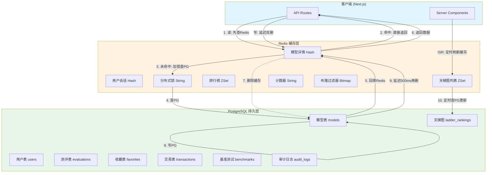
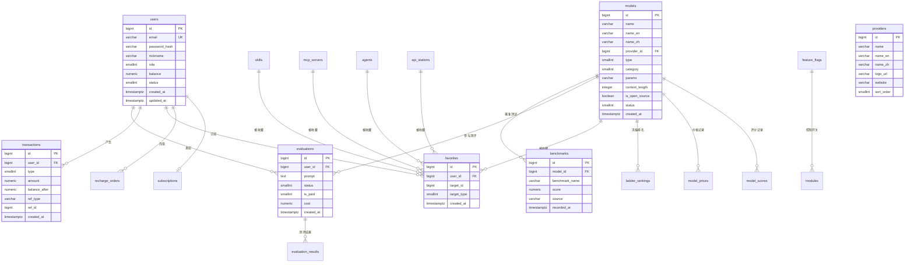
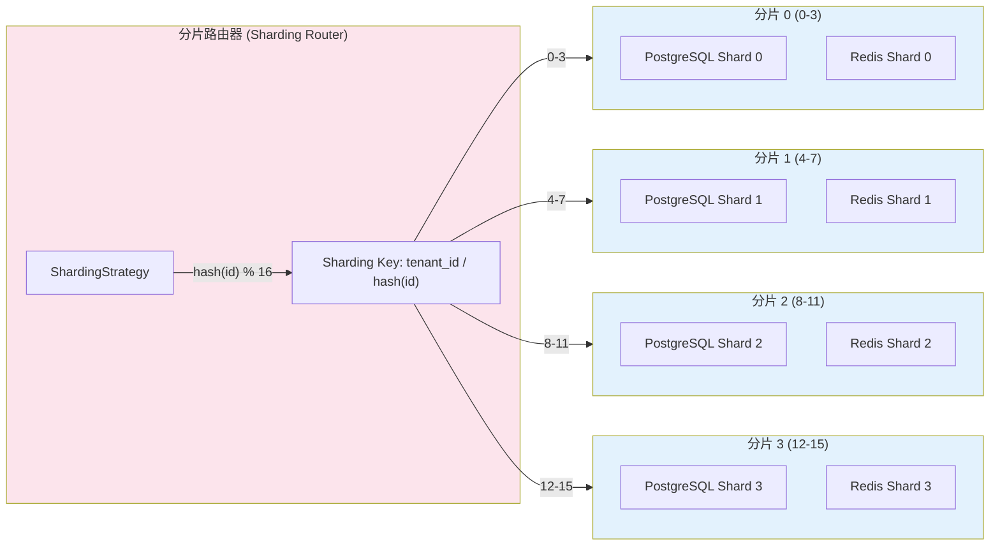

# Aidean AI模型天梯图平台 — 数据库架构设计文档

> 版本：v1.0 | 日期：2026-04-07 | 设计者：数据库架构师

---

## 一、系统概述

### 1.1 业务定位
Aidean 是一个AI模型评测与对比平台，核心功能包括：
- **天梯图榜单**：大模型性能/性价比/开源/手机端 4类榜单
- **模型详情**：参数信息、基准测试、测评示例
- **测评功能**：免费看历史测评，付费自定义提示词实时对比
- **收藏夹系统**：Skill/MCP/Agent/API站/模型 5类收藏
- **用户系统**：注册/登录、余额充值、消费记录
- **扩展天梯图**：Skills/MCP/Agent/API站 4类天梯图

### 1.2 技术栈
| 组件 | 技术 | 版本 |
|------|------|------|
| 数据库 | PostgreSQL | 16.x |
| 缓存 | Redis | 7.x |
| ORM | Prisma | 5.x |
| 部署 | Docker Compose | 2.x |
| 后端 | Next.js 14 App Router | 14.x |

---

## 二、架构分层

### 2.1 数据流图（PG ↔ Redis 交互）



### 2.2 ER图（核心实体关系）



### 2.3 分片路由图（未来扩展预留）



---

## 三、数据库表设计总览

### 3.1 核心业务表（MVP阶段）

| 序号 | 表名 | 中文名 | 用途 | 预估数据量 |
|------|------|--------|------|-----------|
| 1 | `users` | 用户表 | 用户注册/登录/余额 | 10万 |
| 2 | `providers` | 模型商表 | OpenAI/Anthropic等厂商信息 | 50 |
| 3 | `models` | 模型表 | 大模型基本信息 | 1000 |
| 4 | `model_prices` | 模型价格表 | 各平台价格记录 | 5000 |
| 5 | `model_scores` | 模型评分表 | 四维评分记录 | 10000 |
| 6 | `benchmarks` | 基准测试表 | 各基准测试得分 | 50000 |
| 7 | `ladder_rankings` | 天梯排名表 | 榜单排名数据 | 5000 |
| 8 | `ladder_configs` | 天梯配置表 | 权重/算法配置 | 10 |

### 3.2 用户功能表

| 序号 | 表名 | 中文名 | 用途 | 预估数据量 |
|------|------|--------|------|-----------|
| 9 | `evaluations` | 测评任务表 | 用户测评任务 | 10万 |
| 10 | `evaluation_results` | 测评结果表 | 测评详细结果 | 50万 |
| 11 | `evaluation_models` | 测评模型关联表 | 测评-模型多对多 | 30万 |
| 12 | `favorites` | 收藏表 | 用户收藏 | 50万 |
| 13 | `transactions` | 交易记录表 | 余额变动 | 100万 |
| 14 | `recharge_orders` | 充值订单表 | 充值订单 | 20万 |
| 15 | `subscriptions` | 订阅表 | 会员订阅 | 5万 |

### 3.3 扩展天图表

| 序号 | 表名 | 中文名 | 用途 | 预估数据量 |
|------|------|--------|------|-----------|
| 16 | `skills` | Skill技能表 | Skill技能信息 | 5000 |
| 17 | `mcp_servers` | MCP服务器表 | MCP服务信息 | 2000 |
| 18 | `agents` | Agent智能体表 | Agent智能体信息 | 1000 |
| 19 | `api_stations` | API中转站表 | API中转站信息 | 200 |
| 20 | `api_station_models` | API站模型关联表 | 中转站-模型关联 | 2000 |

### 3.4 系统管理表

| 序号 | 表名 | 中文名 | 用途 | 预估数据量 |
|------|------|--------|------|-----------|
| 21 | `feature_flags` | 功能开关表 | 模块启用/禁用控制 | 20 |
| 22 | `scheduled_scripts` | 定时脚本表 | 数据采集脚本配置 | 20 |
| 23 | `script_executions` | 脚本执行记录表 | 脚本执行历史 | 10万 |
| 24 | `audit_logs` | 审计日志表 | 数据变更记录 | 500万 |
| 25 | `dict_items` | 字典表 | 枚举值字典 | 200 |
| 26 | `system_configs` | 系统配置表 | 全局配置参数 | 50 |
| 27 | `news` | 资讯表 | AI行业资讯 | 10万 |

---

## 四、Redis缓存映射

### 4.1 Key命名规范

```
格式：aidean:{模块}:{业务类型}:{标识}:{子标识}
示例：aidean:user:profile:{user_id}
      aidean:model:detail:{model_id}
      aidean:ladder:list:{ladder_type}:{page}
```

### 4.2 缓存映射表

| PG表 | Redis Key模式 | 数据类型 | TTL | 更新策略 |
|------|--------------|---------|-----|---------|
| users | `aidean:user:profile:{id}` | Hash | 30min | 写后删除 |
| users | `aidean:user:session:{token}` | Hash | 2h | 强一致 |
| models | `aidean:model:detail:{id}` | Hash | 1h | 写后删除 |
| models | `aidean:model:slug:{slug}` | String | 1h | 写后删除 |
| providers | `aidean:provider:list` | ZSet | 永久 | 同步删除 |
| ladder_rankings | `aidean:ladder:list:{type}:{page}` | ZSet | 5min | 定时刷新 |
| ladder_rankings | `aidean:ladder:top100:{type}` | ZSet | 1min | 定时刷新 |
| benchmarks | `aidean:benchmark:model:{model_id}` | Hash | 1h | 写后删除 |
| evaluations | `aidean:evaluation:history:{user_id}` | ZSet | 30min | 写后删除 |
| favorites | `aidean:favorite:list:{user_id}:{type}` | Set | 1h | 写后删除 |
| transactions | `aidean:transaction:count:{user_id}:{date}` | String | 30天 | 原子自增 |
| feature_flags | `aidean:feature:all` | Hash | 永久 | 同步更新 |
| dict_items | `aidean:dict:{category}` | Hash | 永久 | 同步更新 |

### 4.3 缓存防护策略

| 风险 | 防护方案 | 实现方式 |
|------|---------|---------|
| 缓存穿透 | 布隆过滤器 + 空值缓存 | Bloom Filter + TTL 5min |
| 缓存击穿 | 分布式锁 + 单线程回填 | SET NX EX 30s |
| 缓存雪崩 | 随机过期时间 | TTL + random(0, 300) |

---

## 五、分阶段实施计划

### 5.1 MVP阶段（核心表）
- 用户表、模型商表、模型表
- 基准测试表、天梯排名表
- 功能开关表、字典表
- 基础索引和约束

### 5.2 优化阶段（索引/分区）
- 全覆盖索引
- 审计日志触发器
- 时序表分区（按月）
- 缓存映射实现

### 5.3 扩展阶段（分库分表）
- 交易记录表分区
- 审计日志表分区
- 分片路由器实现
- 读写分离配置

---

## 六、风险评估与回滚方案

### 6.1 风险评估

| 风险项 | 影响 | 概率 | 缓解措施 |
|--------|------|------|---------|
| 数据迁移失败 | 高 | 低 | 双写验证 + 回滚脚本 |
| 索引过多影响写入 | 中 | 中 | 分批创建 + 监控写入延迟 |
| 缓存不一致 | 高 | 中 | 延迟双删 + 定期校验 |
| 分区表管理失败 | 中 | 低 | pg_partman自动管理 + 告警 |
| 连接数耗尽 | 高 | 低 | PgBouncer连接池 + 监控 |

### 6.2 回滚方案

```
1. 数据库回滚：
   - 保留迁移前快照
   - 执行反向迁移脚本
   - 验证数据完整性

2. 缓存回滚：
   - 清空Redis缓存
   - 重新从PG加载
   - 验证命中率恢复

3. 应用回滚：
   - 回滚Prisma Schema
   - 重新生成客户端
   - 重启服务
```

---

## 七、PostgreSQL关键参数

### 7.1 开发环境 (postgresql.conf)
```ini
shared_buffers = 256MB
effective_cache_size = 1GB
maintenance_work_mem = 64MB
work_mem = 4MB
max_connections = 200
log_min_duration_statement = 1000
log_line_prefix = '%t [%p]: [%l-1] user=%u,db=%d '
timezone = 'Asia/Shanghai'
```

### 7.2 生产环境 (postgresql.conf)
```ini
shared_buffers = 4GB
effective_cache_size = 12GB
maintenance_work_mem = 512MB
work_mem = 16MB
max_connections = 500
log_min_duration_statement = 500
wal_level = replica
max_wal_senders = 10
max_replication_slots = 10
hot_standby = on
timezone = 'Asia/Shanghai'
```

### 7.3 连接池配置 (PgBouncer)
```ini
[databases]
aidean = host=postgres port=5432 dbname=aidean

[pgbouncer]
pool_mode = transaction
max_client_conn = 1000
default_pool_size = 50
min_pool_size = 10
reserve_pool_size = 5
```

---

## 八、Redis关键参数

### 8.1 开发环境 (redis.dev.conf)
```ini
maxmemory 2gb
maxmemory-policy allkeys-lru
appendonly yes
appendfsync everysec
save 900 1
save 300 10
save 60 10000
timezone Asia/Shanghai
```

### 8.2 生产环境 (redis.prod.conf)
```ini
maxmemory 8gb
maxmemory-policy volatile-lru
appendonly yes
appendfsync everysec
save 900 1
save 300 10
save 60 10000
cluster-enabled yes
cluster-config-file nodes.conf
cluster-node-timeout 5000
timezone Asia/Shanghai
```
