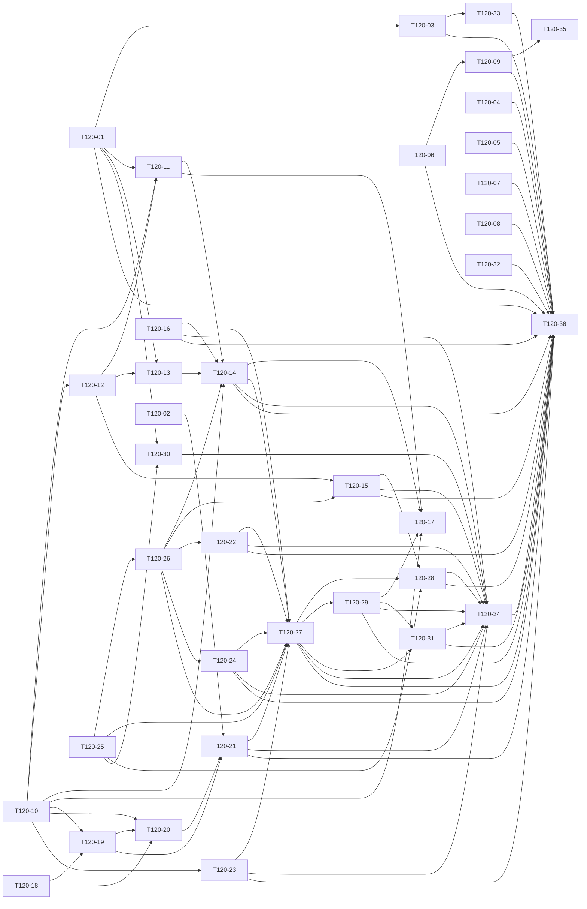

# 08 · 依赖 DAG

> 版本: v1.0 | 更新: 2026-10-23 | 变更: V0.12.0 规划首版（基线 main@3b9f88c）

## 一、拓扑分层（[Ha]=Hark，[外部]=外部助手）
```text
L1: T120-01[外部]  T120-02[外部]  T120-04[外部]  T120-05[外部]  T120-06[外部]  T120-07[外部]  T120-08[外部]  T120-10[Ha]  T120-16[外部]  T120-18[Ha]  T120-25[Ha]  T120-32[外部]
L2: T120-03[外部]  T120-09[外部]  T120-12[Ha]  T120-19[Ha]  T120-23[Ha]  T120-26[Ha]  T120-30[外部]
L3: T120-11[外部]  T120-13[Ha]  T120-15[外部]  T120-20[Ha]  T120-22[外部]  T120-24[外部]  T120-33[外部]  T120-35[外部]
L4: T120-14[外部]  T120-21[外部]
L5: T120-27[外部]
L6: T120-28[外部]  T120-29[外部]
L7: T120-17[外部]  T120-31[外部]
L8: T120-34[外部]
L9: T120-36[外部]
```

## 二、关键路径（按工时，41.0h）
```text
T120-10 → T120-12 → T120-11 → T120-14 → T120-27 → T120-29 → T120-31 → T120-34 → T120-36
```
此为不计人力约束的纯依赖关键路径；计入「一人一车道」后的实际工期见 §四 排程模拟。

## 三、环检测
`graphlib.TopologicalSorter` 静态排序成功，36 节点无环（生成器：`_generator/gen.py`）。

## 四、并行判定（机械规则）
可并行 ⟺ ①无共享可变状态 ∧ ②依赖契约已冻结（T120-10 合并后） ∧ ③文件所有权不相交 ∧ ④不共用迁移版本号。
生成器对全部 630 对卡做路径前缀相交检测，排除「有传递依赖」与「对方禁止清单显式排除」两类后，**剩余重叠 = 0**。
同时 2 个写入方（Hark + 1 名外部助手，不同电脑），满足 ≤3；所有权两两不相交（上式对全部卡对成立）。

### 双车道排程模拟（Hark × 1 + 外部助手 × 1，不同电脑）
两条队列各自按序执行；生成器逐卡模拟开始/结束时刻，检验是否出现「等对方」。
跨方依赖只剩 Hark 先做、助手后用的方向（契约、令牌、五态外壳、认证与监控后端），Hark 的这些卡排在队首，助手需要它们时已在 main 上。

| 车道 | 卡 | 开始(h) | 结束(h) |
|---|---|---|---|
| Hark | T120-10 | 0 | 4 |
| 外部助手 | T120-01 | 0 | 1.5 |
| Hark | T120-25 | 4 | 10 |
| 外部助手 | T120-03 | 1.5 | 5.5 |
| Hark | T120-26 | 10 | 13 |
| 外部助手 | T120-05 | 5.5 | 7.5 |
| Hark | T120-18 | 13 | 16 |
| 外部助手 | T120-04 | 7.5 | 9.5 |
| Hark | T120-19 | 16 | 19 |
| 外部助手 | T120-06 | 9.5 | 12.5 |
| Hark | T120-20 | 19 | 23 |
| 外部助手 | T120-09 | 12.5 | 14 |
| Hark | T120-12 | 23 | 28 |
| 外部助手 | T120-07 | 14 | 15.5 |
| Hark | T120-13 | 28 | 32 |
| 外部助手 | T120-08 | 15.5 | 18.5 |
| Hark | T120-23 | 32 | 36 |
| 外部助手 | T120-16 | 18.5 | 20.5 |
| 外部助手 | T120-32 | 20.5 | 24.5 |
| 外部助手 | T120-30 | 24.5 | 27.5 |
| 外部助手 | T120-02 | 27.5 | 30.5 |
| 外部助手 | T120-11 | 30.5 | 35.5 |
| 外部助手 | T120-33 | 35.5 | 39.5 |
| 外部助手 | T120-22 | 39.5 | 45.5 |
| 外部助手 | T120-15 | 45.5 | 49.5 |
| 外部助手 | T120-21 | 49.5 | 53.5 |
| 外部助手 | T120-14 | 53.5 | 57.5 |
| 外部助手 | T120-24 | 57.5 | 59.5 |
| 外部助手 | T120-27 | 59.5 | 66.5 |
| 外部助手 | T120-28 | 66.5 | 72.5 |
| 外部助手 | T120-29 | 72.5 | 76.5 |
| 外部助手 | T120-31 | 76.5 | 82.5 |
| 外部助手 | T120-34 | 82.5 | 85.5 |
| 外部助手 | T120-36 | 85.5 | 88.5 |

**模拟结论：Hark 等待 0h，外部助手等待 0h**；Hark 收工于 36h，外部助手收工于 88.5h。
**兜底规则**（实际工时超出估算时）：到某卡时前置未上 main → 先做队列里下一张不受阻的卡；若整队都受阻，按 `contracts/` 冻结的 schema 写 mock 先开发，前置合并后在同卡内替换为真实接口，并在 T120-36 统一核对无残留 mock。

### 必须串行的链
- 迁移：`20261024000000`(T120-12，Hark) → `20261024010000`(T120-11，助手) → `20261024020000`(T120-13)
- 认证：T120-18 → T120-19 → T120-20（Hark 一人串行）→ T120-21（助手，排在队列后段）
- 设计系统：T120-25 → T120-26（Hark 第 1 天）→ T120-27 → T120-28 / T120-29 → T120-31

## 五、边（Mermaid 源）

