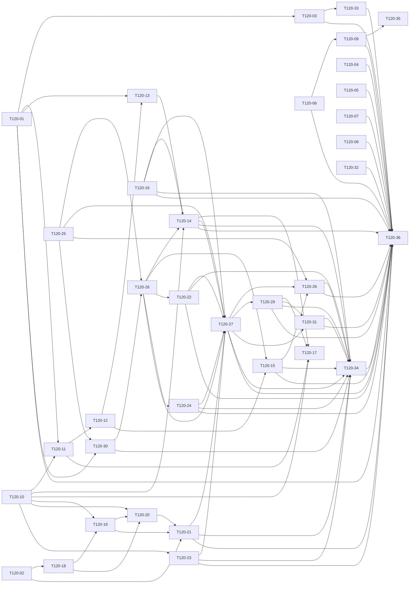

# 08 · 依赖 DAG

> 版本: v1.0 | 更新: 2026-10-23 | 变更: V0.12.0 规划首版（基线 main@3b9f88c）

## 一、拓扑分层（[Ha]=Hark，[外部]=外部助手 A/B，见 07_ 执行方）
```text
L1: T120-01[外部]  T120-02[外部]  T120-04[外部]  T120-05[外部]  T120-06[外部]  T120-07[外部]  T120-08[外部]  T120-10[Ha]  T120-16[外部]  T120-25[Ha]  T120-32[外部]
L2: T120-03[外部]  T120-09[外部]  T120-11[外部]  T120-18[Ha]  T120-23[Ha]  T120-30[外部]
L3: T120-12[Ha]  T120-19[外部]  T120-26[Ha]  T120-33[外部]  T120-35[外部]
L4: T120-13[Ha]  T120-15[外部]  T120-20[Ha]  T120-22[外部]  T120-24[外部]
L5: T120-14[外部]  T120-21[外部]
L6: T120-27[外部]
L7: T120-28[外部]  T120-29[外部]
L8: T120-17[外部]  T120-31[外部]
L9: T120-34[外部]
L10: T120-36[外部]
```

## 二、关键路径（按工时，45.0h）
```text
T120-10 → T120-11 → T120-12 → T120-13 → T120-14 → T120-27 → T120-29 → T120-31 → T120-34 → T120-36
```
关键路径由 Hark 的契约与机制卡（T120-10、12、13、25、26）开路，外部助手 B 接实现；因此 Hark 第一天先开 T120-10 与 T120-25，外部助手 A 先开 S12-0/S12-1，外部助手 B 先开 T120-02。

## 三、环检测
`graphlib.TopologicalSorter` 静态排序成功，36 节点无环（生成器：`_generator/gen.py`）。

## 四、并行判定（机械规则）
可并行 ⟺ ①无共享可变状态 ∧ ②依赖契约已冻结（T120-10 合并后） ∧ ③文件所有权不相交 ∧ ④不共用迁移版本号。
生成器对全部 630 对卡做路径前缀相交检测，排除「有传递依赖」与「对方禁止清单显式排除」两类后，**剩余重叠 = 0**。
同时最多 3 个写入方（Hark + 外部助手 A + 外部助手 B），满足 ≤3；三方所有权两两不相交（上式对全部卡对成立，不区分执行方）。

### 可并行组（首批可同时下发）
- **组 P1（第 1 天）**：Hark：T120-10、T120-25 | A：T120-01 → T120-03、T120-05、T120-04、T120-06 → T120-09、T120-07、T120-08 | B：T120-02（依据：四条全满足；T120-10 只写 packages/shared 与 docs/ADR）
- **组 P2**：Hark：T120-18、T120-12、T120-13、T120-26 | A：T120-30、T120-16、T120-32 | B：T120-11、T120-19（依据：B 的调度注册与改密 API 按 DAG 先于/后于 Hark 的机制卡，路径不相交）
- **组 P3**：Hark：T120-20、T120-23 | A：T120-24、T120-33 | B：T120-14、T120-15、T120-21、T120-22
- **组 P4**：Hark：设计验收与代码审查（不写入） | A：T120-31、T120-34 → T120-36 | B：T120-27 → T120-28 / T120-29

### 必须串行的链
- 迁移：`20261024000000`(T120-11) → `20261024010000`(T120-12) → `20261024020000`(T120-13)
- 认证：T120-02(B) → T120-18(Hark) → T120-19(B) → T120-20(Hark) → T120-21(B)
- 设计系统：T120-25 → T120-30 → T120-26 → T120-27 → T120-28 / T120-29 → T120-31

## 五、边（Mermaid 源）

